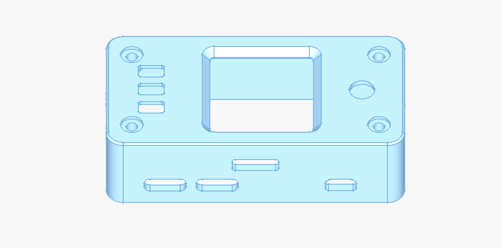
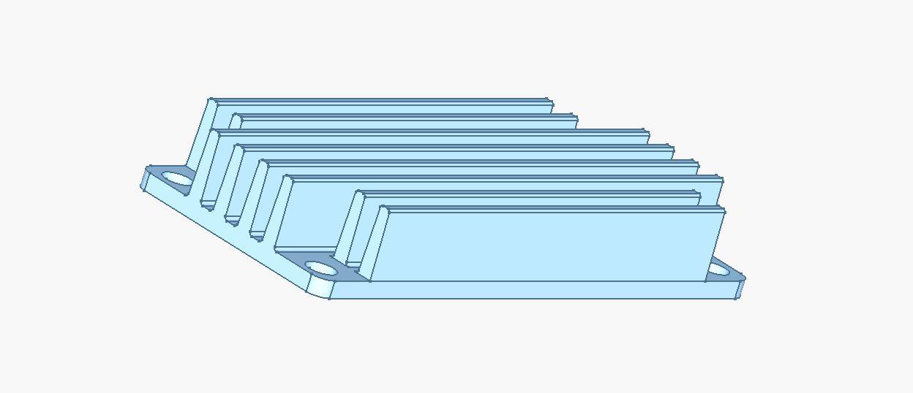
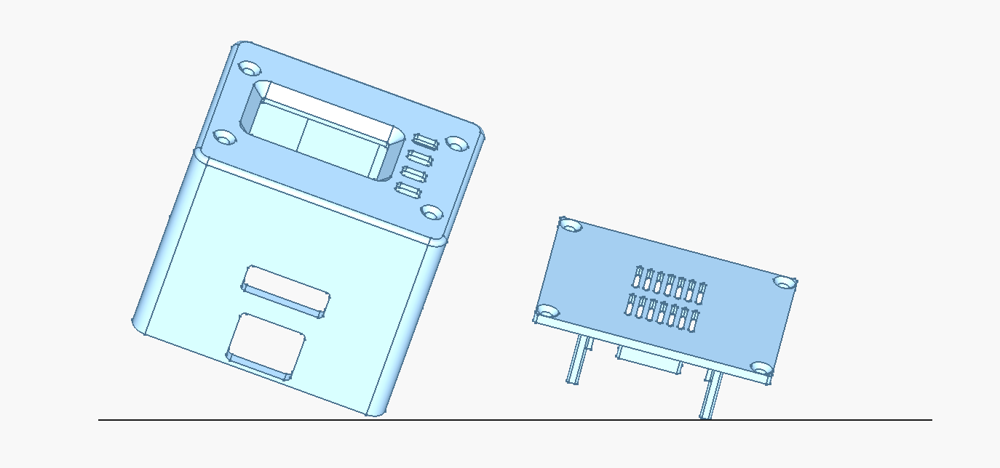

# USBridge 3D Models & Enclosures

This directory contains production STEP CAD files for 3D printing and CNC milling the custom enclosures, buttons, and aluminum cooling heatsinks for **USBridge KVM 2.0** and **USBridge Nano**.

---

## 1. USBridge KVM 2.0 Enclosure (Standard & Full)

Designed specifically for the **Radxa Zero 3W** with the **1.3" IPS LCD Flip-HAT status screen** and front-panel controls. The enclosure keeps the SBC processor accessible on the rear side for direct heatsink thermal transfer.

### Component CAD Files:
| File | Description | Purpose |
| :--- | :--- | :--- |
| [**USBridge_KVM_2.0_Case_V6.step**](./USBridge-KVM-2.0/USBridge_KVM_2.0_Case_V6.step) | Main body enclosure | Fits Radxa Zero 3W + Flip-HAT + connectors |
| [**Key_Single.step**](./USBridge-KVM-2.0/Key_Single.step) | Single push-button cap | Print 3 pcs for screen menu buttons (KEY1, KEY2, KEY3) |
| [**Joystick_Cap.step**](./USBridge-KVM-2.0/Joystick_Cap.step) | 5-way joystick knob | Press-fit knob for 5-position navigation switch |

### Recommended 3D Printing Settings:
* **Manufacturing Technology**: **SLS Nylon PA12** (identical to factory retail kits) or **FDM / SLA**.
* **FDM Materials**: PETG or ABS/ASA (PLA is not recommended due to continuous heat dissipation from the SBC).
* **Layer Height**: 0.16 mm – 0.20 mm.
* **Infill**: 30% – 50% (Gyroid or Grid).
* **Walls / Perimeters**: 3–4 outlines for durable thread mounting.

---

## 2. USBridge KVM 2.0 Aluminum Heatsinks (CNC / Milling)

Precision cooling blocks designed for CNC aluminum machining to keep the Rockchip RK3566 SoC thermally stable under heavy 1080p 60 FPS video capture and hardware encoding loads.

### Radiator CAD Files:
| File | Profile | Description |
| :--- | :--- | :--- |
| [**Radiator_V5.step**](./USBridge-KVM-2.0/Radiator_V5.step) | Longitudinal Ribs | Classic fin profile for natural air convection |
| [**Radiator_V6_Transverse_Ribs.step**](./USBridge-KVM-2.0/Radiator_V6_Transverse_Ribs.step) | Transverse Ribs | Enhanced surface area with cross-cut fins for maximum passive heat dissipation |

* **Material**: Aluminum Alloy (6061-T6 or 6063).
* **Thermal Interface**: 0.5 mm – 1.0 mm thermal silicone pad (12+ W/mK) directly between the SoC and the flat radiator contact pad.

---

## 3. USBridge Nano Enclosure

Ultra-compact protective housing custom-engineered for the **Sipeed NanoKVM** (SOPHGO SG2002 RISC-V board). Provides precision cutouts for the integrated HDMI capture port, 100 Mbit RJ45 Ethernet, and USB-C gadget interface.

### Component CAD Files:
| File | Description | Compatibility |
| :--- | :--- | :--- |
| [**USBridge_Nano_Case.step**](./USBridge-Nano/USBridge_Nano_Case.step) | Complete NanoKVM case | Sipeed NanoKVM (SG2002) |

### Recommended 3D Printing Settings:
* **Technology**: SLS (PA12 / MJF) or SLA / Resin for fine detail around tight port openings.
* **FDM Alternative**: PETG with 0.12 mm – 0.16 mm layer height.
* **Infill**: 40% – 100%.

---

## Assembly Reference

For wiring, PCB schematics, and overall mechanical overview, refer to:
* [Hardware Root Directory](../README.md)
* [Display & ATX PCB Gerber Files](../PCBs/)
* [USBridge Flip-HAT 1.3" LCD Module](../../USBridge-Flip-HAT-1.3-LCD/)
