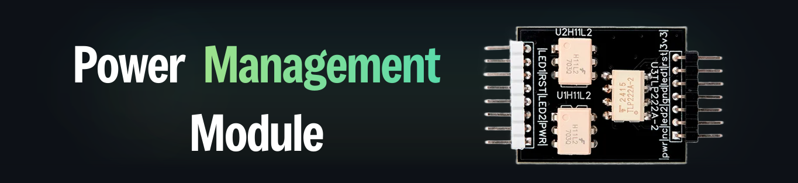

# ATX Power Control Board

The **USBridge ATX Power Control Board** is an adapter module providing hardware-level power management (power on, graceful shutdown, forced reboot) and real-time status telemetry (Power LED and HDD activity LED) for target servers and desktop PCs.

* 👉 [Buy ATX Power Board on usbridge.io ($18)](https://www.usbridge.io/hardware-agent/#buy-power-board)

---

## Technical Specifications & Features

| Feature | Details |
| :--- | :--- |
| **Input Interface** | 8-pin GPIO ribbon cable connecting directly to the USBridge KVM chassis |
| **Output Interface** | Standard 2.54 mm pin header for DuPont jumper wires to motherboard Front Panel |
| **Galvanic Isolation** | **Up to 3.75 kV isolation** via onboard optocouplers (shielding KVM from motherboard ground loops and electrical spikes) |
| **Control Functions** | Remote Power Button (`PWR_SW`), Hardware Reset Button (`RESET`) |
| **Telemetry Sensing** | Power State LED (`P_LED`), Storage Drive Activity LED (`H_LED`) |
| **Compatibility** | Standard ATX, Micro-ATX, and Mini-ITX motherboards |
| **UI Safety Lock** | Hold-to-confirm protection in the client app to prevent accidental server shutdowns |

---

## Motherboard Front Panel Wiring Reference

Connect the 8-pin ribbon cable to the KVM chassis, then connect the DuPont jumper wires according to the white silk-screen labels on the PCB:

| ATX Board Pin | Motherboard Front Panel Header | Description |
| :--- | :--- | :--- |
| **`|PWR|`** | **Power Switch** (`PWR_SW` / `PW_SW`) | Remotely turns the server on or off |
| **`|RST|`** | **Reset Switch** (`RESET` / `RST`) | Triggers an immediate hardware reboot |
| **`|LED1|`** | **Power LED** (`P_LED`) | Reports live power state to client app, even if there is no video signal |
| **`|LED2|`** | **HDD LED** (`H_LED`) | Displays storage drive read/write activity inside the client UI |

---

## Manufacturing Gerber Files

* 📦 **Gerber Archive**: [**ATX_gerber.zip**](./Gerber/ATX_gerber.zip)
* **Fabrication Specs**: Standard 2-layer PCB, 1.6 mm thickness, 1 oz copper.
