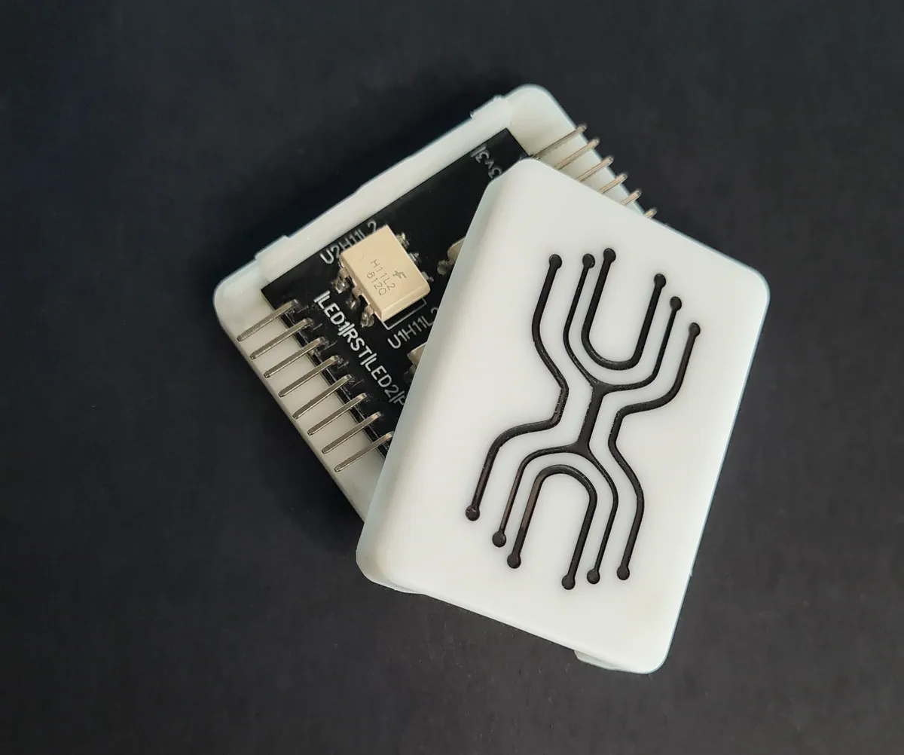
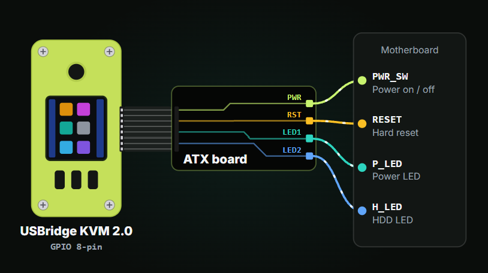

# USBridge ATX Power Control Board

The **USBridge ATX Power Control Board** provides hardware-level server power management (power on, graceful ACPI shutdown, forced reboot) and real-time status telemetry (Power LED and HDD activity LED) for target motherboards.

Now shipping in a **custom protective snap-fit enclosure**, the board connects between the KVM and the target motherboard front-panel headers with up to **3.75 kV galvanic isolation** via onboard optocouplers, shielding your KVM and network infrastructure from motherboard ground loops and electrical transients.

* 👉 **[Buy ATX Power Board on usbridge.io ($14.50)](https://www.usbridge.io/hardware-agent/#buy-power-board)**

**Quick Jump:** [Specifications & Features](#technical-specifications--features) • [Screen Module Prerequisite](#prerequisite-requires-usbridge-screen-module) • [Wiring Reference](#motherboard-front-panel-wiring-reference) • [Manufacturing Files](#manufacturing-gerber-files) • [Related Products](#explore-the-usbridge-ecosystem)

---

## Technical Specifications & Features

| Feature | Details |
| :--- | :--- |
| **Enclosure** | Custom protective snap-fit case included |
| **Input Interface** | 8-pin GPIO ribbon cable connecting directly to the [USBridge Screen Module](../Screen-Module/) |
| **Output Interface** | Standard 2.54 mm pin header for DuPont jumper wires to motherboard Front Panel |
| **Galvanic Isolation** | **Up to 3.75 kV isolation** via onboard optocouplers (shielding KVM from motherboard ground loops and electrical spikes) |
| **Control Functions** | Remote Power Button (`PWR_SW`), Hardware Reset Button (`RESET`) |
| **Telemetry Sensing** | Power State LED (`P_LED`), Storage Drive Activity LED (`H_LED`) |
| **Motherboard Compatibility** | Standard ATX, Micro-ATX, Mini-ITX, and SSI EEB motherboards |
| **UI Safety Lock** | Hold-to-confirm protection in the client app to prevent accidental server shutdowns |

---

## Prerequisite: Requires USBridge Screen Module

The ATX Power Control Board interfaces with the KVM through a dedicated 8-pin ribbon cable that connects directly to the **[USBridge Screen Module](../Screen-Module/)**:

* **Pre-integrated in Standard & Full**: The **[USBridge KVM 2.0 Full](../../Kits/USBridge-KVM-2.0-Full/)** includes both the Screen Module and the ATX board in the box. The **[USBridge KVM 2.0 Standard](../../Kits/USBridge-KVM-2.0-Standard/)** already has the Screen Module pre-installed, so you can connect this ATX board directly.
* **Upgrading KVM 2.0 Low**: If you own the headless **[USBridge KVM 2.0 Low](../../Kits/USBridge-KVM-2.0-Low/)**, you must add the **[USBridge Screen Module ($11.99)](../Screen-Module/)** to provide the required 8-pin ATX expansion header.

---

## Motherboard Front Panel Wiring Reference

Connect the 8-pin ribbon cable from the ATX board to the 8-pin port on your KVM's Screen Module, then connect the DuPont jumper wires to your motherboard's Front Panel header pins:

### Front Panel Pinout & Signal Mapping

| ATX Board Label | Motherboard Header | Wire Type | Signal Function | Behavior & Description |
| :--- | :--- | :--- | :--- | :--- |
| **`PWR`** | **`PWR_SW`** | 2-pin DuPont | Power Switch | Short pulse triggers graceful ACPI power on / shutdown; 5s hold triggers hard power cutoff |
| **`RST`** | **`RESET`** | 2-pin DuPont | Reset Switch | Triggers an immediate hardware reboot for kernel panics and unrecoverable OS lockups |
| **`LED1`** | **`P_LED`** | 2-pin DuPont (`+` / `-`) | Power Status | Real-time telemetry in client UI showing whether the host motherboard is powered |
| **`LED2`** | **`H_LED`** | 2-pin DuPont (`+` / `-`) | Storage Activity | Displays real-time SATA/NVMe storage drive read/write activity inside the USBridge client UI |

> [!TIP]
> **Polarity Guidance:**  
> * **`PWR`** and **`RST`** are momentary switch contacts (polarity independent).  
> * **`LED1`** and **`LED2`** are optocoupler sensing circuits: connect the positive (`+`) and negative (`-`) DuPont pins to the corresponding pins on your motherboard's Front Panel header as marked in your motherboard manual.

---

## Manufacturing Gerber Files

The hardware design is open for fabrication and customization:

* 📦 **Gerber Archive**: [**ATX_gerber.zip**](./Gerber/ATX_gerber.zip)
* **Fabrication Specs**: Standard 2-layer PCB, 1.6 mm thickness, 1 oz copper.

---

## Explore the USBridge Ecosystem

### Ready-to-Use Appliances & Add-Ons

| Product | Form Factor | Key Highlights | Price | Guide |
| :--- | :--- | :--- | :--- | :--- |
| **USBridge Nano** | Ultra-compact | Integrated capture, OLED screen, metal body | **$45** | [View Guide ➔](../../Kits/USBridge-Nano/) |
| **USBridge KVM 2.0 Low** | SBC-based | Budget-friendly, headless 1080p @ 60 FPS | **$79** | [View Guide ➔](../../Kits/USBridge-KVM-2.0-Low/) |
| **USBridge KVM 2.0 Standard** | Desktop Unit | 1.3" IPS screen, joystick, 3 buttons, case | **$109** | [View Guide ➔](../../Kits/USBridge-KVM-2.0-Standard/) |
| **USBridge KVM 2.0 Full** | Flagship Unit | Standard Kit + included ATX Power Control | **$139** | [View Guide ➔](../../Kits/USBridge-KVM-2.0-Full/) |
| **USBridge Screen Module** | Add-on HAT | 1.3" IPS LCD, joystick, 3 buttons, ATX port | **$11.99** | [View Guide ➔](../Screen-Module/) |
| **USB 3.0 Capture Dongle** | Add-on Dongle | 1080p @ 60 FPS, SuperSpeed `[5G]` mode | **$9** | [View Guide ➔](../Capture-Dongle/) |

 

👉 **[Order the ATX Power Board on usbridge.io ($14.50) ➔](https://www.usbridge.io/hardware-agent/#buy-power-board)**

