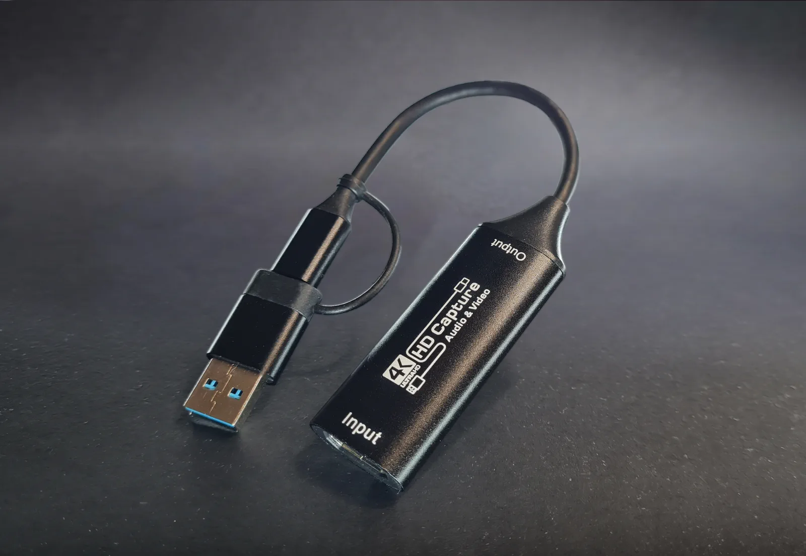

# USBridge USB 3.0 HDMI Capture Dongle

The **USBridge USB 3.0 HDMI Capture Dongle** is a high-throughput, low-latency UVC video capture adapter included with the **USBridge KVM 2.0 Standard** and **Full** kits, and available as a standalone accessory for custom SBC builds and DIY IP-KVM setups.

Featuring hardware-level UVC capture, a SuperSpeed USB 3.0 bus, and a tethered dual-plug USB-A / USB-C connector, it delivers smooth 1080p @ 60 FPS video streaming with uncompressed color fidelity and ultra-low latency (~45 ms).

* 👉 **[Buy HDMI Capture Dongle on usbridge.io ($9)](https://www.usbridge.io/hardware-agent/#buy-capture-card)**

**Quick Jump:** [Specifications](#technical-specifications) • [4K Input & 1080p Streaming](#4k-input-capability--1080p-kvm-streaming) • [SuperSpeed 5G vs 480M Mode](#critical-usb-30-5g-vs-480m-operation-modes) • [Related Products](#explore-the-usbridge-ecosystem)

---

## Technical Specifications

| Feature | Details |
| :--- | :--- |
| **Bus Interface** | **SuperSpeed USB 3.0 (5 Gbps)** via USB Type-A with tethered USB Type-C adapter |
| **Video Input Interface** | Standard HDMI 1.4+ (connecting to host GPU or server motherboard) |
| **Hardware Input Resolution** | **Up to 4K Ultra HD (3840 × 2160 @ 30 FPS)** *(see note below)* |
| **KVM Stream Output** | **1080p @ 60 FPS**, 1080p @ 30 FPS, 720p @ 60 FPS |
| **Stream Latency** | ~45 ms (Moonlight sub-frame streaming pipeline) |
| **Color Capture Formats** | YUY2, NV12 (uncompressed raw frames), MJPEG (compatibility fallback) |
| **Audio Capture** | HDMI digital stereo audio pass-through |
| **Driver Architecture** | Driverless UVC (USB Video Class) compliance across Linux, Windows, macOS |

---

## 4K Input Capability & 1080p KVM Streaming

> [!NOTE]
> **4K Input vs. 1080p @ 60 FPS Streaming:**  
> The internal hardware chip of the capture dongle accepts input resolutions up to **4K Ultra HD (3840 × 2160 @ 30 FPS)**. Within USBridge KVM, video capture and network transmission are deliberately locked to **1080p @ 60 FPS**.  
>  
> This ensures:
> * **Ultra-Low Latency (~45 ms)**: Processing at 1080p avoids massive frame buffer overhead, delivering crisp interactive performance for BIOS configuration and desktop management.
> * **Bandwidth Efficiency**: Uncompressed YUY2/NV12 frames fit cleanly within local network constraints without requiring lossy compression.
> * **Broad Display Compatibility**: Any 4K host output is cleanly scaled without handshake errors.

---

## Critical: USB 3.0 `[5G]` vs `[480M]` Operation Modes

The capture dongle negotiates in either of two hardware modes depending on port capability and cable plug orientation:

* **`[5G]` Mode (USB 3.0 SuperSpeed — 5 Gbps)**: **Target High-Performance Mode**. Delivers uncompressed raw YUY2/NV12 pixel data, razor-sharp text readability, and minimum input latency (~45 ms).
* **`[480M]` Mode (USB 2.0 High-Speed — 480 Mbps)**: Compatibility fallback mode. The stream falls back to lossy MJPEG compression, resulting in color compression artifacts and higher latency.

> [!IMPORTANT]
> **How to ensure `[5G]` Mode:**  
> Check the connection badge in the USBridge client interface or on-device screen:
> * If you see **`[480M]`**, simply **unplug the USB-C connector from the KVM Host port, rotate the plug 180°, and plug it back in**.
> * The dongle will immediately renegotiate into full-speed **`[5G]`** mode.

---

## Explore the USBridge Ecosystem

### Ready-to-Use Appliances & Add-Ons

| Product | Form Factor | Key Highlights | Price | Guide |
| :--- | :--- | :--- | :--- | :--- |
| **USBridge Nano** | Ultra-compact | Integrated capture, OLED screen, metal body | **$45** | [View Guide ➔](../../Kits/USBridge-Nano/) |
| **USBridge KVM 2.0 Low** | SBC-based | Budget-friendly, headless 1080p @ 60 FPS | **$79** | [View Guide ➔](../../Kits/USBridge-KVM-2.0-Low/) |
| **USBridge KVM 2.0 Standard** | Desktop Unit | 1.3" IPS screen, joystick, 3 buttons, case | **$109** | [View Guide ➔](../../Kits/USBridge-KVM-2.0-Standard/) |
| **USBridge KVM 2.0 Full** | Flagship Unit | Standard Kit + included ATX Power Control | **$139** | [View Guide ➔](../../Kits/USBridge-KVM-2.0-Full/) |
| **USBridge Screen Module** | Add-on HAT | 1.3" IPS LCD, joystick, 3 buttons, ATX port | **$11.99** | [View Guide ➔](../Screen-Module/) |
| **ATX Power Control Board** | Add-on Module | 3.75 kV isolation, Power/Reset & telemetry | **$14.50** | [View Guide ➔](../ATX-Board/) |

 

👉 **[Order the HDMI Capture Dongle on usbridge.io ($9) ➔](https://www.usbridge.io/hardware-agent/#buy-capture-card)**

