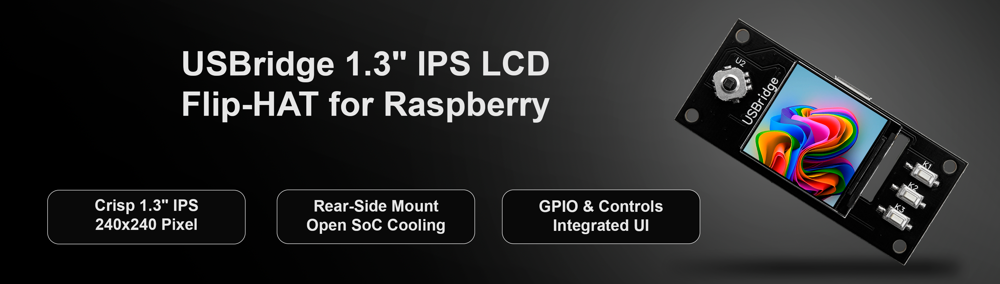

# Screen Module: USBridge Flip-HAT 1.3" IPS LCD

The **USBridge Flip-HAT** is a specialized rear-mounting display and navigation interface designed for Zero-factor boards (**Radxa Zero 3W** and **Radxa Cubie A7Z**). 

Unlike standard top-mounting LCD HATs that sit directly on top of the SoC and block cooling, the Flip-HAT mounts on the reverse side of the board through a mirrored 40-pin header. This leaves the processor completely open and unobstructed for direct contact with large aluminum cooling heatsinks.

* 👉 [Buy Screen Module on usbridge.io ($25)](https://www.usbridge.io/hardware-agent/#buy-screen-module)

---

## Technical Specifications

| Specification | Details |
| :--- | :--- |
| **Display Panel** | 1.3-inch HD IPS LCD |
| **Resolution** | 240 × 240 pixels (RGB, 65K colors) |
| **Interface** | 4-wire SPI (Driver IC: ST7789) |
| **Onboard Controls** | 5-way navigation directional joystick (Up, Down, Left, Right, Center Click) + 3 tactile user buttons (KEY1, KEY2, KEY3) |
| **Mounting Orientation** | Rear-mount (leaves SoC open for passive/active cooling heatsinks) |
| **Connector** | 40-pin female GPIO header |
| **Supported Boards** | Radxa Zero 3W, Radxa Cubie A7Z |

---

## Pinout Mapping

| Component | Function | BCM Pin / Connection |
| :--- | :--- | :--- |
| **LCD** | SPI Interface | Standard SPI (MOSI, SCLK, CS, DC, RST, BL) |
| **Joystick** | 5-Way Switch | Up, Down, Left, Right, Center Press |
| **Buttons** | User Input | KEY1, KEY2, KEY3 |
| **Header** | 40-Pin GPIO | Female pass-through header |

---

## Production Manufacturing Files

The hardware design is open for fabrication and customization:
* 📦 **Gerber Archive**: [**display_plus_gerber.zip**](./Gerber/display_plus_gerber.zip)
* **Fabrication Specs**: Standard 2-layer PCB, 1.6 mm thickness, 1 oz copper, ENIG or HASL surface finish.
