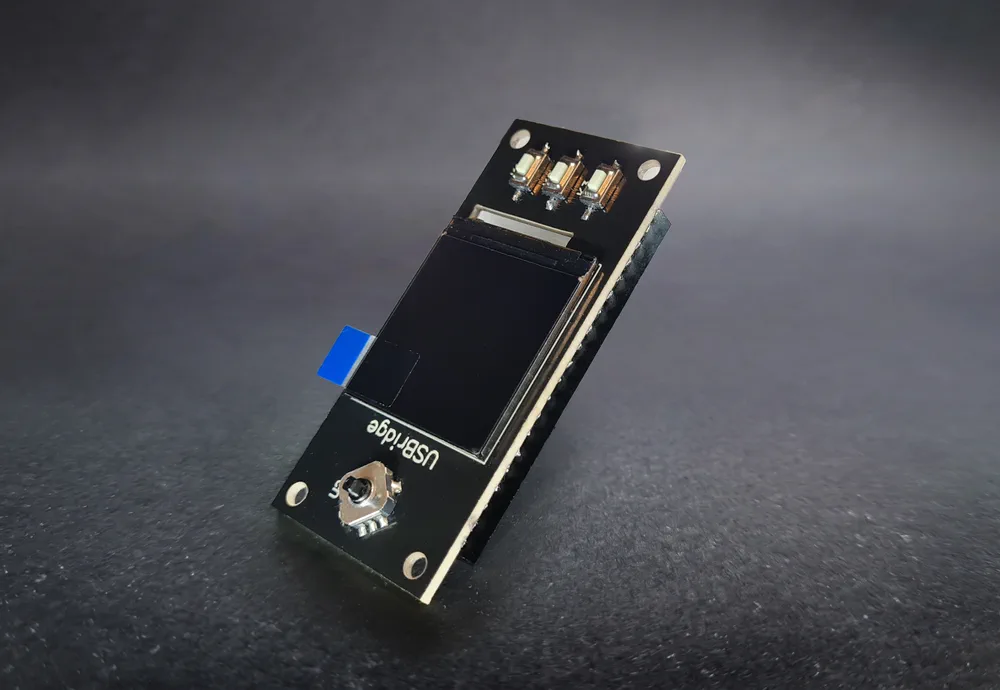
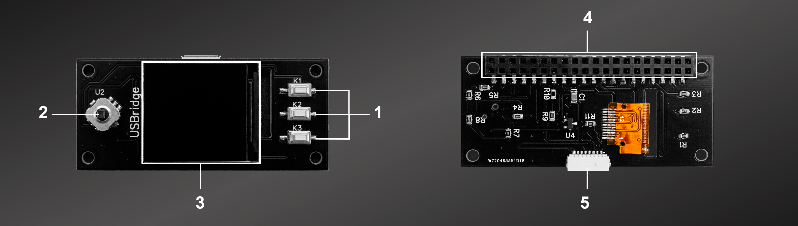
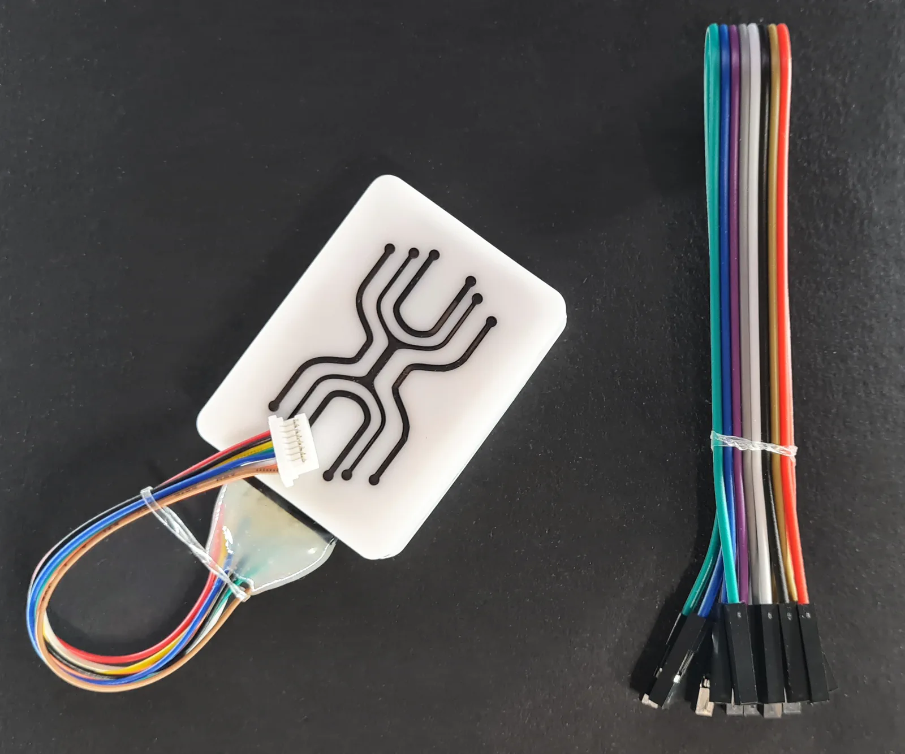

# USBridge Screen Module

The **USBridge Screen Module** is an interactive display, joystick navigation, and ATX control interface engineered specifically for Zero-factor single-board computers (**Radxa Zero 3W / 3E** and **Radxa Cubie A7Z**).

Featuring an innovative inverted rear-mounting design through a mirrored 40-pin GPIO header, the module attaches to the reverse side of the board. Unlike conventional top-mounting LCD HATs that sit directly over the SoC and trap heat, the USBridge Screen Module leaves the processor and memory completely unobstructed for direct thermal contact with large aluminum cooling heatsinks and active fans.

* 👉 **[Buy USBridge Screen Module on usbridge.io ($11.99)](https://www.usbridge.io/hardware-agent/#buy-screen-module)**

**Quick Jump:** [Specifications & Layout](#technical-specifications--hardware-layout) • [Key Capabilities](#key-capabilities--features) • [DIY KVM & Low Upgrade](#diy-ip-kvm--upgrade-your-kvm-20-low) • [ATX Power Integration](#direct-atx-power-control-integration) • [Pinout Mapping](#pinout-mapping) • [Fabrication Files](#production-manufacturing-files) • [Related Products](#explore-the-usbridge-ecosystem)

---

## Technical Specifications & Hardware Layout

### Onboard Hardware Callouts

| # | Component | Description & Function |
| :---: | :--- | :--- |
| **`1`** | **Tactile User Buttons (`K1`, `K2`, `K3`)** | 3 programmable physical buttons used for fast on-screen alphanumeric input (digits, uppercase, lowercase) and direct device actions. |
| **`2`** | **5-Way Navigation Joystick** | Directional control (Up, Down, Left, Right, Center Click) for seamless menu navigation, parameter adjustment, and confirmation. |
| **`3`** | **1.3" IPS Color Display** | High-resolution 240 × 240 pixel IPS screen (RGB, 65K colors, ST7789 driver) for live status telemetry, Wi-Fi configuration, pairing QR codes, and video monitoring. |
| **`4`** | **40-Pin GPIO Mirrored Header** | Female header mounted on the reverse side to connect directly to Radxa Zero 3W / 3E / Cubie A7Z without blocking processor heatsink cooling. |
| **`5`** | **8-Pin ATX Interface Port** | Dedicated low-profile header connecting directly to the [USBridge ATX Power Control Board](../ATX-Board/) via ribbon cable. |

### Technical Specifications

| Specification | Details |
| :--- | :--- |
| **Display Panel** | 1.3-inch Full-Color HD IPS LCD (240 × 240 pixels, 65K colors, wide 178° viewing angle) |
| **Display Interface** | 4-wire high-speed SPI (Driver IC: ST7789) |
| **Physical Controls** | 5-way directional joystick (Up/Down/Left/Right/Press) + 3 tactile user buttons (`K1`, `K2`, `K3`) |
| **Expansion Header** | Dedicated 8-pin port for direct connection to the [USBridge ATX Power Control Board](../ATX-Board/) |
| **Mounting Architecture** | Mirrored rear-mount (leaves SoC open for passive heatsinks and active airflow) |
| **Connector** | 40-pin female GPIO header |
| **Hardware Compatibility** | Radxa Zero 3W, Radxa Zero 3E, Radxa Cubie A7Z |
| **Dimensions** | 65 × 30 mm |

---

## Key Capabilities & Features

* **On-Device Status Dashboard**: Instantly shows your KVM's assigned IP address (DHCP), Wi-Fi connection quality, stream latency, video capture resolution, and frame rate without needing a network scanner or router console.
* **Stand-Alone Wi-Fi Setup**: Configure Wi-Fi networks in seconds using the 3 front-panel physical buttons (Button 1: digits, Button 2: uppercase, Button 3: lowercase; hold Button 3 to confirm) — no host PC, keyboard, or terminal required.
* **Instant QR Code Pairing**: Generates one-click pairing QR codes on-screen for instant onboarding into the USBridge Mobile App and Desktop Client.
* **Live Video Monitor Mode**: Preview the managed server's real-time video feed directly on the 1.3" display to verify system state during local datacenter walk-throughs.

---

## DIY IP-KVM & Upgrade Your KVM 2.0 Low

The USBridge Screen Module gives you complete flexibility whether you are assembling an appliance from scratch or upgrading an existing setup:

### 1. Build Your Own DIY IP-KVM
Already own a supported SBC such as the **Radxa Zero 3W** or **Radxa Cubie A7Z**? Combine your board with the **USBridge Screen Module** and an external USB 3.0 capture dongle to build a full-fledged IP-KVM appliance with local telemetry, physical controls, and instant screen pairing. Flash [USBridge OS](../../../docs/content/9-updates-changelog/recovery-flashing-guide.md) to get started in minutes.

### 2. Upgrade Your USBridge KVM 2.0 Low
If you started with the headless **[USBridge KVM 2.0 Low](../../Kits/USBridge-KVM-2.0-Low/)**, you can easily upgrade it to the **Standard** or **Full** edition at any time:
1. Power off your KVM 2.0 Low unit.
2. Align the 40-pin connector of the Screen Module with the rear GPIO header of your SBC and press firmly into place.
3. Power on the unit. USBridge OS detects the display, buttons, and joystick automatically — no manual driver installation or kernel patching needed!

---

## Direct ATX Power Control Integration

The Screen Module is designed to work seamlessly with the **[USBridge ATX Power Control Board](../ATX-Board/)**:

* **Dedicated 8-Pin ATX Header (#5)**: The module features an onboard 8-pin low-profile ATX expansion port.
* **Clean Ribbon Cable Connection**: Instead of running loose DuPont wires directly to the SBC's GPIO header, plug the ATX board's ribbon cable straight into the Screen Module.
* **Hardware-Level Motherboard Control**: Routes remote Power Button, Reset Button, Power LED, and HDD LED telemetry through the screen HAT into USBridge OS.
* **3.75 kV Galvanic Isolation**: All signals remain physically isolated via the ATX board's onboard optocouplers, protecting both the KVM and the display circuitry against ground loops and electrical transients.

> [!TIP]
> Need bare-metal server power control? Pair this module with the **[ATX Power Control Board ($14.50) ➔](../ATX-Board/)**.

---

## Pinout Mapping

| # | Component | Function | BCM Pin / Connection | Description |
| :---: | :--- | :--- | :--- | :--- |
| **`3`** | **LCD** | SPI Interface | MOSI, SCLK, CS, DC, RST, BL | 4-wire high-speed SPI connection (ST7789 driver) |
| **`2`** | **Joystick** | 5-Way Switch | Up, Down, Left, Right, Center Press | UI navigation and menu confirmation |
| **`1`** | **Buttons** | User Keys | KEY1, KEY2, KEY3 (`K1`, `K2`, `K3`) | Quick actions and on-screen alphanumeric text entry |
| **`5`** | **ATX Header** | 8-Pin Interface | PWR_SW, RESET, PWR_LED, HDD_LED, GND | Direct interconnect port for ATX Power Control Board |
| **`4`** | **Header** | 40-Pin GPIO | Mirrored female header | Mounts on the reverse side of Zero-factor SBCs |

---

## Production Manufacturing Files

The hardware design is completely open for fabrication, modification, and custom enclosures:

* 📦 **Gerber Archive**: [**display_plus_gerber.zip**](./Gerber/display_plus_gerber.zip)
* **Fabrication Specs**: Standard 2-layer PCB, 1.6 mm thickness, 1 oz copper, ENIG or HASL surface finish.

---

## Explore the USBridge Ecosystem

### Ready-to-Use Appliances & Add-Ons

| Product | Form Factor | Key Highlights | Price | Guide |
| :--- | :--- | :--- | :--- | :--- |
| **USBridge Nano** | Ultra-compact | Integrated capture, OLED screen, metal body | **$45** | [View Guide ➔](../../Kits/USBridge-Nano/) |
| **USBridge KVM 2.0 Low** | SBC-based | Budget-friendly, headless 1080p @ 60 FPS | **$79** | [View Guide ➔](../../Kits/USBridge-KVM-2.0-Low/) |
| **USBridge KVM 2.0 Standard** | Desktop Unit | 1.3" IPS screen, joystick, 3 buttons, case | **$109** | [View Guide ➔](../../Kits/USBridge-KVM-2.0-Standard/) |
| **USBridge KVM 2.0 Full** | Flagship Unit | Standard Kit + included ATX Power Control | **$139** | [View Guide ➔](../../Kits/USBridge-KVM-2.0-Full/) |
| **ATX Power Control Board** | Add-on Module | 3.75 kV isolation, Power/Reset & telemetry | **$14.50** | [View Guide ➔](../ATX-Board/) |
| **USB 3.0 Capture Dongle** | Add-on Dongle | 1080p @ 60 FPS, SuperSpeed `[5G]` mode | **$9** | [View Guide ➔](../Capture-Dongle/) |

 

👉 **[Order the Screen Module on usbridge.io ($11.99) ➔](https://www.usbridge.io/hardware-agent/#buy-screen-module)**

