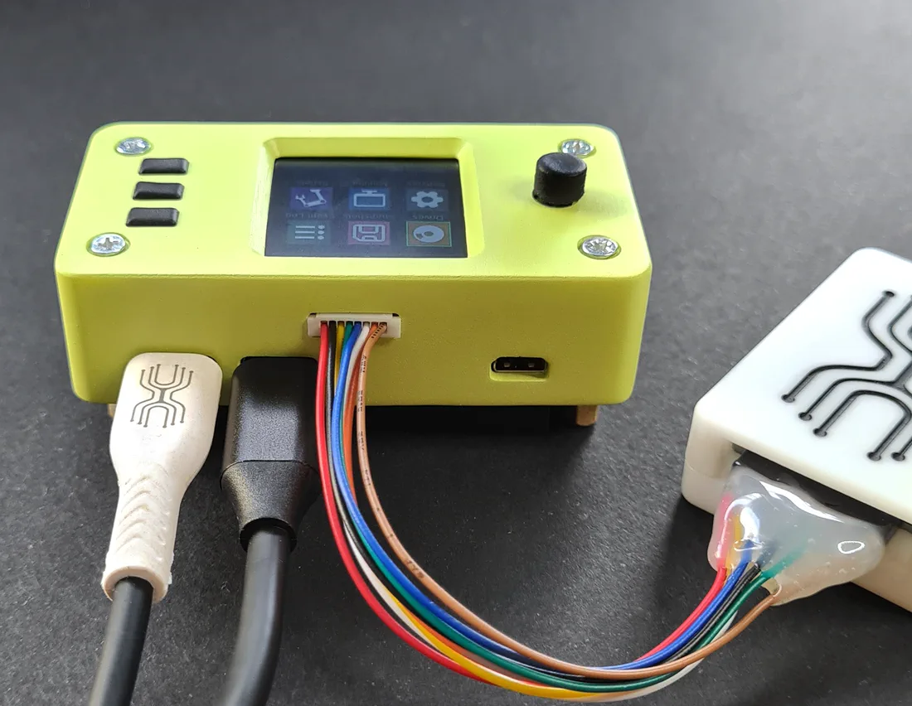
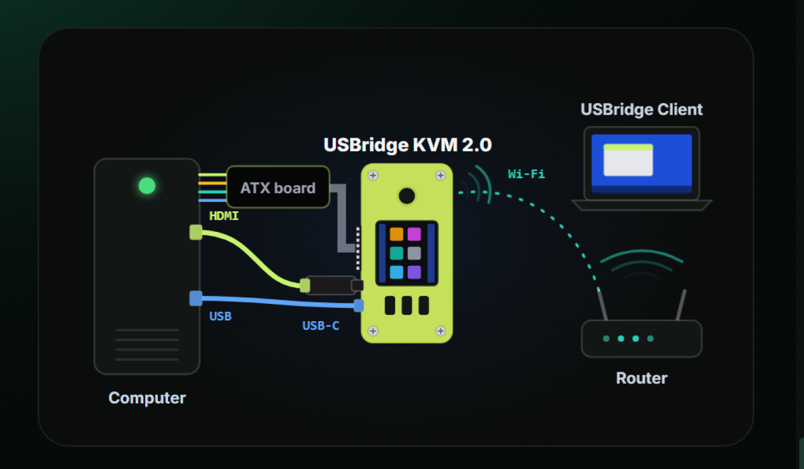
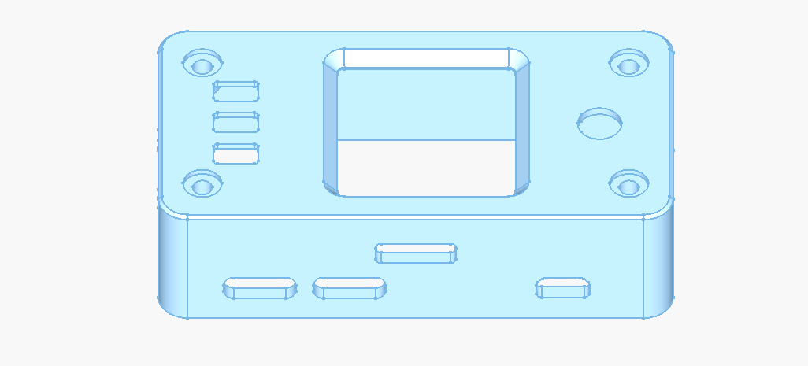
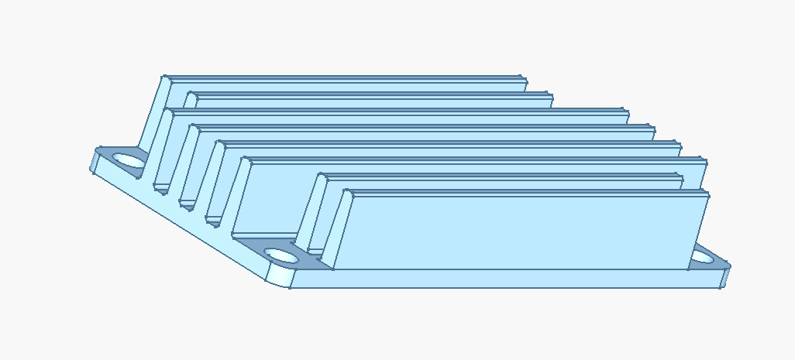

# USBridge KVM 2.0 Full Kit (Ultimate Pro Kit + ATX)

The flagship, all-in-one IP-KVM appliance. Includes the complete KVM 2.0 unit with an interactive color IPS display, active/passive cooling, and a dedicated galvanically isolated ATX Power Management board with DuPont jumpers for complete bare-metal hardware control.

* 👉 [Buy USBridge KVM 2.0 Full on usbridge.io ($139)](https://www.usbridge.io/hardware-agent/#buy-usbridge-kvm-2-0)

---

## Technical Specifications

| Specification | Details |
| :--- | :--- |
| **Base Board** | Radxa Zero 3W |
| **Processor** | Rockchip RK3566 (Quad-Core Cortex-A55 @ 1.6 GHz) |
| **Memory** | 1 GB LPDDR4 |
| **Video Capture** | External USB 3.0 UVC Capture Card (1080p @ 60 FPS) |
| **Stream Latency** | ~45 ms (Moonlight streaming pipeline) |
| **Status Display** | 1.3" IPS full-color LCD (240×240), 3 hardware buttons & 5-way joystick |
| **ATX Power Control** | Hardware Power on/off, hard reset, Power LED & HDD LED telemetry (Optocoupler isolation up to 3.75 kV) |
| **Enclosure** | Custom precision case (69 × 36 × 34 mm) |
| **Cooling** | Custom aluminum cooling heatsink |
| **Operating System** | USBridge KVM OS on included MicroSD card with Lifetime License |

---

## In the Box (Package Contents)
1. **USBridge KVM 2.0 Unit**: Assembled in custom case with integrated 1.3" color IPS display.
2. **ATX Power Control Board**: Dedicated adapter board with 8-pin ribbon cable.
3. **Dupont Jumper Wire Set**: Colorful female-to-female jumper wires to bridge to motherboard Front Panel headers.
4. **HDMI Video Capture Dongle**: High-performance USB 3.0 capture stick (1080p @ 60 FPS).
5. **USB Type-C to Type-C Cable**: Interconnecting the KVM Host port and the capture dongle.
6. **Pre-flashed MicroSD Card**: With latest USBridge KVM OS and lifetime license.

---

## 4-Step Hardware Setup

1. **HDMI**: Connect an HDMI cable from the computer's GPU / motherboard to the capture dongle.
2. **USB-C (Port 1 OTG)**: Connect from Port 1 to the host computer for power, input emulation, and virtual storage.
3. **ATX Control Board**: Plug the ribbon cable into the KVM's 8-pin GPIO port, then attach jumper wires to the motherboard Front Panel headers (`PWR_SW`, `RESET`, `P_LED`, `H_LED`).
4. **Network**: Configure Wi-Fi 6 via the on-device display/joystick or connect directly over USB gadget mode (`10.55.0.1`).

---

## Production CAD Files (3D Models & Heatsinks)

* 📦 [**USBridge_KVM_2.0_Case_V6.step**](./USBridge_KVM_2.0_Case_V6.step) — Enclosure body.
* 📦 [**Key_Single.step**](./Key_Single.step) — Push-button cap.
* 📦 [**Joystick_Cap.step**](./Joystick_Cap.step) — 5-way joystick knob.
* 📦 [**Radiator_V6_Transverse_Ribs.step**](./Radiator_V6_Transverse_Ribs.step) — Transverse cross-cut aluminum heatsink.
