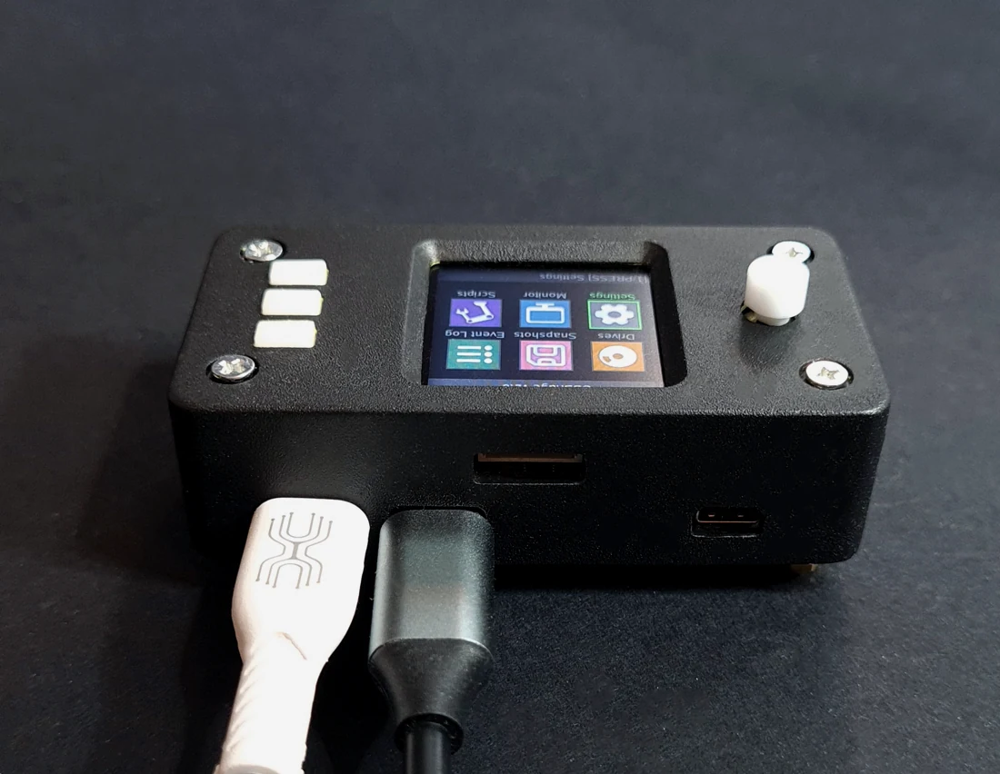
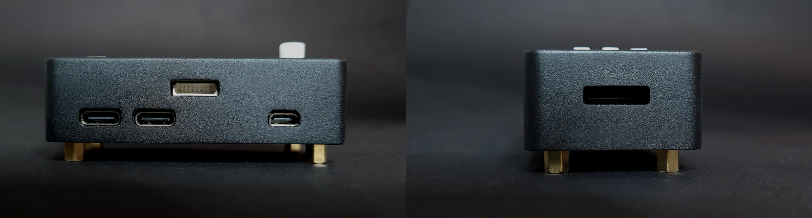
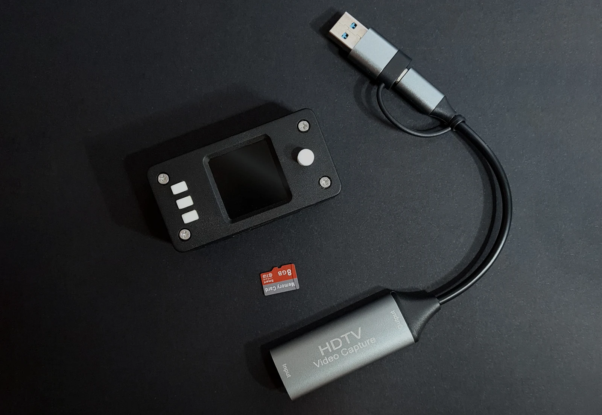
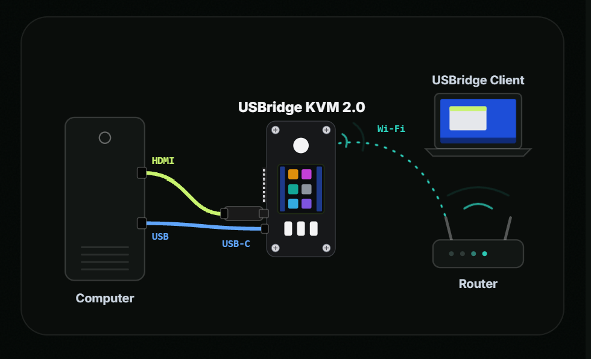
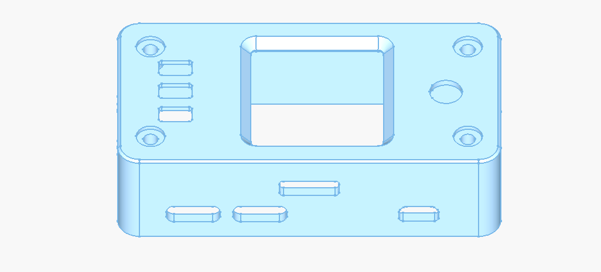

# USBridge KVM 2.0 Lite (Budget Desktop Kit)

The budget-friendly, ready-to-use desktop IP-KVM appliance in a custom protective enclosure. Built on the **Walnut Pi ZeroW (Allwinner H618)** with an interactive 1.3" IPS color display, physical navigation controls, and USB 2.0 video capture for essential server administration, remote maintenance, and BIOS navigation.

* 👉 **[Buy USBridge KVM 2.0 Lite on usbridge.io ($69)](https://www.usbridge.io/hardware-agent/usbridge-kvm-2-lite/)**

**Quick Jump:** [Specifications](#technical-specifications) • [In the Box](#in-the-box-package-contents) • [Features](#key-capabilities--features) • [Snapshots & Storage](#immutable-data-snapshots--storage) • [ATX Expansion](#atx-power-control-expansion) • [Hardware Setup](#3-step-hardware-setup) • [On-Screen Setup](#connect--initial-setup-via-front-panel-screen) • [3D Case & Parts](#3d-printable-enclosure-cad-files)

---

## Technical Specifications

| Specification | Details |
| :--- | :--- |
| **Base Board** | Walnut Pi ZeroW |
| **Processor** | Allwinner H618 (Quad-Core Cortex-A53 up to 1.5 GHz) |
| **Memory** | 1 GB LPDDR4 |
| **Video Capture** | External USB 2.0 HDMI Video Capture Dongle |
| **Video Encoding** | H.264, H.265 (HEVC) |
| **Stream Latency** | Standard (~65 ms, Moonlight streaming pipeline) |
| **Streaming Protocol** | Moonlight protocol & WebRTC |
| **Peripheral Control** | USB HID keyboard and mouse emulation, virtual drive for ISO, IMG, VDI, VMDK, gamepads |
| **Audio** | Audio output and microphone in both directions |
| **Network Interfaces** | Onboard Dual-Band Wi-Fi (2.4 GHz & 5 GHz / Wi-Fi 6) & Bluetooth 5.0 *(see note below)* |
| **Status Screen** | 1.3" IPS full-color LCD (240×240), 3 physical buttons & 5-way joystick (Live Monitor Mode support) |
| **Power Management** | Ready for optional [ATX Power Control Board](../../Accessories/ATX-Board/) via 8-pin expansion header |
| **Ports** | USB-C 2.0 (to the computer / OTG), USB 2.0 (capture dongle), Micro HDMI, 8-pin header for ATX board |
| **Enclosure Dimensions** | 69 × 36 × 34 mm (desktop unit) |
| **MicroSD with OS** | Included (Pre-flashed MicroSD card with Lifetime License) |
| **Operating System** | USBridge OS with Btrfs immutable snapshots & OTA updates |

> [!NOTE]
> * **ATX Remote Power Management:** Front-panel motherboard power control (Power SW, Reset SW, Power LED, HDD LED) can be added optionally with the galvanically isolated [ATX Power Control Board](../../Accessories/ATX-Board/).
> * **Wired Ethernet Support:** If wired network connectivity is required, an external USB-to-Ethernet adapter or USB hub with an RJ45 port can be connected to the host port (not included in the standard kit).

---

## In the Box (Package Contents)

1. **USBridge KVM 2.0 Lite Appliance**: Fully assembled desktop unit in a custom protective enclosure with integrated 1.3" IPS color screen, 5-way joystick, and physical buttons.
2. **USB 2.0 HDMI Video Capture Dongle**: 1080p UVC video capture adapter.
3. **Pre-flashed MicroSD Card**: Pre-installed with USBridge OS and Lifetime License.

### Software License & Billing Management

* **Lifetime OS License**: Pre-flashed and bound to your unit's unique hardware serial number. USBridge OS licenses provide **100% lifetime ownership** — no recurring subscriptions, renewal fees, or hidden costs.
* **License Management Portal ([billing.usbridge.io](https://billing.usbridge.io/))**: Sign in to the billing portal using the email address specified during purchase to view and manage your active licenses, devices, and purchase history.
* **Upgrading MicroSD Card Size**: You can swap in a larger capacity MicroSD card at any time without losing your license. Simply download and flash the OS image following our guide — once the KVM boots and connects to the internet, it automatically validates its lifetime license from the billing server based on the device's hardware serial number.

---

## Key Capabilities & Features

Whether you deploy the pre-assembled **USBridge KVM 2.0 Lite** kit or provision your own SBC, **USBridge OS** provides an enterprise-grade out-of-band management suite:

* **Moonlight & WebRTC Streaming**: Hardware-accelerated video streaming with Moonlight protocol and WebRTC browser client.
* **Unified Ecosystem**: Connect from native desktop clients (Windows, macOS Apple Silicon, Linux), mobile apps (iOS, Android), or any web browser.
* **Zero-Config Remote Access (Tailscale)**: Built-in native Tailscale mesh VPN integration to securely access your KVM from anywhere in the world without port forwarding or static public IPs.
* **Gamepad & Peripheral Emulation**: USB HID keyboard, precision mouse, and virtual gamepad/controller passthrough for remote control.
* **Bi-Directional Stereo Audio & Mic**: Real-time audio streaming from the target machine and microphone passthrough in both directions.
* **Full Out-of-Band Control**: Direct BIOS/UEFI control, virtual ISO drive mounting for bare-metal OS installs, and seamless pairing.
* **Front-Panel Interactive Display**: Built-in settings menu, network status, master key QR code, and Live Monitor Mode.
* **Enterprise Security**: Cryptographic per-request API signing, encrypted DTLS-SRTP media transport, and seamless OTA updates.

---

## Immutable Data Snapshots & Storage

USBridge protects your deployment files, virtual disk images, and backups stored on its **Backup Flash** volume using an immutable **Btrfs storage architecture**:

* **Pure User Data Snapshots**: Snapshots strictly preserve files, directory trees, disk images (ISOs), and backups placed on the storage volume. They do not alter or touch the appliance OS or running processes.
* **Immutable Read-Only Protection**: Every captured state is a frozen, read-only Btrfs subvolume. Even if the managed target server suffers a malware attack or ransomware infection, it has no bus-level or network path to alter, overwrite, or delete historical backup data on the KVM.
* **Point-in-Time File Extraction**: Recovery is performed by mounting any historical snapshot and extracting the exact files or disk images you need without in-place overwrites.
* **Universal Linux Access (No KVM Required)**: The storage volume uses the standard open-source Btrfs filesystem. In an emergency, you do not even need the KVM hardware — insert the MicroSD card into any computer running Linux to immediately mount, inspect, and copy out your files and snapshot subvolumes.
* **Physical-Only Data Wipe Protection**: Stored snapshots and data cannot be erased or wiped remotely over the network by malware or compromised credentials. Purging the storage volume requires physical presence — either by confirming through the on-device display menu using physical hardware buttons, or by removing the MicroSD card to format it externally.
* **Automatic Storage Capacity Growth**: Upgrading to a larger MicroSD card (e.g., 32 GB, 64 GB, 128 GB+) automatically expands the Btrfs data partition on first boot, giving you maximum space for ISO images and backup archives without losing your license.

**Detailed Storage & Snapshot Guides:**
* [Storage & Media Snapshots Overview ➔](../../../docs/content/4-snapshots-state-management/snapshots-overview.md)
* [Creating & Managing Data Snapshots ➔](../../../docs/content/4-snapshots-state-management/creating-managing-snapshots.md)
* [Storage Security & Immutability Rules ➔](../../../docs/content/4-snapshots-state-management/security-storage.md)

---

## ATX Power Control Expansion

The USBridge KVM 2.0 Lite includes an on-board **8-pin expansion header** fully compatible with the optional **[USBridge ATX Power Control Board](../../Accessories/ATX-Board/)** ($14.50).

* **Hardware Power & Reset**: Remotely turn on, shut down, or hard-reset unresponsive servers.
* **Galvanic Optical Isolation**: Provides up to 3.75 kV isolation between the KVM and the target motherboard.
* **LED Telemetry**: Real-time motherboard power and storage activity status in client applications.
* 👉 [**Learn more about the ATX Power Control Board ➔**](../../Accessories/ATX-Board/)

---

## 3-Step Hardware Setup

1. **HDMI Cable**: Connect an HDMI cable from the target computer's GPU / motherboard video output to the included USB 2.0 capture dongle plugged into the KVM Host port.
2. **USB-C Cable (Port 1 OTG)**: Connect a USB-C cable from Port 1 (OTG) to a USB port on the target computer for power delivery, peripheral emulation, and virtual storage mounting.
3. **Network Connection**: Connect to Wi-Fi (2.4 / 5 GHz / Wi-Fi 6) using the onboard screen or attach an external USB-to-Ethernet adapter.

---

## Connect & Initial Setup via Front-Panel Screen

Because the **Lite Kit** comes fully assembled with the pre-flashed MicroSD card and an interactive 1.3" IPS color screen, initial network setup and pairing are executed directly on the device:

### 1. Wi-Fi Configuration
1. Power on the unit.
2. Navigate to **`Settings` ➔ `Internet` ➔ `Wi-Fi`**.
3. Select **`Enable Wi-Fi`**. After a few seconds, the **`Available Networks`** option becomes active.
4. Select **`Available Networks`** to scan for surrounding wireless networks.
5. Choose your Wi-Fi network to enter the password using the 3 front-panel physical buttons:
   * **Button 1**: Digits (`0–9`)
   * **Button 2**: Uppercase letters (`A–Z`)
   * **Button 3**: Lowercase letters (`a–z`)
6. Once the password is typed, **press and hold Button 3** to confirm and connect.
7. The assigned IP address is immediately displayed under **`Wi-Fi Status`** and on the main status dashboard.

### 2. Fast Screen Pairing
1. Navigate to **`Settings` ➔ `Authentication` ➔ `Show Master Key`**.
2. A pairing QR code appears on the 1.3" color screen.
3. **Mobile App**: Scan the QR code with the USBridge mobile app to pair instantly.
4. **Desktop Client**: Open the [Desktop Client App](../../../README.md#client-downloads), click **`+` ➔ Manual**, and enter the device IP and master key (or click the pairing link shown on screen).
5. **Web Client**: Connect directly in any browser via **[web.usbridge.io](https://web.usbridge.io/)**.

### 3. Live Monitor Mode
The front-panel 1.3" color screen isn't just for status — it features a dedicated **Monitor Mode**. Press the physical button to toggle the display into a miniature local monitor showing the target computer's live video output in real time.

For complete details on settings, see the [Full Initial Setup Documentation](../../../docs/content/1-getting-started/initial-setup.md).

---

## 3D Printable Enclosure (CAD Files)

The USBridge KVM 2.0 Lite utilizes the same modular form factor and production enclosure design as the Standard model:

We provide the complete production STEP models for 3D printing the desktop enclosure and tactile controls:

* 📦 [**USBridge_KVM_2.0_Case_V6.step**](./USBridge_KVM_2.0_Case_V6.step) — Main body enclosure designed for Zero-factor boards and the 1.3" display.
* 📦 [**Key_Single.step**](./Key_Single.step) — Push-button cap for the 3 front-panel tactile switches.
* 📦 [**Joystick_Cap.step**](./Joystick_Cap.step) — Ergonomic 5-way joystick knob.
* **Recommended Technology**: High-Precision Resin (SLA / MSLA / DLP) with Tough / ABS-like resin for production-grade finish, or SLS Nylon (PA12).
* **FDM Alternative**: PETG, 0.12–0.16 mm layer height, 40–100% infill.

---

## Ready to Deploy?

Get your pre-assembled appliance or explore other models in the USBridge ecosystem:

* 🛒 **[Order USBridge KVM 2.0 Lite ($69) on usbridge.io ➔](https://www.usbridge.io/hardware-agent/usbridge-kvm-2-lite/)**

### Explore Other USBridge KVM Kits

| Model | Form Factor | Capture Mode | Price | Details |
| :--- | :--- | :--- | :---: | :--- |
| **USBridge Nano** | Pocket Appliance + OLED | Built-in MIPI CSI (1080p60) | **$89** | [View Nano Kit Guide ➔](../USBridge-Nano/) |
| **USBridge KVM 2.0 Low** | Bare board + Extruded Heatsink | USB 3.0 Dongle (1080p60) | **$99** | [View Low Kit Guide ➔](../USBridge-KVM-2.0-Low/) |
| **USBridge KVM 2.0 Standard** | Desktop Unit + Screen | USB 3.0 Dongle (1080p60) | **$117** | [View Standard Kit Guide ➔](../USBridge-KVM-2.0-Standard/) |
| **USBridge KVM 2.0 Full** | Desktop Unit + Screen + ATX Power Board | USB 3.0 Dongle (1080p60) | **$139** | [View Full Kit Guide ➔](../USBridge-KVM-2.0-Full/) |

Explore all kits, expansion PCBs, and accessories in the **[Hardware Catalog ➔](../../README.md)**.
