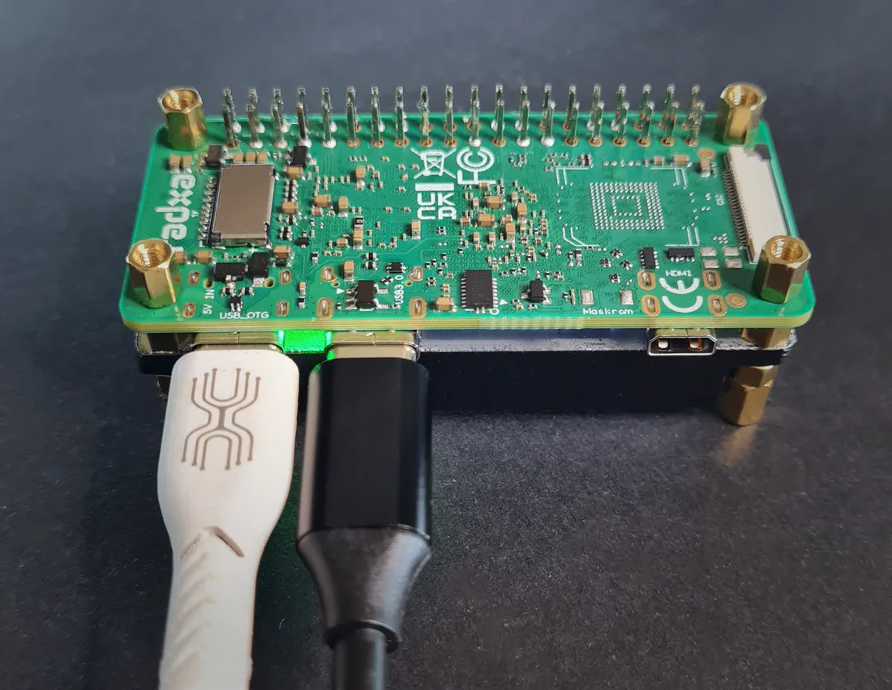
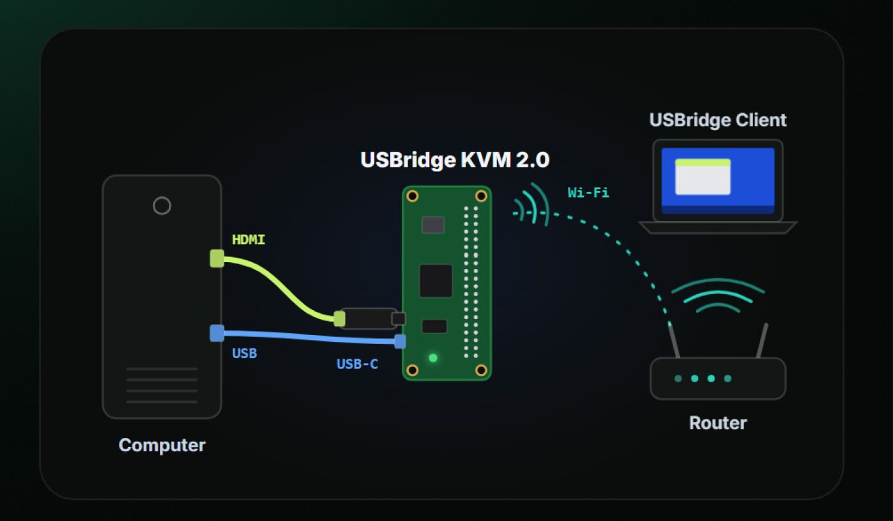
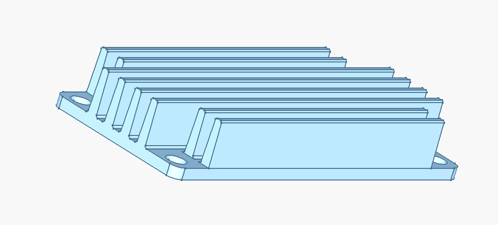

# USBridge KVM 2.0 Low Kit (Minimalist Board Edition)

<div align="center">

</div>

The minimalist bare-board KVM kit engineered for dense server rack integration, homelabs, and custom enclosures where a compact footprint and passive cooling are required.

* 👉 **[Buy USBridge KVM 2.0 Low on usbridge.io ($99)](https://www.usbridge.io/hardware-agent/#buy-usbridge-kvm-2-0-low)**

**Quick Jump:** [Specifications](#technical-specifications) • [In the Box](#in-the-box-package-contents) • [Features](#key-capabilities--features) • [Hardware Setup](#3-step-hardware-setup) • [Firmware Flashing](#firmware-flashing--recovery-guide) • [Headless Provisioning](#headless--bulk-provisioning-usbridge_provisionjson) • [Cooling Heatsink](#cnc-aluminum-heatsinks-cad-files)

---

## Technical Specifications

| Specification | Details |
| :--- | :--- |
| **Base Board** | Radxa Zero 3W |
| **Processor** | Rockchip RK3566 (Quad-Core Cortex-A55 up to 1.6 GHz) + 0.8 TOPS NPU |
| **Memory** | 1 GB LPDDR4 |
| **Video Capture** | External USB 3.0 UVC Capture Card (1080p @ 60 FPS) |
| **Stream Latency** | ~45 ms (Moonlight streaming pipeline) |
| **Streaming Protocol** | Moonlight protocol, sub-frame low latency & WebRTC |
| **Peripheral Control** | USB HID keyboard and mouse emulation, virtual ISO drive, gamepads |
| **Audio** | Audio output and microphone in both directions |
| **Network Interfaces** | Onboard Wi-Fi 6 & Bluetooth 5.4; Ethernet via USB hub + USB virtual Ethernet (`10.55.0.1`) |
| **Status Screen** | None (Headless operation via web panel, mobile app, and SSH) |
| **Cooling** | Passive solid extruded aluminum heatsink |
| **Ports** | USB-C 2.0 (OTG to target PC), USB-C 3.0 (Host for capture card), Micro HDMI |
| **Operating System** | USBridge OS with Btrfs immutable snapshots & OTA updates |

---

## In the Box (Package Contents)

1. **Radxa Zero 3W Board**: Pre-configured single-board computer with USBridge firmware.
2. **Aluminum Cooling Heatsink**: Custom high-efficiency passive cooling block.
3. **USB 3.0 HDMI Video Capture Dongle**: High-throughput 1080p @ 60 FPS UVC capture stick.
4. **USB-C Interconnect Cable**: Linking the KVM Host port to the capture dongle.
5. *Optional*: Pre-flashed MicroSD card with USBridge OS (Lifetime License included).

---

## Key Capabilities & Features

Whether you deploy the pre-assembled **USBridge KVM 2.0 Low** kit or provision your own SBC, **USBridge OS** provides an enterprise-grade out-of-band management suite:

* **Ultra-Low Latency Streaming**: Hardware-accelerated sub-frame encoding with Moonlight protocol and WebRTC.
* **Unified Ecosystem**: Connect from native desktop clients (Windows, macOS Apple Silicon, Linux), mobile apps (iOS, Android), or any web browser.
* **Zero-Config Remote Access (Tailscale)**: Built-in native Tailscale mesh VPN integration to securely access your KVM from anywhere in the world without port forwarding or static public IPs.
* **Gamepad & Peripheral Emulation**: USB HID keyboard, precision mouse, and virtual gamepad/controller passthrough for remote gaming, simulation, or specialized control.
* **Bi-Directional Stereo Audio & Mic**: Real-time audio streaming from the target machine and microphone passthrough in both directions.
* **Full Out-of-Band Control**: Direct BIOS/UEFI control, virtual ISO drive mounting for bare-metal OS installs, and seamless pairing.
* **Enterprise Security**: Cryptographic per-request API signing, encrypted DTLS-SRTP media transport, and seamless OTA updates.

### DIY KVM Setup: Turn Your SBC into an IP-KVM

Already own a supported single-board computer (Radxa Zero 3W / 3E, Radxa Cubie A7Z)? Flash **USBridge OS** and connect a standard USB capture dongle to build your own IP-KVM:

#### 3-Minute Flashing Guide (Video Tutorial)

Watch the complete guide on how to flash the firmware and perform the first boot:

[](https://youtu.be/9FyPjEfH5Wg)

* [Download USBridge Firmware ➔](https://www.usbridge.io/hardware-agent/#firmware)
* [Hardware Board Comparison ➔](../../../docs/content/6-hardware-connectivity/board-comparison.md)

---

## 3-Step Hardware Setup

<div align="center">

</div>

1. **HDMI Cable**: Connect an HDMI cable from the target computer's GPU / motherboard video output to the included USB 3.0 capture dongle.
2. **USB-C Cable (OTG Port)**: Connect a USB-C cable from Port 1 (OTG) to a USB port on the target computer for power delivery, peripheral emulation, and virtual storage mounting.
3. **Network Connection**: Connect via onboard Wi-Fi 6, plug in a USB Ethernet adapter, or pair instantly over the USB cable (`10.55.0.1`) using the desktop app.

---

## Firmware Flashing & Recovery Guide

For blank boards, fresh installations, or full recovery of the **Radxa Zero 3W (RK3566)**:

### 1. Download Firmware
Grab the latest raw compressed disk image (`usbridge-rz3w-<version>.gptimg.zst`) from the official repository or direct file mirror:
* **[usbridge.io Firmware Portal](https://www.usbridge.io/hardware-agent/#firmware)**
* **[flash.usbridge.io Mirror](https://flash.usbridge.io/)**

Decompress the image using `zstd -d` (Linux/macOS) or [7-Zip](https://www.7-zip.org/) (Windows) to get the raw `.gptimg`.

### 2. Flash to Onboard eMMC or MicroSD
* **Windows (eMMC Maskrom Mode)**: Install Rockchip **DriverAssistant** and run **RKDevTool**. Hold the Maskrom button on the Radxa Zero 3W while plugging the USB-C cable into your PC, select the `.gptimg`, and click **Upgrade**.
* **Linux / macOS (CLI)**: Install `rkdeveloptool` and use our automated helper script `flash-tool/rz3w/flash-device-fast.sh` which flashes and decompresses on the fly.
* **MicroSD Card Flashing**: Flash the decompressed image directly onto a MicroSD card (Class 10, 2GB+) using [BalenaEtcher](https://etcher.balena.io/) or `dd`.

For comprehensive instructions covering driver installation, eMMC Maskrom pinouts, and troubleshooting, read the **[Step-by-Step Recovery Flashing Guide ➔](../../../docs/content/9-updates-changelog/recovery-flashing-guide.md)**.

---

## Headless & Bulk Provisioning (`usbridge_provision.json`)

Because the **Low Kit** operates without a physical status screen, unattended configuration via a provisioning file is the fastest way to configure Wi-Fi, static networking, and security credentials.

### How It Works
1. Create a plain text file named `usbridge_provision.json`.
2. Copy it to the root of a FAT32/exFAT MicroSD card or USB flash drive.
3. Insert the card/drive into the appliance and power it on.
4. On boot, USBridge OS automatically detects the file, applies all network and authorization settings without any user interaction, and renames the file to `usbridge_provision.applied.json`.

### Example `usbridge_provision.json`
```json
{
  "master_key": "your-secure-secret-key-12345",
  "wifi": {
    "ssid": "Your-Office-WiFi",
    "password": "WiFiPassword123"
  },
  "interfaces": {
    "wlan0": {
      "mode": "dhcp"
    }
  },
  "ssh": true
}
```

> [!TIP]
> **Prefer GUI Setup?** You can also plug the board's USB cable into your computer: your computer immediately gets a virtual network adapter (`10.55.0.1`). Open `http://10.55.0.1` in your browser or click **`+` ➔ Over USB** in the [Desktop Client App](../../../README.md#client-downloads) to pair instantly.

For all supported JSON schema options (static IP, VLANs, custom ports, and multi-node batch deployments), see the **[Headless Provisioning Guide ➔](../../../docs/content/1-getting-started/headless-provisioning.md)**.

---

## CNC Aluminum Heatsinks (CAD Files)

<div align="center">

</div>

The Low Kit relies on massive passive heatsinks to maintain optimal Rockchip RK3566 operating temperatures without fans:

* 📦 [**Radiator_V6_Transverse_Ribs.step**](./Radiator_V6_Transverse_Ribs.step) — Transverse cross-cut ribs for maximum passive surface area and omnidirectional airflow.
* 📦 [**Radiator_V5.step**](./Radiator_V5.step) — Longitudinal fin profile for directed channel airflow.
* **Manufacturing Material**: CNC Machined Aluminum Alloy (6061-T6 or 6063).

---

## Ready to Deploy?

Get your pre-assembled appliance or explore other models in the USBridge ecosystem:

* 🛒 **[Order USBridge KVM 2.0 Low ($99) on usbridge.io ➔](https://www.usbridge.io/hardware-agent/#buy-usbridge-kvm-2-0-low)**

### Explore Other USBridge KVM Kits

| Model | Form Factor | Capture Mode | Price | Details |
| :--- | :--- | :--- | :---: | :--- |
| **USBridge Nano** | Pocket Appliance + OLED | Built-in MIPI CSI (1080p60) | **$89** | [View Nano Kit Guide ➔](../USBridge-Nano/) |
| **USBridge KVM 2.0 Standard** | Desktop Unit + 1.3" Color IPS Screen | USB 3.0 Dongle (1080p60) | **$117** | [View Standard Kit Guide ➔](../USBridge-KVM-2.0-Standard/) |
| **USBridge KVM 2.0 Full** | Desktop Unit + Screen + ATX Power Board | USB 3.0 Dongle (1080p60) | **$139** | [View Full Kit Guide ➔](../USBridge-KVM-2.0-Full/) |

Explore all kits, expansion PCBs, and accessories in the **[Hardware Catalog ➔](../../README.md)**.
