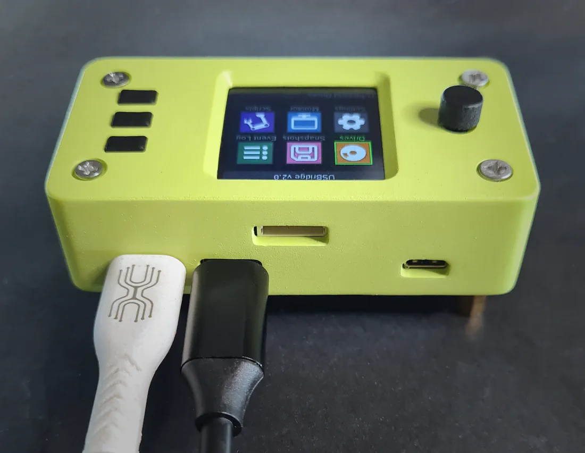
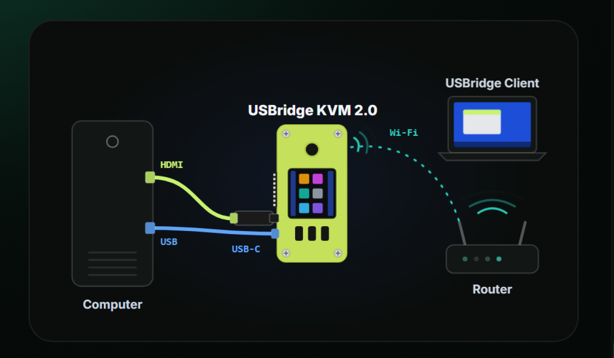
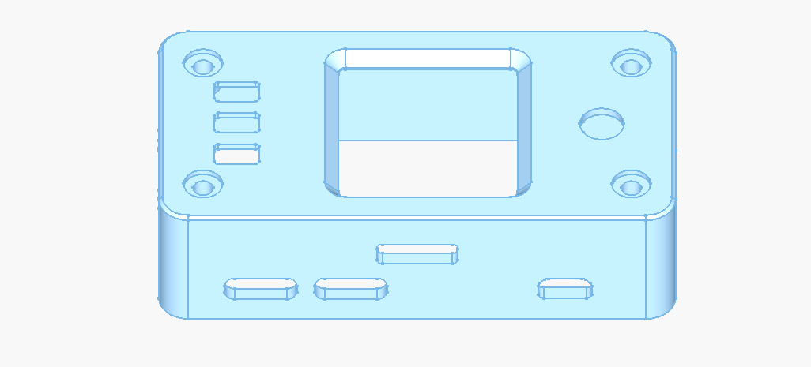

# USBridge KVM 2.0 Standard Kit (Complete Desktop Kit)

The complete ready-to-use desktop IP-KVM appliance in a stylish custom enclosure, featuring an interactive 1.3" IPS color status display and full peripheral emulation out of the box.

* 👉 [Buy USBridge KVM 2.0 Standard on usbridge.io ($117)](https://www.usbridge.io/hardware-agent/#buy-usbridge-kvm-2-0-standard)

---

## Technical Specifications

| Specification | Details |
| :--- | :--- |
| **Base Board** | Radxa Zero 3W |
| **Processor** | Rockchip RK3566 (Quad-Core Cortex-A55 @ 1.6 GHz) |
| **Memory** | 1 GB LPDDR4 |
| **Video Capture** | External USB 3.0 UVC Capture Card (1080p @ 60 FPS) |
| **Stream Latency** | ~45 ms (Moonlight streaming pipeline) |
| **Status Display** | 1.3" IPS full-color LCD (240×240), 3 hardware buttons & 5-way joystick |
| **Enclosure** | Custom precision case (69 × 36 × 34 mm) |
| **Network** | Onboard Wi-Fi 6 & Bluetooth; Ethernet via USB hub |
| **Expansion Header** | 8-pin GPIO port ready for optional ATX Power Control board |
| **Operating System** | USBridge KVM OS on included MicroSD card with Lifetime License |

---

## In the Box (Package Contents)
1. **USBridge KVM 2.0 Unit**: Assembled in custom case with integrated 1.3" color IPS display and controls.
2. **HDMI Video Capture Dongle**: High-performance USB 3.0 stick (1080p @ 60 FPS).
3. **USB Type-C to Type-C Cable**: Interconnecting the KVM and the capture dongle.
4. **Pre-flashed MicroSD Card**: With latest USBridge KVM OS and lifetime license.

---

## 3-Step Hardware Setup

1. **HDMI**: Connect an HDMI cable from the computer's GPU / motherboard to the included capture dongle.
2. **USB-C (Port 1 OTG)**: Connect from Port 1 to the host computer for power, input emulation, and virtual storage mounting.
3. **Network**: Pair via onboard Wi-Fi 6 using the interactive status screen and joystick, or connect directly over USB gadget mode (`10.55.0.1`).

---

## 3D Printable Enclosure (CAD Files)

* 📦 [**USBridge_KVM_2.0_Case_V6.step**](./USBridge_KVM_2.0_Case_V6.step) — Main body enclosure.
* 📦 [**Key_Single.step**](./Key_Single.step) — Push-button cap (print 3 pcs).
* 📦 [**Joystick_Cap.step**](./Joystick_Cap.step) — 5-way joystick knob.
* **Recommended Technology**: High-Precision Resin (SLA / MSLA) or SLS Nylon (PA12).
