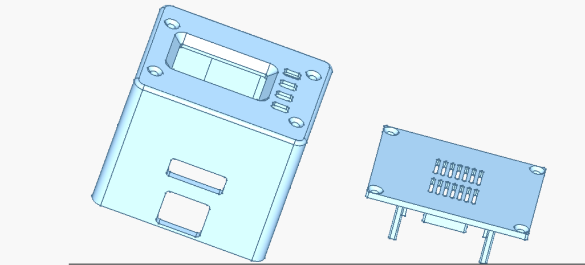

# USBridge Nano Kit

The most compact out-of-band KVM appliance powered by USBridge OS. Based on the SOPHGO SG2002 RISC-V SoC, it features native MIPI CSI HDMI capture, an on-device 128×64 status OLED display, and a 100 Mbit RJ45 Ethernet port.

* 👉 [Buy USBridge Nano on usbridge.io ($89)](https://www.usbridge.io/hardware-agent/#buy-nano-kvm)

---

## Technical Specifications

| Specification | Details |
| :--- | :--- |
| **Base Board** | Sipeed NanoKVM (SOPHGO SG2002) |
| **Processor** | 1 RISC-V C906 core @ 1.0 GHz |
| **Memory** | 256 MB DDR3 |
| **Video Capture** | Built-in HDMI capture via MIPI CSI |
| **Stream Resolution & FPS** | 1080p @ 60 FPS |
| **Video Latency** | **Lowest** (direct MIPI hardware pipeline) |
| **Streaming Protocol** | Moonlight protocol, sub-frame low latency & WebRTC |
| **Peripheral Control** | USB HID keyboard and mouse emulation, virtual ISO drive, gamepads |
| **Audio** | Audio output and microphone in both directions |
| **Network** | 100 Mbit Ethernet port (RJ45) + USB virtual Ethernet (`10.55.0.1`) |
| **Status Screen** | Built-in 128×64 monochrome OLED |
| **Security** | Physical OLED verification code for SSH enablement |
| **Power Input** | USB-C |
| **Enclosure Dimensions** | 49 × 41 × 41 mm |
| **Operating System** | USBridge OS on pre-flashed MicroSD card (Lifetime License included) |

---

## In the Box (Package Contents)

1. **USBridge Nano KVM Appliance**: Fully assembled unit in custom protective housing.
2. **Pre-flashed MicroSD Card**: With latest USBridge OS and lifetime license.

---

## Key Capabilities & Features

Whether you deploy the pre-built **USBridge Nano** or install our firmware on your own hardware, **USBridge OS** provides an enterprise-grade out-of-band management suite:

* **Ultra-Low Latency Streaming**: Hardware-accelerated sub-frame encoding with Moonlight protocol and WebRTC.
* **Unified Ecosystem**: Connect from native desktop clients (Windows, macOS Apple Silicon, Linux), mobile apps (iOS, Android), or any web browser.
* **Zero-Config Remote Access (Tailscale)**: Built-in native Tailscale mesh VPN integration to securely access your KVM from anywhere in the world without port forwarding or static public IPs.
* **Gamepad & Peripheral Emulation**: USB HID keyboard, precision mouse, and virtual gamepad/controller passthrough for remote gaming, simulation, or specialized control.
* **Bi-Directional Stereo Audio & Mic**: Real-time audio streaming from the target machine and microphone passthrough in both directions.
* **Full Out-of-Band Control**: Direct BIOS/UEFI control, virtual ISO drive mounting for bare-metal OS installs, and seamless pairing.
* **Enterprise Security**: End-to-end TLS encryption, device master key authentication, physical presence verification for SSH, and over-the-air (OTA) updates.

### Already Own a Sipeed NanoKVM? Upgrade It!

Turn your existing off-the-shelf **Sipeed NanoKVM** into a high-performance management appliance. Flashing **USBridge OS** replaces the stock firmware with our optimized operating system.

#### Stock Firmware vs. USBridge OS (Video Comparison)

Watch the side-by-side comparison demonstrating latency, responsiveness, and feature differences between factory stock firmware and USBridge OS:

#### Firmware & Flashing Guides
* [Download USBridge NanoKVM Firmware ➔](https://www.usbridge.io/hardware-agent/#firmware)
* [NanoKVM Reflashing Guide ➔](../../../docs/content/6-hardware-connectivity/nanokvm.md)
* [Step-by-Step Recovery & Flashing Guide ➔](../../../docs/content/9-updates-changelog/recovery-flashing-guide.md)

---

## 3-Step Hardware Setup

1. **HDMI Cable**: Connect from the target computer's GPU / motherboard video out directly into the Nano HDMI port.
2. **USB-C Cable**: Connect from the Nano to a USB port on the target computer. This single cable delivers power, keyboard/mouse emulation, and virtual storage mounting.
3. **Ethernet Cable**: Plug a network cable from your local router or switch into the 100 Mbit Ethernet port.

---

## Connect & Initial Setup

Once your USBridge Nano is powered and cabled up, connect to it using one of the quick pairing methods below.

### Default IP Address (`10.55.0.1` over USB)

Plug the board's USB cable into your computer: your computer immediately gets a virtual USB network adapter (its own internet connection remains completely untouched), and the KVM is reachable at **`10.55.0.1`**.

Open **`http://10.55.0.1`** in any web browser to access the setup page:
* Displays the QR code for fast pairing
* Direct connection link and device master key
* Moonlight PIN authorization
* Network configuration settings

> [!NOTE]
> On the Sipeed NanoKVM, the USB virtual Ethernet interface (`10.55.0.1`) is always active and accessible.

### On Your Local Network (Ethernet)

When connected via RJ45 Ethernet cable, your local router assigns the KVM an IP address automatically via DHCP (there is no fixed default). 

The assigned IP address is displayed:
1. At the very top of the `http://10.55.0.1` web setup page.
2. Directly on the Nano's built-in 128×64 OLED screen upon boot.

---

### Ways to Connect (Pick One)

1. **Recommended — [Desktop Client App](../../../README.md#client-downloads)**: Click **`+`** ➔ **Over USB**. The app automatically detects the KVM over the cable and pairs by itself.
2. **Phone or Tablet**: Open `http://10.55.0.1` on the computer the KVM is plugged into and scan the displayed pairing QR code with the USBridge mobile app.
3. **Headless Provisioning (Automated Deployment)**: Place a `usbridge_provision.json` file onto the MicroSD card boot partition before first boot. You choose the key and write it into the file; no QR code scanning required. See [Headless Provisioning Guide](../../../docs/content/1-getting-started/headless-provisioning.md).
4. **[Web Client in Browser](https://web.usbridge.io/)**: No desktop app installed? Connect instantly in any browser via **[web.usbridge.io](https://web.usbridge.io/)** or click the Web Client link directly inside the `http://10.55.0.1` setup page. *(The [native desktop app](../../../README.md#client-downloads) is recommended for best video performance and hardware acceleration).*

For complete step-by-step setup details, see the [Full Initial Setup Documentation](../../../docs/content/1-getting-started/initial-setup.md).

---

## Enabling Secure SSH Access

For strict security, **SSH access is disabled by default** in USBridge OS to protect the appliance against unauthorized network access.

To enable SSH, a **Physical Presence Verification Code** is required:

1. When you request to enable SSH in the web management interface (`http://10.55.0.1` or settings), a **one-time numeric security code** is generated and displayed on the Nano's built-in 128×64 OLED screen.
2. Enter this code into the web interface prompt to verify physical ownership.
3. Once verified, the SSH service starts securely on standard port `22`.

> [!IMPORTANT]
> This physical confirmation ensures that remote network attackers cannot enable root/shell access without physical possession of the device.

---

## 3D Printable Enclosure (CAD Files)

We provide the complete production STEP model for 3D printing replacement or custom enclosures:

* 📦 **Model File**: [**USBridge_Nano_Case.step**](./USBridge_Nano_Case.step)
* **Recommended Technology**: High-Precision Resin (SLA / MSLA / DLP) with Tough / ABS-like resin or SLS Nylon (PA12).
* **FDM Alternative**: PETG, 0.12–0.16 mm layer height, 40–100% infill.
