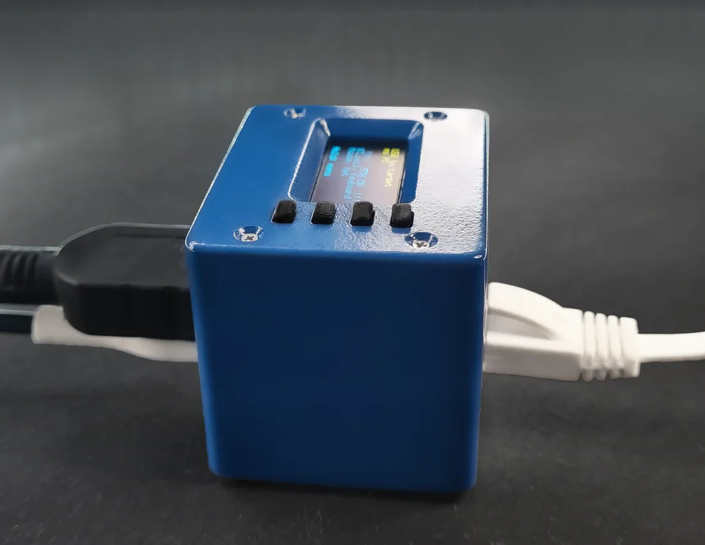
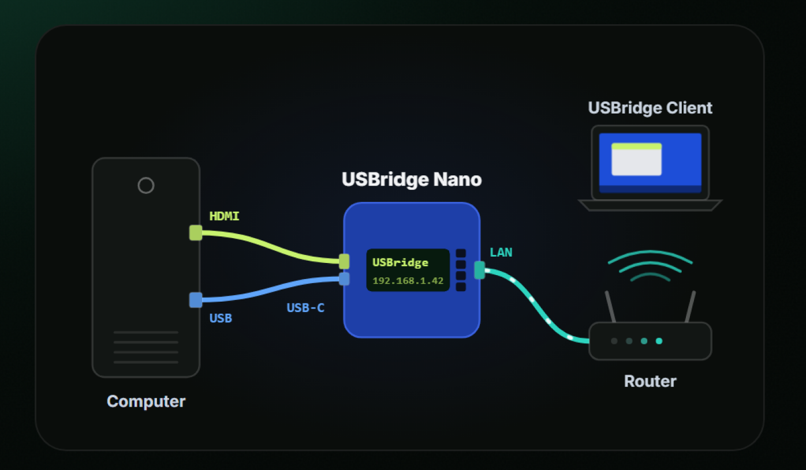

# USBridge Nano Kit

The most compact out-of-band KVM appliance powered by USBridge OS. Powered by the Sipeed NanoKVM (SG2002 RISC-V SoC), it features native MIPI CSI HDMI capture, an on-device 128×64 status OLED display, and a 100 Mbit RJ45 Ethernet port.

* 👉 [Buy USBridge Nano on usbridge.io ($89)](https://www.usbridge.io/hardware-agent/#buy-nano-kvm)

---

## Technical Specifications

| Specification | Details |
| :--- | :--- |
| **Base Board** | Sipeed NanoKVM (SOPHGO SG2002) |
| **Processor** | 1 RISC-V C906 core @ 1.0 GHz |
| **Memory** | 256 MB DDR3 |
| **Video Capture** | Built-in HDMI capture via MIPI CSI |
| **Stream Resolution & FPS** | 1080p @ 60 FPS |
| **Streaming Protocol** | Moonlight protocol, sub-frame low latency |
| **Peripheral Control** | USB HID keyboard and mouse emulation, virtual ISO drive, gamepads |
| **Audio** | Audio output and microphone in both directions |
| **Network** | 100 Mbit Ethernet port (RJ45) |
| **Status Screen** | Built-in 128×64 monochrome OLED |
| **Power Input** | USB-C |
| **Enclosure Dimensions** | 49 × 41 × 41 mm |
| **Operating System** | USBridge OS on pre-flashed MicroSD card (Lifetime License included) |

---

## In the Box (Package Contents)
1. **USBridge Nano KVM Appliance**: Fully assembled unit in custom protective housing.
2. **Pre-flashed MicroSD Card**: With latest USBridge OS and lifetime license.
3. **USB-C Cable**: For host power and peripheral emulation.

---

## 3-Step Hardware Setup

1. **HDMI Cable**: Connect from the target computer's GPU / motherboard video out directly into the Nano HDMI port.
2. **USB-C Cable**: Connect from the Nano to a USB port on the target computer. This single cable delivers power, keyboard/mouse emulation, and virtual storage mounting.
3. **Ethernet Cable**: Plug a network cable from your local router or switch into the 100 Mbit Ethernet port.

---

## 3D Printable Enclosure (CAD Files)

We provide the complete production STEP model for 3D printing replacement or custom enclosures:

* 📦 **Model File**: [**USBridge_Nano_Case.step**](./USBridge_Nano_Case.step)
* **Recommended Technology**: High-Precision Resin (SLA / MSLA) or SLS Nylon (PA12).
* **FDM Alternative**: PETG, 0.12–0.16 mm layer height, 40–100% infill.
