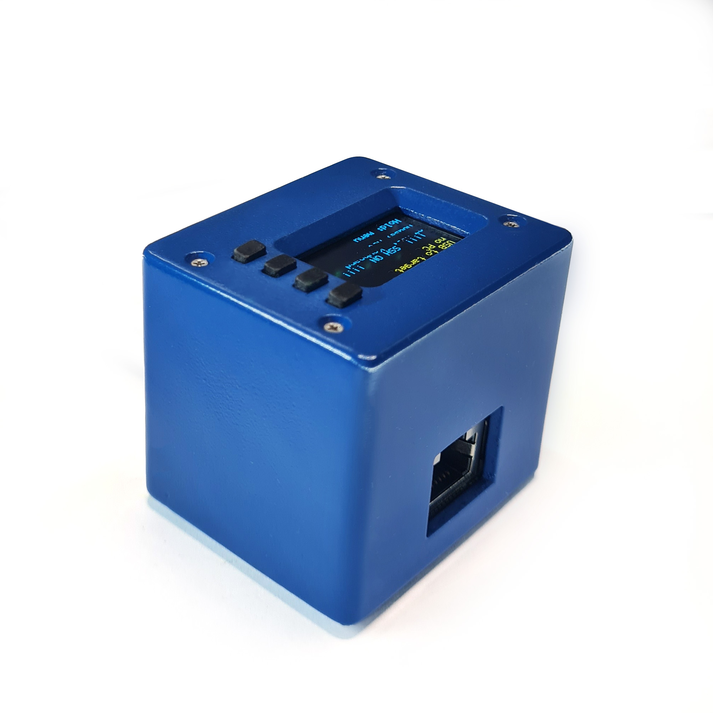
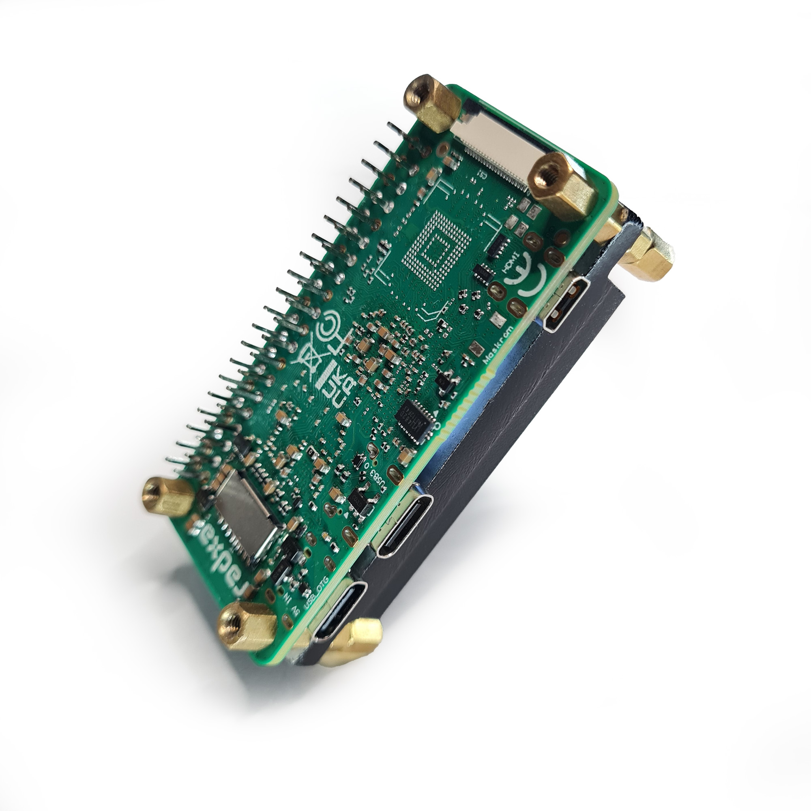
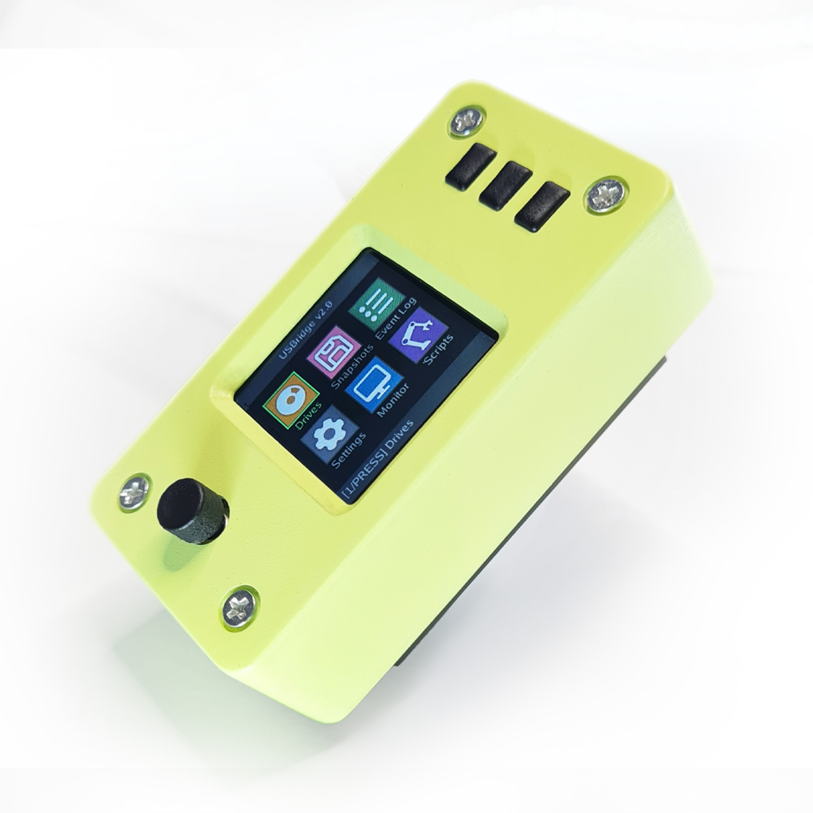
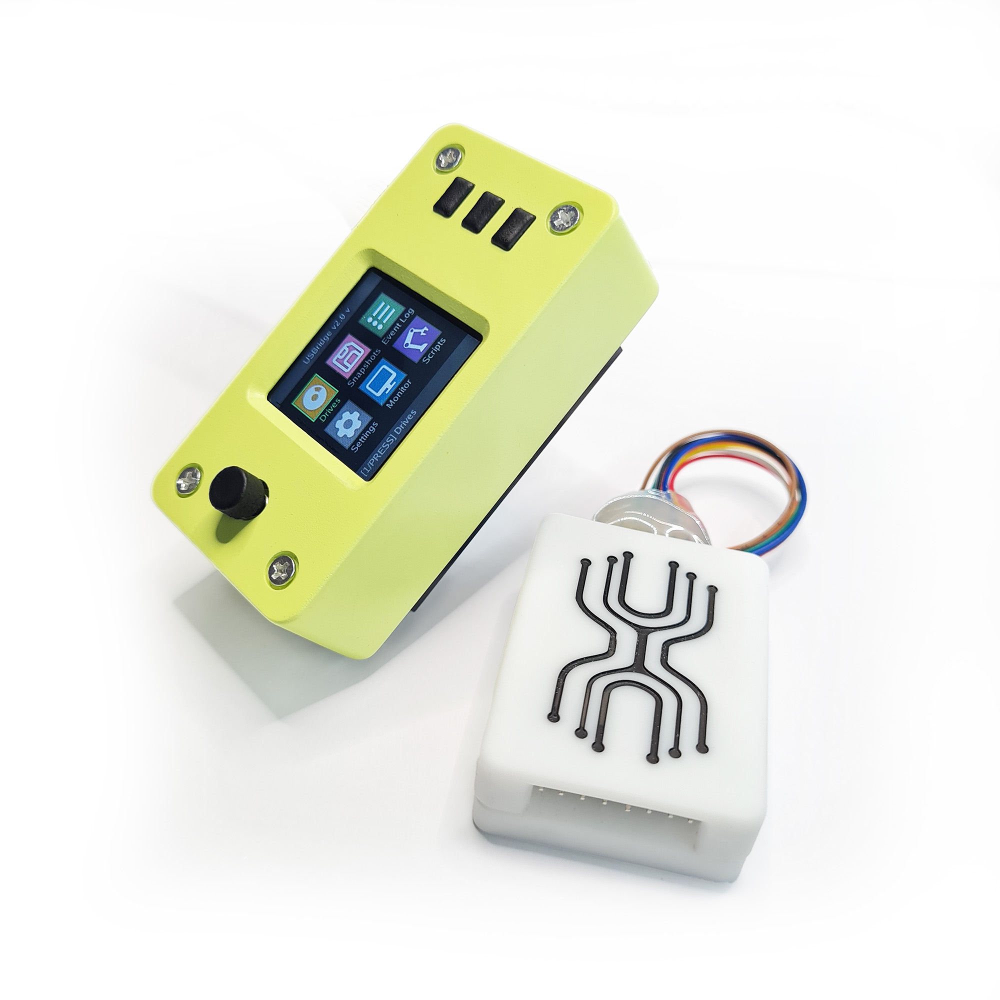
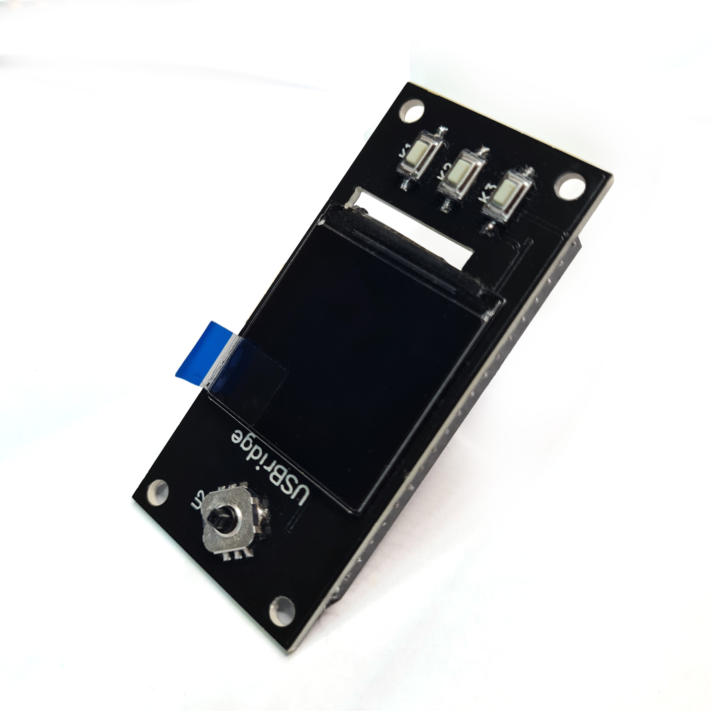
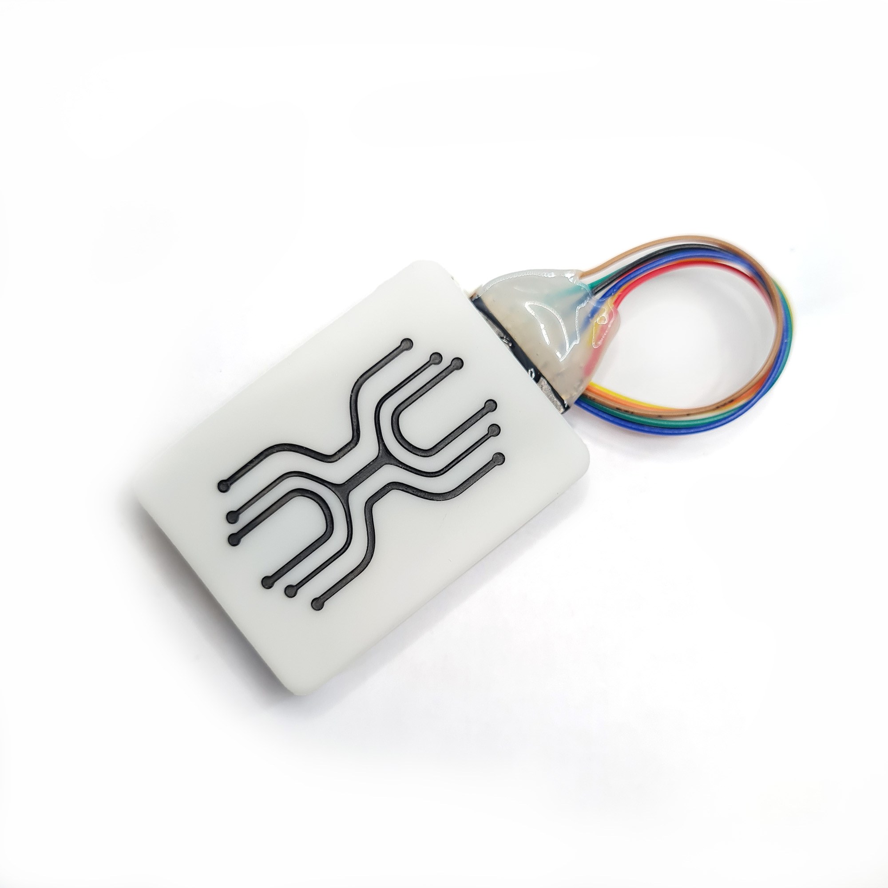
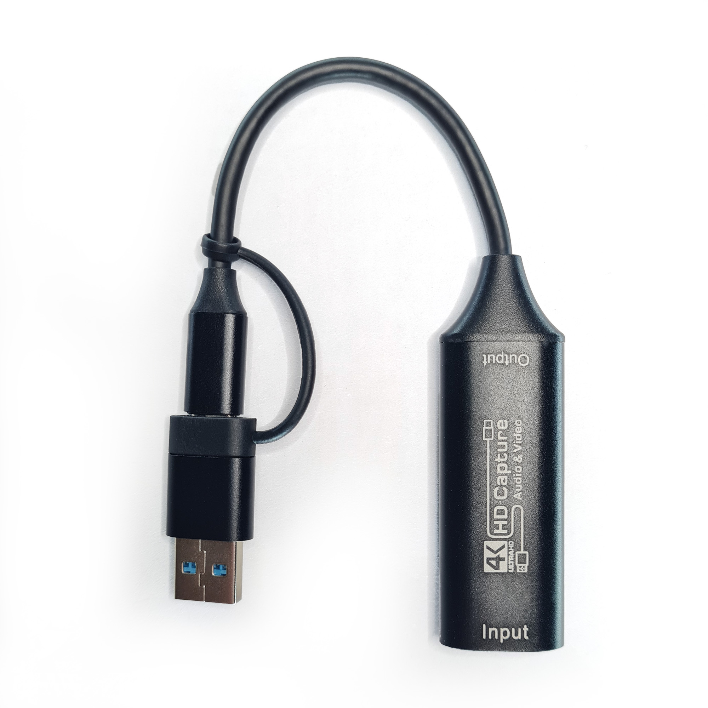

# USBridge Hardware Catalog

Explore the official **USBridge** hardware ecosystem — complete out-of-band management appliances, ready-to-deploy kits, and modular expansion accessories.

Click on any product card below to view detailed specifications, included components, and connection guides, or use the direct purchase links.

---

## Hardware Kits

Ready-to-use IP-KVM appliances designed for standalone administration, server racks, and remote infrastructure.

<table>
  <tr>
    <td width="50%" valign="top">
      
      <h3><a href="./Kits/USBridge-Nano/">USBridge Nano</a></h3>
      
<strong>$89</strong> &nbsp;·&nbsp; <a href="https://www.usbridge.io/hardware-agent/#buy-nano-kvm"><strong>Buy Now ➔</strong></a> <em>Pocket-Sized MIPI CSI KVM</em>

      
Ultra-compact, pocket-sized IP KVM appliance based on the SOPHGO SG2002 RISC-V SoC with built-in MIPI CSI video capture and integrated status OLED display.

      <ul>
        <li><strong>Resolution:</strong> 1080p @ 60 FPS (Lowest MIPI Latency)</li>
        <li><strong>Network:</strong> Dedicated 100M Ethernet port (RJ45)</li>
        <li><strong>Form Factor:</strong> 49 × 41 × 41 mm ultra-compact enclosure</li>
      </ul>
      
<a href="./Kits/USBridge-Nano/"><strong>View Kit Details ➔</strong></a>

    </td>
    <td width="50%" valign="top">
      
      <h3><a href="./Kits/USBridge-KVM-2.0-Low/">USBridge KVM 2.0 Low</a></h3>
      
<strong>$99</strong> &nbsp;·&nbsp; <a href="https://www.usbridge.io/hardware-agent/#buy-usbridge-kvm-2-0-low"><strong>Buy Now ➔</strong></a> <em>Server Rack & Headless KVM</em>

      
Minimalist bare-board hardware KVM with high-efficiency extruded aluminum passive cooling. Designed for dense 1U/2U server rack trays and custom mounting.

      <ul>
        <li><strong>Resolution:</strong> 1080p @ 60 FPS (USB 3.0 UVC Dongle)</li>
        <li><strong>Network:</strong> Wi-Fi 6 (Ethernet via USB hub)</li>
        <li><strong>Cooling:</strong> Solid extruded aluminum heatsink</li>
      </ul>
      
<a href="./Kits/USBridge-KVM-2.0-Low/"><strong>View Kit Details ➔</strong></a>

    </td>
  </tr>
  <tr>
    <td width="50%" valign="top">
      
      <h3><a href="./Kits/USBridge-KVM-2.0-Standard/">USBridge KVM 2.0 Standard</a></h3>
      
<strong>$117</strong> &nbsp;·&nbsp; <a href="https://www.usbridge.io/hardware-agent/#buy-usbridge-kvm-2-0-standard"><strong>Buy Now ➔</strong></a> <em>Complete Desktop Appliance</em>

      
Complete desktop out-of-band management appliance featuring a 1.3" 240×240 IPS color display with 5-way joystick and custom engineered enclosure.

      <ul>
        <li><strong>Resolution:</strong> 1080p @ 60 FPS (USB 3.0 UVC Dongle)</li>
        <li><strong>Display:</strong> 1.3" IPS color screen with Live Monitor Mode</li>
        <li><strong>Form Factor:</strong> 69 × 36 × 34 mm desktop enclosure</li>
      </ul>
      
<a href="./Kits/USBridge-KVM-2.0-Standard/"><strong>View Kit Details ➔</strong></a>

    </td>
    <td width="50%" valign="top">
      
      <h3><a href="./Kits/USBridge-KVM-2.0-Full/">USBridge KVM 2.0 Full</a></h3>
      
<strong>$139</strong> &nbsp;·&nbsp; <a href="https://www.usbridge.io/hardware-agent/#buy-usbridge-kvm-2-0"><strong>Buy Now ➔</strong></a> <em>Flagship Appliance with ATX Control</em>

      
The complete flagship management solution: desktop appliance with color IPS screen, active cooling heatsink, plus the ATX Power Control Board for remote hard reset and power cycling.

      <ul>
        <li><strong>Resolution:</strong> 1080p @ 60 FPS (USB 3.0 UVC Dongle)</li>
        <li><strong>Power Control:</strong> ATX Board with optical isolation included</li>
        <li><strong>Display & Cooling:</strong> 1.3" IPS LCD + extruded heatsink</li>
      </ul>
      
<a href="./Kits/USBridge-KVM-2.0-Full/"><strong>View Kit Details ➔</strong></a>

    </td>
  </tr>
</table>

---

## Accessories & Add-ons

Modular components and interface boards to expand your existing USBridge setup.

<table>
  <tr>
    <td width="33.3%" valign="top">
      
      <h3><a href="./Accessories/Screen-Module/">Screen Module (Flip-HAT 1.3" LCD)</a></h3>
      
<strong>$22</strong> &nbsp;·&nbsp; <a href="https://www.usbridge.io/hardware-agent/#buy-screen-module"><strong>Buy Now ➔</strong></a>

      
240×240 IPS color display with 5-way navigation joystick. Mirrored rear-mount design keeping the SBC processor exposed for massive heatsink cooling.

      <ul>
        <li><strong>Compatibility:</strong> Radxa Zero 3W, Radxa Cubie A7Z</li>
        <li><strong>Interface:</strong> SPI, 40-pin GPIO mirrored connector</li>
      </ul>
      
<a href="./Accessories/Screen-Module/"><strong>View Module Specs ➔</strong></a>

    </td>
    <td width="33.3%" valign="top">
      
      <h3><a href="./Accessories/ATX-Board/">Power Control Board (ATX)</a></h3>
      
<strong>$18</strong> &nbsp;·&nbsp; <a href="https://www.usbridge.io/hardware-agent/#buy-power-board"><strong>Buy Now ➔</strong></a>

      
Galvanically isolated (up to 3.75 kV) motherboard front-panel adapter board for hardware-level Power, Reset, and LED telemetry.

      <ul>
        <li><strong>Safety:</strong> Optical galvanic isolation up to 3.75 kV</li>
        <li><strong>Headers:</strong> PWR SW, RESET SW, PWR LED, HDD LED</li>
      </ul>
      
<a href="./Accessories/ATX-Board/"><strong>View Module Specs ➔</strong></a>

    </td>
    <td width="33.3%" valign="top">
      
      <h3><a href="./Accessories/Capture-Dongle/">HDMI Capture Dongle</a></h3>
      
<strong>$15</strong> &nbsp;·&nbsp; <a href="https://www.usbridge.io/hardware-agent/#buy-capture-card"><strong>Buy Now ➔</strong></a>

      
High-throughput 1080p @ 60 FPS UVC video capture adapter optimized for USB 3.0 5 Gbps bus operation and real-time sub-frame hardware encoding.

      <ul>
        <li><strong>Resolution:</strong> 1080p @ 60 FPS</li>
        <li><strong>Bus Speed:</strong> SuperSpeed USB 3.0 <code>[5G]</code> mode</li>
      </ul>
      
<a href="./Accessories/Capture-Dongle/"><strong>View Dongle Specs ➔</strong></a>

    </td>
  </tr>
</table>
