# USBridge KVM 2.0 | Ultra-Low Latency IP KVM

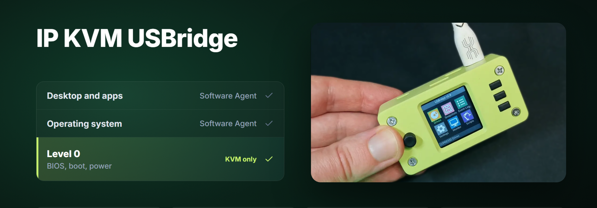

  <b>Remote access at Level 0. Zero latency. Absolute hardware autonomy.</b> 
  The Software Agent works while the system is alive. KVM 2.0 goes below it — all in one unified USBridge Client.

---

## Overview

**System frozen or won't boot? The KVM is still there.**

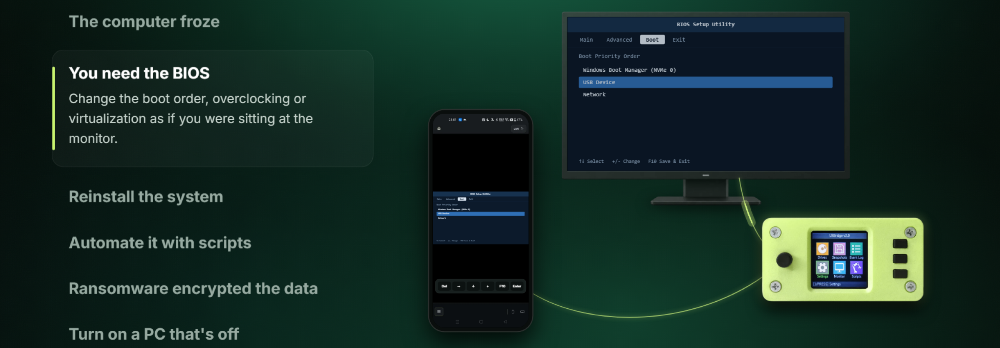

The **USBridge KVM 2.0** is an out-of-band remote management appliance operating at hardware Level 0. Whether you need BIOS/UEFI setup, boot-loader rescue, an OS reinstallation, or remote reboot of an unresponsive bare-metal server, USBridge KVM bypasses the host operating system entirely.

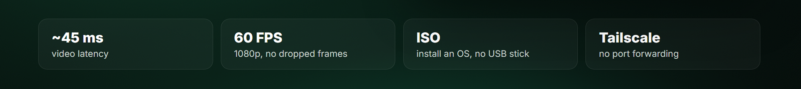

Engineered with the **Moonlight streaming protocol**, it delivers smooth **1080p @ 60 FPS** with **~45 ms ultra-low latency**, peripheral passthrough, hardware-isolated immutable Btrfs storage snapshots, and an on-device OCR engine with an MCP server for autonomous AI administration.

---

## Choose Your KVM: Four Devices, One KVM OS

Every edition runs the same unified USBridge KVM OS with regular OTA updates, REST API, Moonlight engine, and client compatibility.

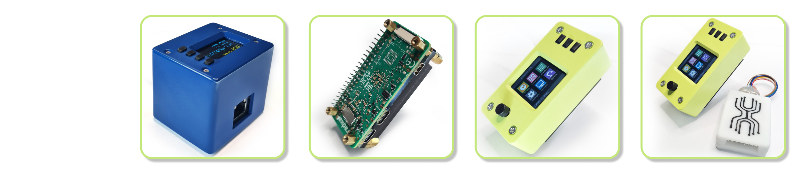

| Feature | **USBridge Nano** | **USBridge KVM 2.0 Low** | **USBridge KVM 2.0 Standard** | **USBridge KVM 2.0 Full** |
| :--- | :---: | :---: | :---: | :---: |
| **Price** | **$89** | **$99** | **$117** | **$139** |
| **Target Use** | Ultra-compact pocket KVM | Minimalist board for server racks | Complete ready-to-run desktop kit | Ultimate Pro kit with ATX & screen |
| **Base Board** | Sipeed NanoKVM (SG2002) | Radxa Zero 3W | Radxa Zero 3W | Radxa Zero 3W |
| **Processor** | 1 RISC-V core @ 1.0 GHz | 4 Cortex-A55 cores @ 1.6 GHz | 4 Cortex-A55 cores @ 1.6 GHz | 4 Cortex-A55 cores @ 1.6 GHz |
| **RAM** | 256 MB DDR3 | 1 GB LPDDR4 | 1 GB LPDDR4 | 1 GB LPDDR4 |
| **Video Capture** | Built-in HDMI (MIPI CSI) | USB 3.0 Dongle (1080p 60 FPS) | USB 3.0 Dongle (1080p 60 FPS) | USB 3.0 Dongle (1080p 60 FPS) |
| **Video Stream** | 1080p @ 60 FPS | 1080p @ 60 FPS | 1080p @ 60 FPS | 1080p @ 60 FPS |
| **Network** | Ethernet port (RJ45) | Wi-Fi 6 (Ethernet via USB hub) | Wi-Fi 6 (Ethernet via USB hub) | Wi-Fi 6 (Ethernet via USB hub) |
| **Status Screen** | 128×64 Mono OLED | — | 240×240 IPS Color Display | 240×240 IPS Color Display |
| **Enclosure** | Custom compact case | Bare board + Heatsink | Custom case | Custom case |
| **Dimensions** | 49 × 41 × 41 mm | Minimal footprint | 69 × 36 × 34 mm | 69 × 36 × 34 mm |
| **ATX Power Control** | — | Optional expansion | Optional expansion | **Included** (ATX board + wires) |
| **MicroSD with OS** | Included | Optional | Included | Included |
| **Lifetime OS License** | Included | Included | Included | Included |

---

## Already Have a Board? Install USBridge Firmware

Turn standard off-the-shelf single-board computers into an enterprise-grade out-of-band management appliance. Flash USBridge onto a board you already have — same client apps, same API, and same OTA updates on every one.

| | **Radxa Zero 3W / 3E** | **Radxa Cubie A7Z** | **Sipeed NanoKVM** |
| :--- | :---: | :---: | :---: |
| **What it is** | SBC + USB 3.0 capture card | SBC + USB 3.0 capture card | Off-the-shelf KVM, reflashed |
| **SoC** | Rockchip RK3566, 4 cores | Allwinner A733, 8 cores | SOPHGO SG2002, 1 RISC-V core |
| **Video capture** | USB 3.0 (UVC) · MIPI coming | USB 3.0 (UVC) · MIPI coming | **MIPI CSI** (built-in HDMI) |
| **Video** | 1080p60 | 1080p60 · up to 4K30 on MIPI (coming) | 1080p60 |
| **Codecs** | H.264, HEVC | H.264, HEVC | H.264, HEVC |
| **Latency** | USB: +10–15 ms vs MIPI · MIPI: lowest | USB: +10–15 ms vs MIPI · MIPI: lowest | **Lowest** (MIPI) |
| **BIOS-in-Terminal (OCR)** | ✅ NPU | ✅ CPU | — |
| **Status display** | 3W: ✅ 240×240 color LCD + [monitor mode](./docs/content/2-kvm-vkm/display-mode.md) · 3E: not yet | ✅ 240×240 color LCD + [monitor mode](./docs/content/2-kvm-vkm/display-mode.md) | ✅ built-in 128×64 mono OLED, status only |
| **Get it** | [Download firmware ➔](https://www.usbridge.io/hardware-agent/#firmware) | [Download firmware ➔](https://www.usbridge.io/hardware-agent/#firmware) | [Download firmware ➔](https://www.usbridge.io/hardware-agent/#firmware) |

**Full side-by-side — latency, audio, codecs, storage, every feature: [NanoKVM vs Radxa Zero 3W vs Cubie A7Z ➔](./docs/content/6-hardware-connectivity/board-comparison.md)**  
*Raspberry Pi and Banana Pi support is in development.*

👉 **Flashing guides:** [Flashing & Recovery Guide](./docs/content/9-updates-changelog/recovery-flashing-guide.md) · [Flash-Tool Directory](./flash-tool/)

### Connecting After Flashing:
* **Default USB Gadget IP:** `10.55.0.1`  
  Connect the board to your PC via USB. Open `http://10.55.0.1` in any browser for immediate pairing, setup QR code, Moonlight PIN, and Wi-Fi configuration.
* **Auto-Discovery:** In the desktop USBridge Client, click **`+` ➔ Over USB** to pair with the board automatically.

---

## Key Features

### [Zero Latency Streaming](./docs/content/2-kvm-vkm/video-streaming-quality.md)
* **45 ms latency**: Sub-frame hardware encoding guarantees an imperceptible delay between physical input and visual response.
* **60 FPS stream**: High-refresh-rate remote rendering for precise cursor control and fluid UI navigation.
* **Zero dropped frames**: Hardware-level network optimization ensures continuous frame delivery even under high bandwidth loads.

### [Access From Anywhere](./docs/content/7-software-access/)
One client on every device: a computer, a phone or just a browser.

* **Cross-platform native apps** for Windows, macOS, Linux, iOS, and Android.
* **Browser access**: via [web.usbridge.io](https://web.usbridge.io), or directly from the [web client](./docs/content/7-software-access/web-client.md) hosted on the KVM itself — fully operational offline.
* **Built-in Tailscale**: reach your machine from anywhere across encrypted peer-to-peer mesh with **no port forwarding** or public IP required.
* **Unified control**: the same client also runs USBridge software agents for computers without dedicated KVM hardware.

### [Virtual Media](./docs/content/5-remote-disk-image-mounting/mounting-iso-images.md)
No more USB sticks: an image connects to the computer as a real USB drive.

* **ISO mounting as CD/DVD drive**: install any operating system straight from BIOS/UEFI.
* **Direct disk booting**: mount **IMG, VDI, VMDK** images and entire host drives as [bootable physical storage](./docs/content/5-remote-disk-image-mounting/booting-from-virtual-disks.md).
* **Zero pre-upload delay**: streams directly from your computer with high-speed RAM caching for instant boot times.
* **Write protection**: **Overlay mode** redirects every write operation to a separate temporary layer, keeping your source image pristine and untouched.

### [Peripheral Emulation](./docs/content/2-kvm-vkm/keyboard-mouse-control.md)
The computer sees ordinary USB devices, with no drivers or setup.

* **Immediate keyboard response**: works from the first second in BIOS, UEFI, and bootloader environments.
* **Precise mouse control**: absolute 1:1 pointer tracking, relative mode for legacy systems, plus multi-touch and stylus support.
* **Gamepad passthrough**: emulates standard [Xbox 360 controller (XInput)](./docs/content/2-kvm-vkm/gamepad.md) or generic DirectInput.
* **Audio & Network**: host sound forwarded to your side ([audio redirection](./docs/content/2-kvm-vkm/audio-redirection.md)), microphone passthrough to the host, and USB gadget Ethernet when an OS installer lacks native NIC drivers.

### [Storage with Snapshots](./docs/content/4-snapshots-state-management/snapshots-overview.md)
Images and files on the microSD inside the KVM are safe from deletion and ransomware.

* **Automated snapshots**: 30 seconds after file write activity stops, the KVM takes a read-only snapshot autonomously.
* **Hardware-isolated immutability**: even with host `root` privileges, compromised systems cannot alter or erase completed snapshots ([security reference](./docs/content/4-snapshots-state-management/security-storage.md)).
* **Instant rollback**: need an older file? Mount any snapshot directly to copy data; the integrated log shows exact change history.
* **Standard Btrfs filesystem**: any Linux workstation can read the microSD card directly.

### [BIOS as Text Over SSH](./docs/content/3-bios-in-terminal/technology-overview.md)
The KVM reads the screen on the device itself and shows the BIOS in a normal terminal.

* **Direct SSH access**: connect via `ssh user@<kvm-ip>` — no browser, no heavy video stream required.
* **Plain text clipboard**: copy POST codes, hardware serial numbers, and MAC addresses straight from the console.
* **Keyboard navigation**: browse menus using standard arrow keys, Enter, and Esc just like a physical serial console.
* **100% on-device OCR**: optical character recognition executes entirely on local KVM hardware without cloud dependencies.

### [Scripts & AI Agents](./docs/content/3-bios-in-terminal/scripting-automation.md)
Scripts and AI see the screen as text, so BIOS chores can be automated.

* **Starlark scripting (Python syntax)**: write straightforward automation scripts that wait for target screen text and trigger deterministic keystrokes.
* **Flexible execution**: trigger scripts directly from the client interface, on-device display, or over the [REST API](./docs/content/10-developer-api/rest-api-reference.md).
* **Built-in MCP server**: integrate external AI models (such as Claude) via the [Model Context Protocol (MCP)](./docs/content/3-bios-in-terminal/mcp-ai-agents.md) to visually inspect screens, navigate BIOS menus, and mount rescue ISOs autonomously.
* **Unattended end-to-end workflows**: automated OS deployments from initial boot-override selection through partition setup to final reboot without human intervention.

### [Power Control](./docs/content/6-hardware-connectivity/power-management-module-control.md)
Power on, power off and hard reset, even when the computer is completely frozen.

* **Direct motherboard integration**: dedicated ATX board bridges directly into motherboard Front Panel Power and Reset headers.
* **Status telemetry**: real-time Power LED and HDD activity LED feedback inside the client UI.
* **Galvanic isolation**: rated up to **3.75 kV isolation** to shield the KVM from ground loops, electrical surges, and motherboard noise.
* **Accidental trigger safety**: actions require hold-to-confirm in the UI, ensuring production servers never reboot by accident.

---

## Client Downloads

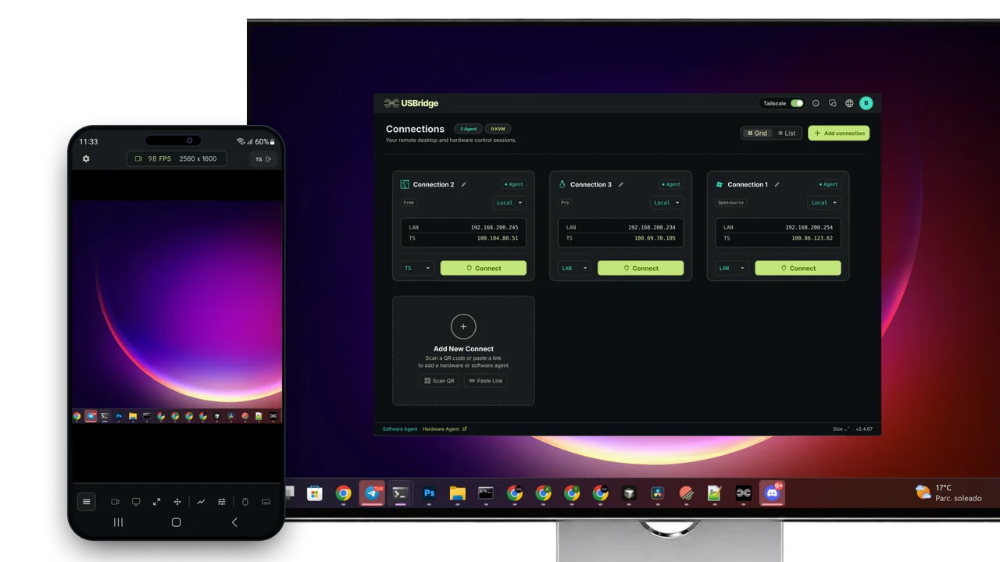

Manage your hardware KVMs and software agents from a single unified application.

**Unified Installer (Client + Software Agent):**  
[Windows Setup (.exe)](https://github.com/USBridge-Technologies/USBridge-Remote/releases/latest/download/USBridge-Windows-x86_64-Setup.exe) · [macOS Apple Silicon (.dmg)](https://github.com/USBridge-Technologies/USBridge-Remote/releases/latest/download/USBridge-macOS-arm64.dmg)

| Platform | Installer | Portable / Alternative | Store / Package Manager |
| :--- | :--- | :--- | :--- |
| **Windows** (x86_64) | [Setup (.exe)](https://github.com/USBridge-Technologies/USBridge-Remote/releases/latest/download/USBridge-Windows-x86_64-Setup.exe) | [Portable (.zip)](https://github.com/USBridge-Technologies/USBridge-Remote/releases/latest/download/USBridgeClient-Windows-x86_64.zip) | — |
| **macOS** (Apple Silicon) | [Disk Image (.dmg)](https://github.com/USBridge-Technologies/USBridge-Remote/releases/latest/download/USBridgeClient-macOS-arm64.dmg) | — | — |
| **Linux** (x86_64) | [Debian / Ubuntu (.deb)](https://github.com/USBridge-Technologies/USBridge-Remote/releases/latest/download/USBridgeClient-Linux-x86_64.deb) [Fedora / RHEL (.rpm)](https://github.com/USBridge-Technologies/USBridge-Remote/releases/latest/download/USBridgeClient-Linux-x86_64.rpm) [Arch (.pkg.tar.zst)](https://github.com/USBridge-Technologies/USBridge-Remote/releases/latest/download/USBridgeClient-Linux-x86_64.pkg.tar.zst) | [AppImage](https://github.com/USBridge-Technologies/USBridge-Remote/releases/latest/download/USBridgeClient-Linux-x86_64.AppImage) | [APT / DNF / pacman repo](https://github.com/USBridge-Technologies/USBridge-Remote#install-from-the-terminal) [Snap Store](https://snapcraft.io/usbridge-client) |
| **Android** (ARM64) | [APK (self-updating)](https://github.com/USBridge-Technologies/USBridge-Remote/releases/latest/download/USBridgeClient-Android-arm64-selfupdate.apk) | — | [Google Play](https://play.google.com/store/apps/details?id=io.usbridge.client) |
| **iOS / iPadOS** | — | — | [Apple App Store](https://apps.apple.com/us/app/usbridge-client/id6787665935) |
| **Web Browser** | — | [Open web.usbridge.io](https://web.usbridge.io) | Works in Chrome, Edge, Safari, Firefox |

*For terminal install commands and headless deployment, see the [USBridge-Remote Repository](https://github.com/USBridge-Technologies/USBridge-Remote).*

---

## Comparison: USBridge KVM 2.0 vs Other IP KVM Solutions

| Feature | **JetKVM Mini** | **USBridge KVM 2.0** | **PiKVM V4 Mini** | **TinyPilot Voyager 3** |
| :--- | :---: | :---: | :---: | :---: |
| **Price** | $39 | **from $99** | from $252 | $399 |
| **Video Resolution & Rate** | 1080p @ 30 / 720p @ 60 | **1080p @ 60 FPS** | 1920 × 1200 @ 60 FPS | 1920 × 1200 @ 60 FPS |
| **Video Latency** | Not stated | **~45 ms (Moonlight)** | Not stated | 80–100 ms |
| **Network Interfaces** | 100 Mbps Ethernet / Wi-Fi | **Wi-Fi 6**, Ethernet via USB | Gigabit Ethernet | Gigabit Ethernet |
| **ATX Power Control** | ❌ | ✅ **Included in Full** (Isolated) | ✅ | ❌ |
| **Virtual Media (ISO/IMG)** | ✅ | ✅ **Fast RAM cache + Overlay** | ✅ | ✅ |
| **On-Device Status Screen** | ✅ | ✅ **240×240 IPS Color** | ✅ | ✅ |
| **Immutable Storage Snapshots** | ❌ | ✅ **Btrfs Read-Only Snapshots** | ❌ | ❌ |
| **BIOS-in-Terminal & AI (OCR, MCP)** | ❌ | ✅ **Local OCR + MCP Server** | ❌ | Paid license |

> [!NOTE]
> **What about the USBridge Nano?**
> The **USBridge Nano** ($89) is an ultra-compact pocket appliance based on the Sipeed SG2002 RISC-V SoC with native MIPI CSI HDMI capture. It is intended for administrators seeking the smallest form factor with built-in Ethernet, running the same USBridge OS streaming core.

---

## Technical Specifications & Quick Start Guides

<b>1. USBridge Nano — Setup & Specifications (Ultra-Compact Pocket KVM)</b>

 

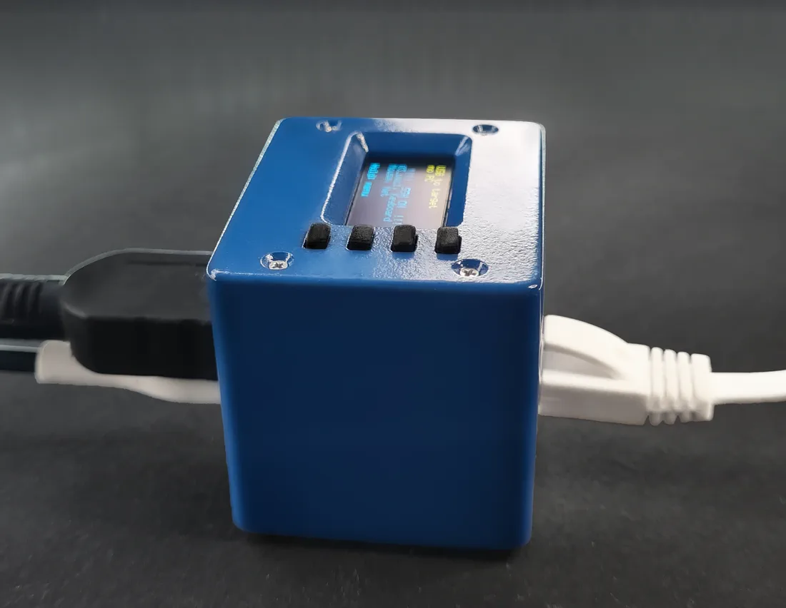

### Technical Specifications
| Specification | Details |
| :--- | :--- |
| **Board** | Sipeed NanoKVM (SG2002) |
| **Processor** | RISC-V C906, 1 core, 1 GHz |
| **Memory** | 256 MB DDR3 |
| **Video** | HDMI capture, 1080p 60 FPS |
| **Control** | USB HID keyboard and mouse, virtual ISO drive, gamepads |
| **Audio** | Audio output and microphone in both directions |
| **Network** | 100 Mbit Ethernet port |
| **Remote Access** | USBridge Client, web interface, Tailscale P2P, Moonlight |
| **Power** | USB-C |
| **Screen** | 128×64 Mono OLED |
| **Dimensions with Case** | 49 × 41 × 41 mm |
| **System** | USBridge OS on the included MicroSD card |

### Set Up in 3 Steps

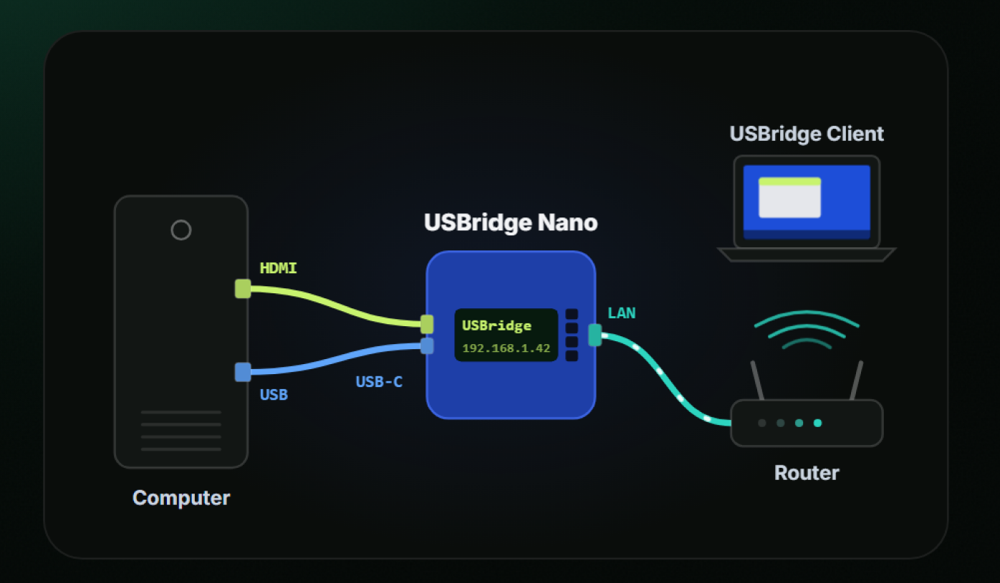

1. **HDMI:** Connect HDMI cable from target computer video out directly to the Nano HDMI port.
2. **USB-C:** Connect USB-C cable from Nano to the computer. It powers the Nano and emulates keyboard, mouse, and virtual media.
3. **Ethernet:** Plug network cable from your router/switch into the 100 Mbit Ethernet port.

 

<b>2. USBridge KVM 2.0 Low — Setup & Specifications (Minimalist Board for Server Racks)</b>

 

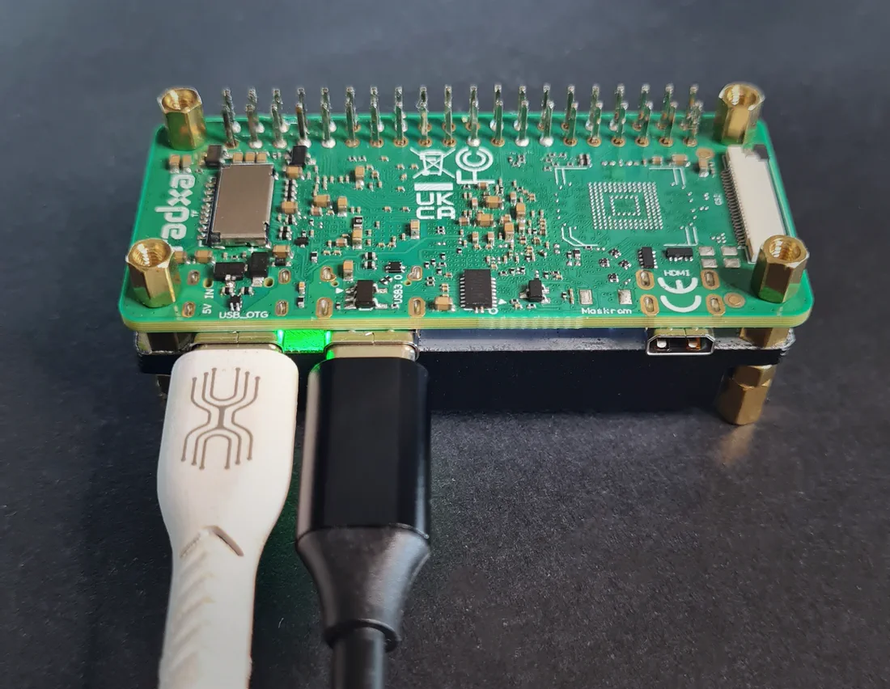

### Technical Specifications
| Specification | Details |
| :--- | :--- |
| **Board** | Radxa Zero 3W |
| **Processor** | Rockchip RK3566, 4 Cortex-A55 cores up to 1.6 GHz |
| **Memory** | 1 GB LPDDR4 |
| **Video** | HDMI capture, 1080p 60 FPS, about 45 ms latency |
| **Control** | USB HID keyboard and mouse, gamepads, virtual drive for ISO, IMG, VDI, VMDK |
| **Audio** | Audio from the computer |
| **Network** | Onboard Wi-Fi 6 and Bluetooth. Ethernet through a USB hub with a network port (hub not included) |
| **Remote Access** | USBridge Client, web interface, Tailscale P2P |
| **Power** | USB-C |
| **Ports** | USB-C 2.0 (to the computer), USB-C 3.0 (capture dongle), Micro HDMI |
| **Case** | No case, bare board with heatsink |
| **Cooling** | Passive, aluminum heatsink |
| **MicroSD Card** | Not included, +$5 optional |
| **System** | USBridge KVM OS, Btrfs snapshots, over-the-air updates |

### Set Up in 3 Steps

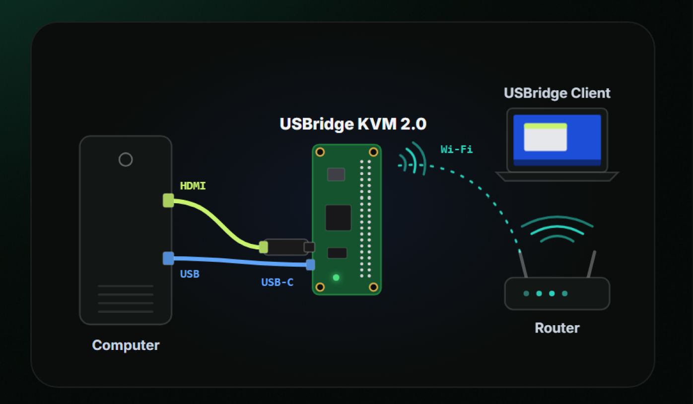

1. **HDMI:** HDMI cable from the computer to the video capture dongle on the KVM.
2. **USB-C (OTG):** Connect USB-C cable to the target computer for power and peripheral emulation.
3. **Network:** Connect via Wi-Fi 6, USB Ethernet adapter, or USB gadget mode (`10.55.0.1`).

 

<b>3. USBridge KVM 2.0 Standard — Setup & Specifications (Complete Desktop Kit)</b>

 

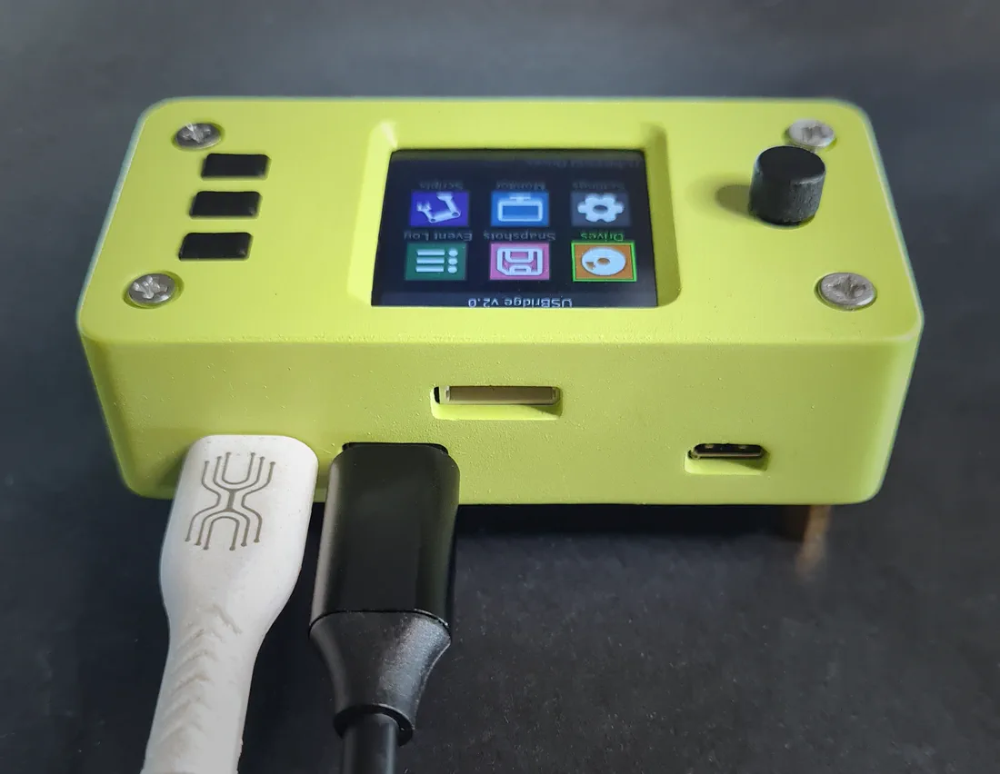

### Technical Specifications
| Specification | Details |
| :--- | :--- |
| **Board** | Radxa Zero 3W |
| **Processor** | Rockchip RK3566, 4 Cortex-A55 cores up to 1.6 GHz |
| **Memory** | 1 GB LPDDR4 |
| **Video** | HDMI capture, 1080p 60 FPS, about 45 ms latency |
| **Control** | USB HID keyboard and mouse, gamepads, virtual drive for ISO, IMG, VDI, VMDK |
| **Audio** | Audio from the computer |
| **Network** | Onboard Wi-Fi 6 and Bluetooth. Ethernet through a USB hub with a network port (hub not included) |
| **Remote Access** | USBridge Client, web interface, Tailscale P2P |
| **Power** | USB-C |
| **Ports** | USB-C 2.0 (to the computer), USB-C 3.0 (capture dongle), Micro HDMI, 8-pin header for the ATX board |
| **Case** | Custom case |
| **Screen** | 1.3" full-color IPS, 240×240 (ST7789, SPI), 3 buttons and a 5-way joystick |
| **Dimensions with Case** | 69 × 36 × 34 mm |
| **MicroSD Card** | With USBridge KVM OS, included |
| **System** | USBridge KVM OS, Btrfs snapshots, over-the-air updates |

### Set Up in 3 Steps

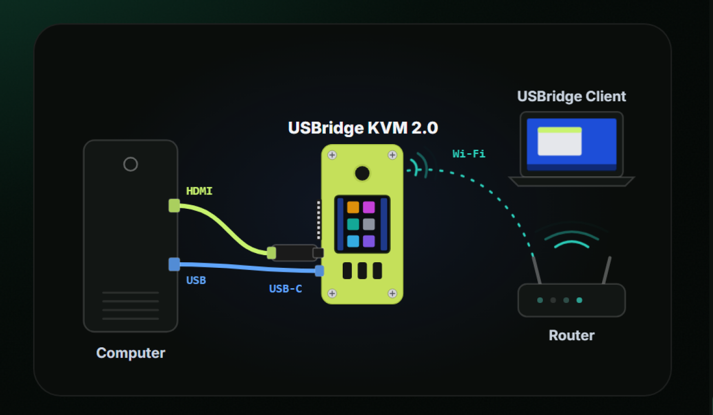

1. **HDMI:** Connect HDMI cable from computer GPU output to the included capture dongle.
2. **USB-C (Port 1):** Link Port 1 to the host computer for power, keyboard, mouse, and virtual drives.
3. **Network:** Pair via onboard Wi-Fi 6 using the interactive status screen or connect over USB (`10.55.0.1`).

 

<b>4. USBridge KVM 2.0 Full — Setup & Specifications (Ultimate Pro Kit + ATX)</b>

 

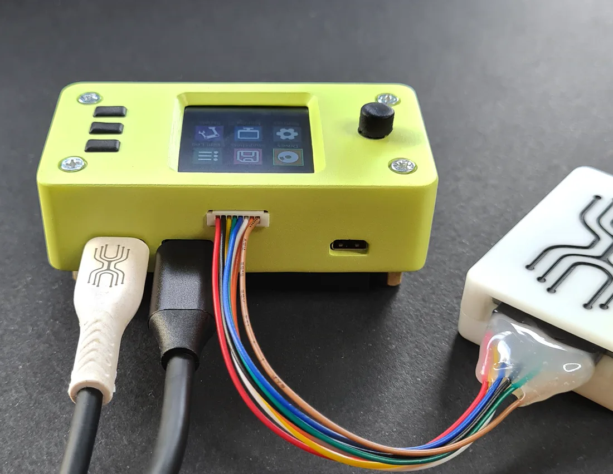

### Technical Specifications
| Specification | Details |
| :--- | :--- |
| **Board** | Radxa Zero 3W |
| **Processor** | Rockchip RK3566, 4 Cortex-A55 cores up to 1.6 GHz |
| **Memory** | 1 GB LPDDR4 |
| **Video** | HDMI capture, 1080p 60 FPS, about 45 ms latency |
| **Control** | USB HID keyboard and mouse, gamepads, virtual drive for ISO, IMG, VDI, VMDK |
| **Audio** | Audio from the computer |
| **Network** | Onboard Wi-Fi 6 and Bluetooth. Ethernet through a USB hub with a network port (hub not included) |
| **Remote Access** | USBridge Client, web interface, Tailscale P2P |
| **Power** | USB-C |
| **Ports** | USB-C 2.0 (to the computer), USB-C 3.0 (capture dongle), Micro HDMI, 8-pin header for the ATX board |
| **Case** | Custom case |
| **Screen** | 1.3" full-color IPS, 240×240 (ST7789, SPI), 3 buttons and a 5-way joystick |
| **ATX Power** | Power on, power off (normal and forced), reset. Optocoupler (galvanic isolation). ATX, Micro-ATX, Mini-ITX |
| **Dimensions with Case** | 69 × 36 × 34 mm |
| **Cooling** | Passive, aluminum heatsink |
| **MicroSD Card** | With USBridge KVM OS, included |
| **System** | USBridge KVM OS, Btrfs snapshots, over-the-air updates |

### Set Up in 4 Steps

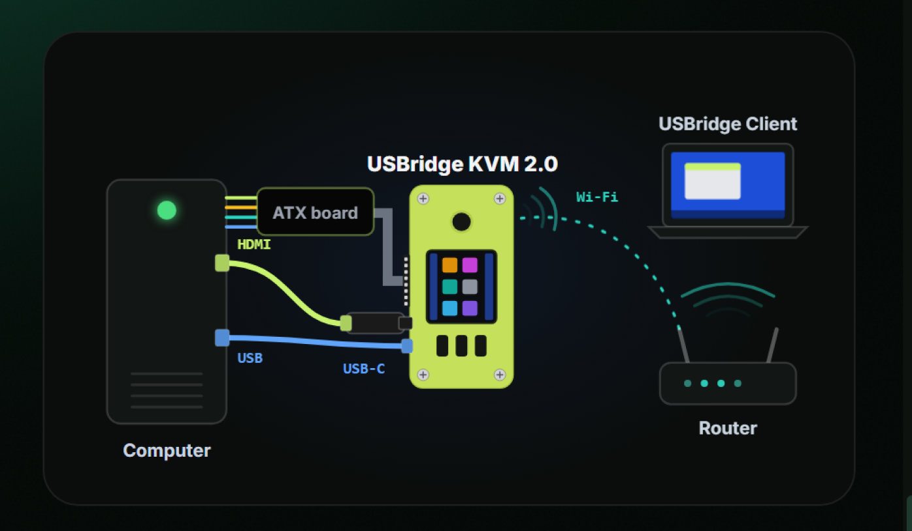

1. **HDMI:** Connect HDMI cable from target computer GPU/motherboard to the capture dongle.
2. **USB-C (Port 1):** Connect Port 1 to computer USB port for power, input emulation, and virtual storage.
3. **ATX Control Board:** Plug the ribbon cable into KVM 8-pin GPIO, then bridge jumper wires to motherboard Front Panel (`PWR_SW`, `RESET`, `P_LED`, `H_LED`).
4. **Network:** Configure Wi-Fi 6 via the on-device display/joystick or connect directly over USB gadget mode.

---

## DIY KVM Setup: Full BIOS Control in 3 Minutes

Provision a supported SBC, flash the firmware image, and connect a standard USB capture interface to deploy your own IP-KVM.

### 1. Hardware Checklist (Bill of Materials)

| Component | Description |
| :--- | :--- |
| **Supported SBC** | Radxa Zero 3W / 3E, Radxa Cubie A7Z; also the off-the-shelf [Sipeed NanoKVM](./docs/content/6-hardware-connectivity/nanokvm.md) (HDMI capture built in). Which to pick: [board comparison](./docs/content/6-hardware-connectivity/board-comparison.md). |
| **HDMI-to-USB Capture Card** | Generic MS2109 (7–12$), or standard UVC dongle. |
| **MicroSD Card (2GB+)** | Standard 2GB+ capacity. Class 10 or higher recommended for fast boot times. |
| **Optional: Status Screen** | 1.3" 240×240 LCD: the [USBridge 1.3" LCD Flip-HAT](https://www.usbridge.io/hardware-agent/#buy-screen-module) (mirrored pinout, SoC stays against the heatsink) or the standard [Waveshare 1.3" LCD HAT](https://www.waveshare.com/1.3inch-lcd-hat.htm). Fits both the Radxa Zero 3W and the Cubie A7Z; not supported on the Zero 3E yet. Fully optional: the system runs headless via a single config file. |

### 2. 3-Minute Flashing Guide (Video Tutorial)

Watch the complete guide on how to flash the firmware and perform the first boot.

**Quick Links for Setup:**
* [Step-by-step Flashing Guide](./docs/content/9-updates-changelog/recovery-flashing-guide.md)
* [Headless Provisioning Guide](./docs/content/1-getting-started/headless-provisioning.md)
* [Full Documentation](./docs/README.md)

---

## Accessories

| Accessory | Description | Details |
| :--- | :--- | :--- |
| [**Screen Module (Flip-HAT 1.3" LCD)**](https://www.usbridge.io/hardware-agent/#buy-screen-module) | 240×240 IPS status screen designed specifically for Zero-factor boards. Mounts on the back of the PCB so the CPU remains open for large heatsinks and active cooling. | [LCD Flip-HAT Specs](./Hardware/Accessories/Screen-Module/) |
| [**Power Control Board (ATX)**](https://www.usbridge.io/hardware-agent/#buy-power-board) | Galvanically isolated (up to 3.75 kV) front-panel adapter board for Power, Reset, Power LED, and HDD LED headers. | [ATX Board Guide](./Hardware/Accessories/ATX-Board/) |
| [**HDMI Capture Dongle (1080p @ 60 FPS)**](https://www.usbridge.io/hardware-agent/#buy-capture-card) | High-throughput UVC video capture card optimized for USB 3.0 `[5G]` mode and sub-frame hardware encoding. | [Capture Dongle Specs](./Hardware/Accessories/Capture-Dongle/) |

---

## Unified Ecosystem: [USBridge-Remote](https://github.com/USBridge-Technologies/USBridge-Remote)

Control your entire infrastructure from a single point using **[USBridge-Remote](https://github.com/USBridge-Technologies/USBridge-Remote)** — our dedicated cross-platform agent application. It enables a hybrid access approach within a single interface, combining hardware and software-level management:

* **Hardware Level (Layer 0):** Add USBridge-KVM devices for direct BIOS access, virtual media mounting, and bare-metal recovery of unresponsive machines.
* **Software Level (OS-level):** Deploy this lightweight software agent inside an already booted operating system for high-performance desktop management without KVM hardware dependency.

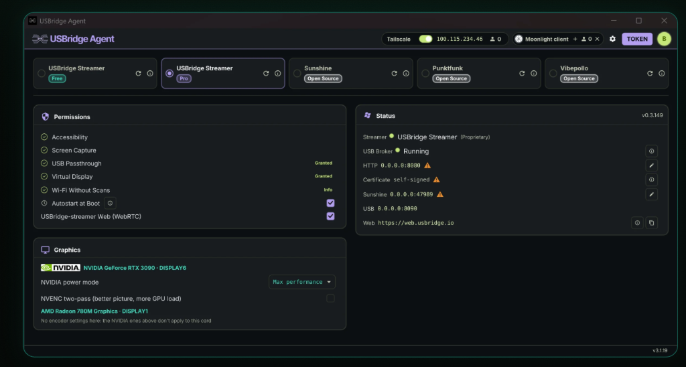

### Multi-Protocol & Streamer Engine Support
The USBridge Agent features a modular streaming architecture allowing you to switch between streaming engines on the fly based on your latency, hardware encoder, and workflow requirements:
* **USBridge Streamer (Free & Pro)**: Our proprietary ultra-low latency engine optimized for NVENC/VAAPI/Apple Silicon hardware encoding, virtual displays, seamless USB device passthrough, and WebRTC browser streaming.
* **Sunshine**: Native support for the popular open-source GameStream host implementation.
* **Punktfunk**: High-speed, lightweight open-source remote access protocol.
* **Vibepollo**: Optimized protocol for specialized streaming pipelines and low-overhead control.

### Agent Download Matrix

The agent runs as a background service on your target OS (servers, remote workstations, or headless nodes) to stream the desktop and execute system-level commands.

| Platform | Downloads | Store / Package Manager |
| :--- | :--- | :--- |
| **Windows** (x86_64) | [Setup (.exe)](https://github.com/USBridge-Technologies/USBridge-Remote/releases/latest/download/USBridgeAgent-Windows-x86_64-Setup.exe) [Portable (.zip)](https://github.com/USBridge-Technologies/USBridge-Remote/releases/latest/download/USBridgeAgent-Windows-x86_64.zip) | Windows Service background autostart |
| **macOS** (Apple Silicon) | [Disk image (.dmg)](https://github.com/USBridge-Technologies/USBridge-Remote/releases/latest/download/USBridgeAgent-macOS-arm64.dmg) | macOS background daemon |
| **Linux** (x86_64) | [Debian / Ubuntu (.deb)](https://github.com/USBridge-Technologies/USBridge-Remote/releases/latest/download/USBridgeAgent-Linux-x86_64.deb) [Fedora / RHEL (.rpm)](https://github.com/USBridge-Technologies/USBridge-Remote/releases/latest/download/USBridgeAgent-Linux-x86_64.rpm) [Arch (.pkg.tar.zst)](https://github.com/USBridge-Technologies/USBridge-Remote/releases/latest/download/USBridgeAgent-Linux-x86_64.pkg.tar.zst) [AppImage (portable)](https://github.com/USBridge-Technologies/USBridge-Remote/releases/latest/download/USBridgeAgent-Linux-x86_64.AppImage) | Systemd service |

More on the Agent: [USBridge-Remote Repository](https://github.com/USBridge-Technologies/USBridge-Remote#agent).

---

## Documentation & Hardware Reference

Complete technical guides are located in the [`docs/`](./docs/README.md) directory:

* **[Getting Started & Provisioning](./docs/content/1-getting-started/)** — Quick start, network configuration, and headless bulk setup.
* **[BIOS-in-Terminal & OCR](./docs/content/3-bios-in-terminal/)** — Local OCR engine, SSH terminal access, and Starlark scripting.
* **[Snapshots & Storage Management](./docs/content/4-snapshots-state-management/)** — Btrfs snapshots, rollback, and security.
* **[Virtual Media Mounting](./docs/content/5-remote-disk-image-mounting/)** — Mounting ISOs, bootable disks, and RAM cache.
* **[Hardware Reference & Pinouts](./docs/content/6-hardware-connectivity/)** — Architecture, board comparison, and power thermal guidelines.
* **[Developer REST API](./docs/content/10-developer-api/)** — Full API reference for headless integrations and custom scripting.
* **[Hardware Models & Schematics](./Hardware/)** — PCB files and 3D printable STL/STEP enclosures.

---

## Community & Independent Reviews

| Creator / Channel | Review / Tutorial | Link |
| :--- | :--- | :--- |
| **Learn To HomeLab** | *Is This The Best KVM On The Market?* | [Watch Review](https://www.youtube.com/watch?v=U3GhuyD-gzw) |
| **Barmine Tech** | *The Best KVM I've Used? USBridge KVM 2.0 (Independent Review)* | [Watch Review](https://www.youtube.com/watch?v=DA_hMD3T0Qg) |
| **Jonatan Castro** | *Unboxing & What's in the box (Spanish)* | [Watch Review](https://www.youtube.com/watch?v=7YJS81rI3U8&t) |
| **USBridge Official** | *NanoKVM with USBridge firmware: 60 FPS instead of lag* | [Watch on YouTube](https://youtu.be/q8rX7o-Svqs) |
| **USBridge Official** | *Official Overview & Feature Walkthrough* | [Watch on YouTube](https://youtu.be/4h5Q8XpDzqI) |
| **USBridge Official** | *Assembly & Packaging of USBridge KVM 2.0* | [Watch on YouTube](https://youtu.be/l6QtajSYtwQ) |

Join our community on [Discord](https://discord.gg/XwNpCrGfsB) and [Reddit](https://www.reddit.com/r/USBridge/) to discuss homelab setups, custom automation scripts, and firmware updates!
