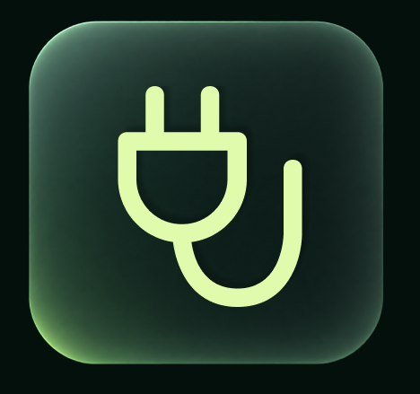
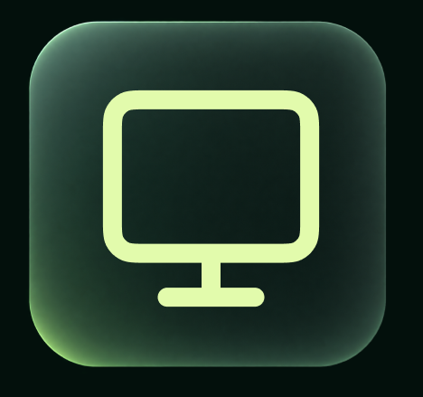
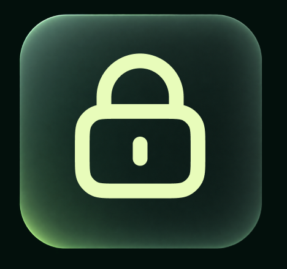
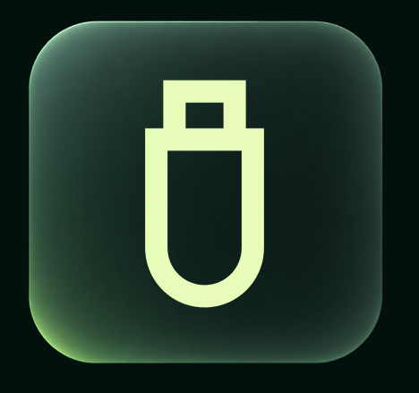
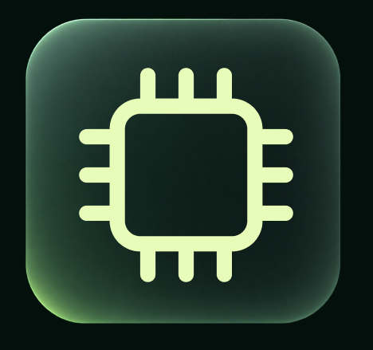
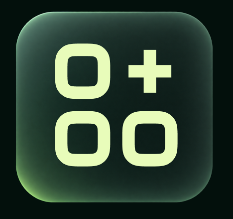
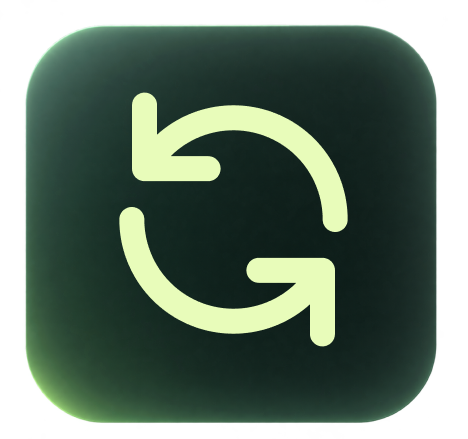

# USBridge Technical Documentation

**USBridge** is a hardware & firmware ecosystem for out-of-band server management — delivering **1080p 60 FPS** Moonlight streaming, BIOS-in-Terminal (SSH + OCR), virtual media mounting, and immutable Btrfs snapshots with zero software agents on the target machine.

> **Supported Hardware:**
> * **Ready-to-use Appliances:** [USBridge KVM 2.0](../Hardware/) ([Low](../Hardware/Kits/USBridge-KVM-2.0-Low/) / [Standard](../Hardware/Kits/USBridge-KVM-2.0-Standard/) / [Full](../Hardware/Kits/USBridge-KVM-2.0-Full/)), [USBridge Nano](../Hardware/Kits/USBridge-Nano/)
> * **DIY Boards (USBridge Firmware):** [Sipeed NanoKVM (SG2002)](../Hardware/Kits/USBridge-Nano/#already-own-a-sipeed-nanokvm-upgrade-it), [Radxa Zero 3W / Cubie A7Z](../Hardware/Kits/USBridge-KVM-2.0-Low/#diy-kvm-setup-turn-your-sbc-into-an-ip-kvm)

Use the categorized hub below to jump to hardware setup, streaming engine configuration, automation scripting, or REST API docs.

---

<table width="100%" style="width: 100%; display: table; table-layout: fixed; border-collapse: collapse;">
<tbody>
<tr>
<td valign="top" width="50%">

 <strong>Getting Started</strong>
 
Unbox, wire up, and initialize your physical KVM appliance.
<ul>
<li><strong>Quick Start Guides:</strong>
  <ul>
    <li><a href="./content/1-getting-started/quick-start.md">USBridge KVM 2.0</a></li>
    <li><a href="./content/1-getting-started/quick-start-nano.md">USBridge Nano & Sipeed NanoKVM</a></li>
    <li><a href="./content/1-getting-started/quick-start-radxa.md">Radxa Boards (DIY)</a></li>
  </ul>
</li>
<li><a href="./content/1-getting-started/whats-in-the-box.md">What’s in the Box</a></li>
<li><a href="./content/1-getting-started/initial-setup.md">Initial Client Setup</a></li>
<li><a href="./content/1-getting-started/headless-provisioning.md">Headless & Bulk Provisioning (JSON)</a></li>
<li><a href="./content/1-getting-started/device-status-menu.md">Onboard Status & Menu Layout</a></li>
</ul>
</td>
<td valign="top" width="50%">

 <strong>KVM Engine</strong>
 
Configure streaming parameters, peripheral overlays, and inputs.
<ul>
<li><a href="./content/2-kvm-vkm/video-streaming-quality.md">Video Streaming & Quality (Moonlight)</a></li>
<li><a href="./content/2-kvm-vkm/keyboard-mouse-control.md">Keyboard & Mouse Emulation (HID)</a></li>
<li><a href="./content/2-kvm-vkm/gamepad.md">Gamepad Emulation (HID)</a></li>
<li><a href="./content/2-kvm-vkm/audio-redirection.md">Audio Redirection Specification</a></li>
<li><a href="./content/2-kvm-vkm/network.md">USB-LAN Network Bridge (RNDIS)</a></li>
<li><a href="./content/2-kvm-vkm/display-mode.md">Local Display Mode (On-Device Server Screen)</a></li>
</ul>
</td>
</tr>
<tr>
<td valign="top">

 <strong>BIOS-in-Terminal</strong>
 
Low-level raw terminal redirection and headless control text streams.
<ul>
<li><a href="./content/3-bios-in-terminal/technology-overview.md">Technology Overview</a></li>
<li><a href="./content/3-bios-in-terminal/supported-bios-uefi-types.md">Supported BIOS/UEFI Types</a></li>
<li><a href="./content/3-bios-in-terminal/logging-automation.md">Automation & AI Agents: Overview</a></li>
<li><a href="./content/3-bios-in-terminal/scripting-automation.md">Starlark Scripting Reference</a></li>
<li><a href="./content/3-bios-in-terminal/mcp-ai-agents.md">AI Agent Integration (MCP)</a></li>
</ul>
</td>
<td valign="top">

 <strong>Snapshots & States</strong>
 
Btrfs-driven immutable file storage and read-only data snapshots.
<ul>
<li><a href="./content/4-snapshots-state-management/snapshots-overview.md">Snapshots Architecture Overview</a></li>
<li><a href="./content/4-snapshots-state-management/creating-managing-snapshots.md">Creating & Managing State Files</a></li>
<li><a href="./content/4-snapshots-state-management/security-storage.md">Security & Immutable Storage Rules</a></li>
</ul>
</td>
</tr>
<tr>
<td valign="top">

 <strong>Virtual Media & Drive Emulation</strong>
 
High-speed bare-metal OS provisioning and diskless booting via virtual block devices.
<ul>
<li><a href="./content/5-remote-disk-image-mounting/mounting-iso-images.md">Mounting ISO Images</a></li>
<li><a href="./content/5-remote-disk-image-mounting/booting-from-virtual-disks.md">Booting Server from Workstation Drives & VMs</a></li>
</ul>
</td>
<td valign="top">

 <strong>Hardware & Power</strong>
 
Physical pinouts, schematic internals, power logic, and cooling.
<ul>
<li><a href="../Hardware/">Hardware Catalog & Models Overview</a></li>
<li><a href="./content/6-hardware-connectivity/board-comparison.md">Board Comparison: NanoKVM vs Zero 3W vs Cubie A7Z</a></li>
<li><a href="./content/6-hardware-connectivity/nanokvm.md">Sipeed NanoKVM Reference</a></li>
<li><a href="./content/6-hardware-connectivity/ports-connectors-reference.md">Ports & Connectors Reference</a></li>
<li><a href="./content/6-hardware-connectivity/power-thermal.md">Power Limits & Thermal Behavior</a></li>
<li><a href="./content/6-hardware-connectivity/architecture.md">SoC Platform Architecture</a></li>
<li><a href="./content/6-hardware-connectivity/power-management-module-control.md">PMM Relay Controlling</a></li>
</ul>
</td>
</tr>
<tr>
<td valign="top">

 <strong>Software Apps</strong>
 
Cross-platform management clients and mobile application runtimes.
<ul>
<li><a href="./content/7-software-access/desktop-app.md">Desktop Client (Win / Mac / Linux)</a></li>
<li><a href="./content/7-software-access/mobile-app.md">Mobile Companion App</a></li>
<li><a href="./content/7-software-access/web-client.md">Web Client (Browser, Zero-Install)</a></li>
</ul>
</td>
<td valign="top">

 <strong>Maintenance</strong>
 
General troubleshooting routines and emergency system recoveries.
<ul>
<li><a href="./content/8-maintenance-support/faq.md">Frequently Asked Questions</a></li>
<li><a href="./content/8-maintenance-support/factory-reset.md">Factory Reset Protocol</a></li>
</ul>
</td>
</tr>
<tr>
<td valign="top" width="50%">

 <strong>Developer & API Reference</strong>
 
Direct HTTP access for custom integrations, scripts, and AI agents.
<ul>
<li><a href="./content/10-developer-api/rest-api-reference.md">REST API Reference</a></li>
<li><a href="./content/10-developer-api/security-model.md">Security & Authentication Model</a></li>
<li><a href="./content/3-bios-in-terminal/scripting-automation.md">Starlark Scripting Reference</a></li>
<li><a href="./content/3-bios-in-terminal/mcp-ai-agents.md">AI Agent Integration (MCP)</a></li>
</ul>
</td>
<td valign="top" width="50%">

 <strong>Updates, Blueprints & Changelogs</strong>
 
Firmware releases, recovery flashing guides, and hardware CAD files.
<ul>
<li><a href="./content/9-updates-changelog/firmware-update-guide.md">Firmware Update Guide</a></li>
<li><a href="./content/9-updates-changelog/recovery-flashing-guide.md">USB Recovery Flashing Guide</a></li>
<li><a href="./content/9-updates-changelog/3d-models-pcb-files.md">3D Models & PCB Files</a></li>
</ul>
</td>
</tr>
</tbody>
</table>
