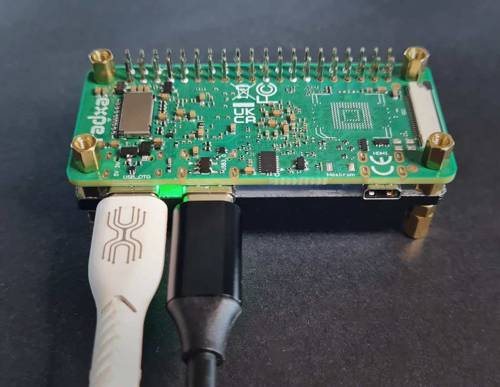
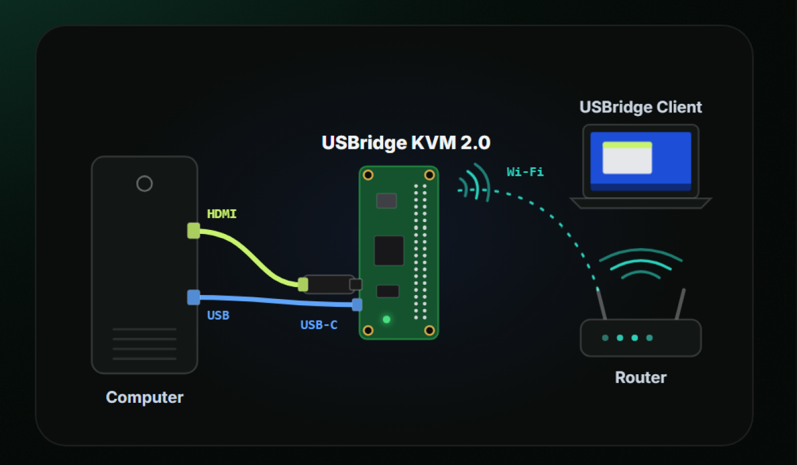

# Quick Start: USBridge KVM 2.0 Low

This guide covers the hardware setup, initial headless connection, and provisioning for the **USBridge KVM 2.0 Low** appliance.

---

## 1. What's in the Box

* **Radxa Zero 3W Board**: Pre-configured single-board computer powered by the Rockchip RK3566 quad-core SoC with 1 GB LPDDR4 memory.
* **Extruded Aluminum Heatsink**: High-efficiency passive cooling block pre-mounted for silent thermal dissipation.
* **USB 3.0 HDMI Video Capture Dongle**: High-throughput 1080p @ 60 FPS UVC capture stick.
* **Pre-installed MicroSD card**: High-endurance card pre-flashed with USBridge OS.
* **Full lifetime USBridge OS license**: Included with the device (no subscriptions, recurring fees, or renewal charges).

---

## 2. Physical Ports & Connectors

* **USB-C 3.0 (Host Capture Port)**: Connects to the included USB 3.0 HDMI capture dongle to stream video from the target server.
* **USB-C 2.0 (OTG / Host HID & Power)**: Connects to an available USB port on the target server. Delivers power and provides hardware-level keyboard, mouse, and virtual ISO media emulation.
* **Micro HDMI**: Mirror video output for connecting a local physical monitor directly at the server or rack.
* **MicroSD Slot**: Holds the operating system and immutable Btrfs storage volume.
* **40-Pin Expansion Header**: Allows modular attachment of the optional Screen Module or ATX power control accessories.

---

## 3. 3-Step Hardware Setup

1. **HDMI Cable**: Connect an HDMI cable from the target computer's GPU / motherboard video output into the included USB 3.0 capture dongle plugged into the KVM Host port.
2. **USB-C OTG Cable**: Connect a USB-C cable from Port 1 (OTG) to a USB port on the target computer. This single cable delivers power, keyboard/mouse emulation, and virtual storage mounting.
3. **Network Connection**: Connect via onboard Wi-Fi 6 or attach an external USB-to-Ethernet adapter to the host port.

### Capture Dongle Cable Orientation (`[5G]` vs `[480M]`)

The USB 3.0 HDMI capture dongle negotiates in either of two hardware modes depending on the physical orientation of the USB-C plug:

* **`[5G]` Mode (SuperSpeed USB 3.0 — Target Mode)**: Full 5 Gbps bus bandwidth, uncompressed YUY2/NV12 video, zero JPEG compression artifacts, and minimal input latency (~45 ms).
* **`[480M]` Mode (High-Speed USB 2.0 — Fallback Mode)**: Compatibility fallback running at 480 Mbps. The stream falls back to lossy MJPEG compression with visible artifacts, color banding, and increased latency.

> [!IMPORTANT]
> **How to ensure `[5G]` Mode:**  
> Check the connection badge in the USBridge client interface. If you see **`[480M]`**, simply **unplug the USB-C cable from the KVM Host port, rotate the plug 180°, and plug it back in**. The dongle will immediately renegotiate into high-speed **`[5G]`** mode.

---

## 4. Connect & Initial Setup

Because the **Low** edition operates headlessly without an onboard screen, choose one of the two quick pairing methods below. For comprehensive pairing details, master key mechanics, and client walkthroughs, refer to the **[Initial Client Setup Guide](./initial-setup.md)**.

### Method A: Default IP Address (`10.55.0.1` over USB)

Plug the KVM's USB-C OTG cable directly into your workstation or laptop: your computer immediately gets a virtual USB network adapter (its own internet connection remains completely untouched), and the KVM is reachable at **`10.55.0.1`**.

1. **Desktop Client**: Open the [Desktop Client App](../7-software-access/desktop-app.md) and click **`+` ➔ Over USB**. The app detects the KVM over the cable and pairs with a single click.
2. **Web Browser**: Alternatively, open **`http://10.55.0.1`** in any web browser to access the onboard setup page:
   * Displays the QR code for fast pairing
   * Direct connection link and device master key
   * Moonlight PIN authorization
   * Wi-Fi network configuration settings

### Method B: Headless Provisioning (`usbridge_provision.json`)

Ideal for server racks, homelabs, or unattended deployments where you want the appliance to connect to your Wi-Fi network automatically on first boot:

1. Insert the MicroSD card into your computer's card reader.
2. Open the **`BOOT`** partition (readable by Windows, macOS, and Linux).
3. Create a plain text configuration file named **`usbridge_provision.json`** containing your Wi-Fi credentials and master key.
4. Eject the card, insert it into the KVM 2.0 Low, and power on. The device connects to your network automatically.

> [!TIP]
> For detailed configuration parameters, JSON schema, and examples, see the **[Headless Provisioning Guide](./headless-provisioning.md)**.

---

## 5. Modular Upgrades

The Low edition is fully modular:
* **Add Screen & Joystick**: Plug the **[USBridge Screen Module](../../../Hardware/Accessories/Screen-Module/)** onto the 40-pin GPIO header at any time to upgrade your unit to a Standard edition with on-device telemetry and physical buttons.
* **Add Hardware Power Control**: Connect the **[ATX Power Control Board](../../../Hardware/Accessories/ATX-Board/)** to the Screen Module for remote server power, reset, and LED telemetry.

---

* 👉 For full technical specifications, Btrfs storage details, and 3D-printable enclosure CAD files, see the **[USBridge KVM 2.0 Low Hardware Reference](../../../Hardware/Kits/USBridge-KVM-2.0-Low/)**.
