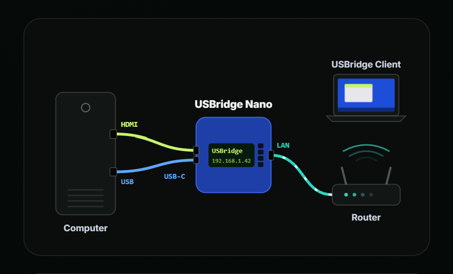

# Quick Start: USBridge Nano

This guide covers the hardware setup and initial connection for the **USBridge Nano** appliance.

---

## 1. What's in the Box

* **USBridge Nano unit**: Fully assembled in a custom protective metal enclosure with an integrated OLED status screen and physical control buttons.
* **Pre-installed MicroSD card**: High-endurance card pre-flashed with USBridge OS.
* **Full lifetime USBridge OS license**: Included with the device (no subscriptions, recurring fees, or renewal charges).

---

## 2. Physical Ports & Connectors

* **HDMI IN**: Connects to the HDMI video output of the target server or host machine.
* **USB-C (Host HID & Power)**: Single multi-function USB-C port that connects to an available USB port on the target server. It simultaneously powers the Nano and provides hardware-level keyboard, mouse, and virtual media block emulation.
* **Ethernet (RJ45)**: 100 Mbit Ethernet interface connecting to your local network router or switch (DHCP enabled).
* **OLED Screen (128×64)**: Real-time display showing the assigned device IP address, network connection state, streaming FPS, and one-time physical presence codes for secure SSH access.

---

## 3. Hardware Setup & First Connection

1. **Connect HDMI**: Run an HDMI cable from the target server into the Nano's **HDMI IN** port.
2. **Connect HID & Power**: Plug the USB-C cable from the Nano's USB-C port into a USB port on the target server (provides power and keyboard/mouse emulation). Alternatively, you can use an external 5V/2A power supply on this port.
3. **Connect Network**: Plug an Ethernet cable into the **RJ45** port connected to your local network.
4. **Boot Up**: The device boots automatically from the pre-flashed MicroSD card. Within seconds, the onboard OLED screen will display the assigned DHCP IP address.

---

## 4. Initial Client Pairing

1. Open the [Desktop Client App](../7-software-access/desktop-app.md) or [Web Client](https://web.usbridge.io).
2. Discover the Nano device automatically on your local network, or manually enter the IP address displayed on the OLED screen.
3. Verify your secure session using the physical presence code shown on the OLED display.

---

* 👉 For full hardware specifications, technical pinouts, and 3D enclosure CAD files, see the **[USBridge Nano Hardware Guide](../../Hardware/Kits/USBridge-Nano/)**.
