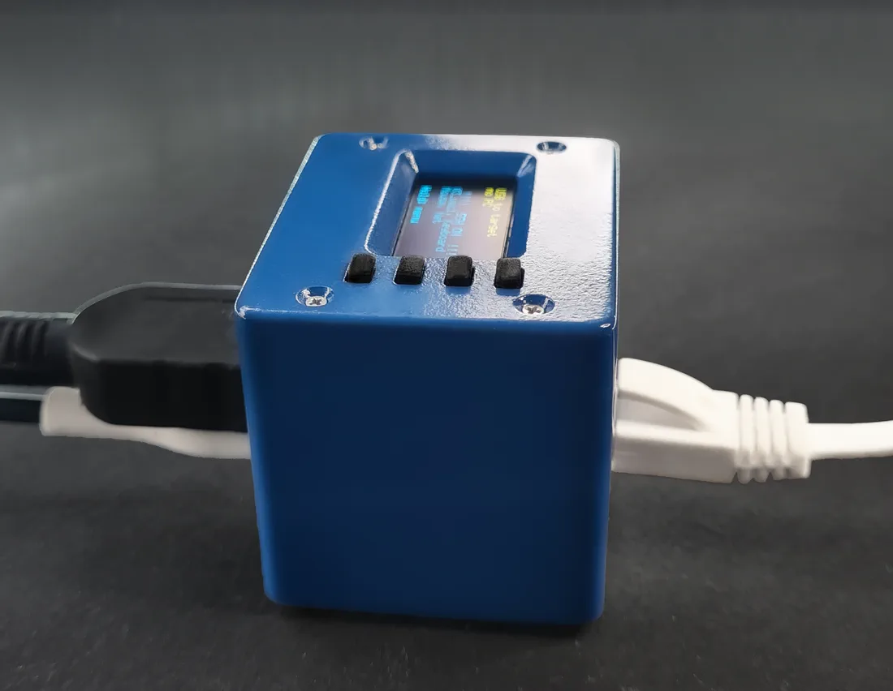

# Quick Start: USBridge Nano

This guide covers the hardware setup and initial connection for the **USBridge Nano** appliance.

---

## 1. What's in the Box

* **USBridge Nano unit**: Fully assembled in a custom protective enclosure with an integrated OLED status screen and physical control buttons.
* **Pre-installed MicroSD card**: High-endurance card pre-flashed with USBridge OS.
* **Full lifetime USBridge OS license**: Included with the device (no subscriptions, recurring fees, or renewal charges).

---

## 2. Physical Ports & Connectors

* **HDMI IN**: Connects to the HDMI video output of the target server or host machine.
* **USB-C (Host HID & Power)**: Single multi-function USB-C port connecting to an available USB port on the target server. It simultaneously powers the Nano and provides hardware-level keyboard, mouse, and virtual media block emulation.
* **Ethernet (RJ45)**: 100 Mbit Ethernet interface connecting to your local network router or switch (DHCP enabled).
* **OLED Screen (128×64)**: Real-time display showing the assigned device IP address, network connection state, streaming FPS, and one-time physical presence codes for secure SSH access.

---

## 3. 3-Step Hardware Setup

1. **HDMI Cable**: Connect from the target computer's GPU / motherboard video output directly into the Nano's **HDMI IN** port.
2. **USB-C Cable**: Connect from the Nano to a USB port on the target computer. This single cable delivers power, keyboard/mouse emulation, and virtual storage mounting.
3. **Ethernet Cable**: Plug a network cable from your local router or switch into the 100 Mbit Ethernet port.

The device boots automatically from the pre-flashed MicroSD card. Within seconds, the onboard OLED screen will initialize and display the assigned DHCP IP address.

---

## 4. Connect & Initial Setup

Once your USBridge Nano is powered and cabled up, connect to it using one of the quick pairing methods below. For comprehensive pairing details, master key mechanics, and client walkthroughs, refer to the **[Initial Client Setup Guide](./initial-setup.md)**.

### Method A: On Your Local Network (Ethernet)

When connected via an RJ45 Ethernet cable, your local router assigns the KVM an IP address automatically via DHCP (there is no fixed default).

The assigned IP address is displayed directly on the Nano's built-in 128×64 OLED screen upon boot.

1. Open the [Desktop Client App](../7-software-access/desktop-app.md) or [Web Client](https://web.usbridge.io).
2. Discover the Nano device automatically on your local network, or manually enter the IP address displayed on the OLED screen.
3. Verify your secure session using the physical presence code shown on the OLED display.

### Method B: Default IP Address (`10.55.0.1` over USB)

Plug the Nano's USB cable directly into your workstation or laptop: your computer immediately gets a virtual USB network adapter (its own internet connection remains completely untouched), and the KVM is reachable at **`10.55.0.1`**.

Open **`http://10.55.0.1`** in any web browser to access the onboard setup page:
* Displays the QR code for fast pairing
* Direct connection link and device master key
* Moonlight PIN authorization
* Network configuration settings

> [!TIP]
> For the complete walkthrough on pairing, browser configuration, and Moonlight setup, see the **[Initial Setup & Client Pairing Guide](./initial-setup.md)**.

---

* 👉 For full technical specifications, Btrfs storage details, and 3D-printable enclosure CAD files, see the **[USBridge Nano Hardware Reference](../../../Hardware/Kits/USBridge-Nano/)**.
