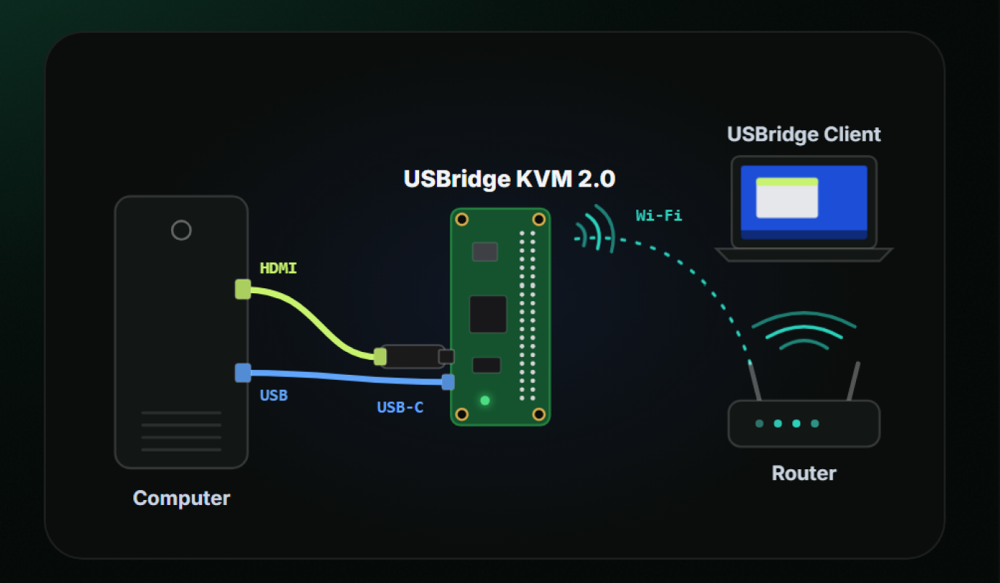

# Quick Start: Radxa Boards (DIY IP-KVM)

Turn standard off-the-shelf single-board computers (SBCs) into an enterprise-grade out-of-band management appliance with **USBridge OS**: 1080p @ 60 FPS ultra-low latency streaming, USB HID keyboard & mouse emulation, virtual ISO drive mounting, immutable Btrfs storage snapshots, and zero-config remote access.

* **[Download USBridge Firmware ➔](https://www.usbridge.io/firmware/)**
* **[Manage Licenses on billing.usbridge.io ➔](https://billing.usbridge.io/)**
* **[Hardware Board Comparison ➔](../6-hardware-connectivity/board-comparison.md)**

### Video Tutorial: 3-Minute DIY IP-KVM Setup

Watch the complete walkthrough on how to flash USBridge OS and complete the initial boot on your Radxa board:

[](https://youtu.be/9FyPjEfH5Wg)

---

## 1. Supported Hardware & Requirements

USBridge OS officially supports the following Radxa SBC platforms:

| Board Model | Processor (SoC) | RAM | AI Accelerator | Primary Network | Boot Medium |
| :--- | :--- | :--- | :--- | :--- | :--- |
| **Radxa Zero 3W** | Rockchip RK3566 (4 × Cortex-A55 @ 1.6 GHz) | 1–8 GB LPDDR4 | 0.8 TOPS NPU (for OCR) | Onboard Wi-Fi 6 & BT 5.4 | MicroSD or onboard eMMC |
| **Radxa Zero 3E** | Rockchip RK3566 (4 × Cortex-A55 @ 1.6 GHz) | 1–8 GB LPDDR4 | 0.8 TOPS NPU (for OCR) | Gigabit Ethernet (RJ45) | MicroSD or onboard eMMC |
| **Radxa Cubie A7Z** | Allwinner A733 (8 cores: 2 × A76 + 6 × A55) | 1–16 GB LPDDR4 | CPU-based OCR | Onboard Wi-Fi 6 & BT 5.4 | MicroSD |

### Required Hardware Components
* **Radxa SBC**: Radxa Zero 3W, Radxa Zero 3E, or Radxa Cubie A7Z.
* **USB 3.0 HDMI Video Capture Dongle**: 1080p @ 60 FPS UVC capture stick (e.g., **[USBridge Capture Dongle](../../../Hardware/Accessories/Capture-Dongle/)**).
* **MicroSD Card**: High-speed Class 10 / U3 card (16 GB or larger recommended).
* **USB-C Cables**: USB-C data cable for host OTG peripheral transmission, plus a 5V / 2A+ power supply.
* **Cooling**: Extruded aluminum heatsink or passive cooling block.

### Optional Add-on Modules
* **[USBridge Screen Module](../../../Hardware/Accessories/Screen-Module/)**: 1.3" IPS full-color LCD (240×240), 5-way joystick, and 3 physical buttons (supports Live Monitor Mode).
* **[USBridge ATX Power Control Board](../../../Hardware/Accessories/ATX-Board/)**: Dedicated board providing 3.75 kV galvanic isolation for remote motherboard power, reset, and LED telemetry.

---

## 2. Firmware Flashing & Card Layout

USBridge OS boots from the MicroSD card (or onboard eMMC on Radxa Zero 3W/3E).

### Step 1: Download the Firmware Image
Download the latest compressed disk image from the **[USBridge Firmware Hub](https://www.usbridge.io/firmware/)**:
* For **Radxa Zero 3W / 3E**: `usbridge-rz3w-<version>.gptimg.zst`
* For **Radxa Cubie A7Z**: `usbridge-a7z-<version>.gptimg.zst`

Decompress the archive using [7-Zip](https://www.7-zip.org/) (Windows) or `zstd -d` (Linux / macOS) to extract the raw `.gptimg` file.

### Step 2: Write to MicroSD Card
Flash the raw `.gptimg` directly to your MicroSD card using [BalenaEtcher](https://etcher.balena.io/), [Raspberry Pi Imager](https://www.raspberrypi.com/software/), or the Linux `dd` command:

```bash
sudo dd if=usbridge-rz3w-<version>.gptimg of=/dev/sdX bs=4M status=progress conv=fsync
```

> [!TIP]
> **Flashing to onboard eMMC (Radxa Zero 3W/3E):**  
> If your board features onboard eMMC storage, you can write the image directly into eMMC over a USB cable via Rockchip Maskrom mode using `rkdeveloptool` or RKDevTool. See the full step-by-step instructions in the **[Recovery Flashing Guide](../9-updates-changelog/recovery-flashing-guide.md)**.

### MicroSD Card Partition Layout

USBridge OS partitions your storage into an enterprise A/B update structure with an immutable Btrfs data snapshot layer:

| Partition | Size | Mounted at | Purpose |
| :--- | :--- | :--- | :--- |
| **`p1` (FAT32, label `BOOT`)** | 32 MB | `/uboot` | Bootloader and kernel artifacts. Host partition for `usbridge_provision.json` (readable on Windows, macOS, Linux). |
| **`p2` / `p3` (ext4)** | ~440 MB each | `/` | Dual system slots (System A / System B) for atomic OTA updates with automated rollback. |
| **`p5` (ext4, label `data`)** | 128 MB | `/data` | Device configuration, machine identity, license validation token, and pairing keys. |
| **`p6` (btrfs, label `EMMC`)** | Remainder of card | `/mnt/emmc` | Storage volume: ISO library, VM images, and immutable read-only snapshots. Automatically expands on first boot. |

---

## 3. Hardware Connections & Setup

<div align="center">

</div>

1. **HDMI Cable**: Connect an HDMI cable from the target server's GPU / motherboard video output into the USB 3.0 capture dongle plugged into the Radxa board's USB 3.0 Host port.
2. **USB-C OTG Cable**: Connect a USB-C cable from the Radxa board's OTG port (Port 1) to an available USB port on the target computer. This single link delivers power, keyboard/mouse emulation, and virtual storage mounting.
3. **Network Connection**: Connect to your network via onboard Wi-Fi 6, the Radxa Zero 3E's Ethernet port, or an external USB-to-Ethernet adapter.

### Capture Dongle Cable Orientation (`[5G]` vs `[480M]`)

The USB 3.0 HDMI capture dongle negotiates in either of two hardware modes depending on the physical orientation of the USB-C plug:

* **`[5G]` Mode (SuperSpeed USB 3.0 — Target Mode)**: Full 5 Gbps bus bandwidth, uncompressed YUY2/NV12 video, zero JPEG compression artifacts, and minimal input latency (~45 ms).
* **`[480M]` Mode (High-Speed USB 2.0 — Fallback Mode)**: Compatibility fallback running at 480 Mbps. The stream falls back to lossy MJPEG compression with visible artifacts, color banding, and increased latency.

> [!IMPORTANT]
> **How to ensure `[5G]` Mode:**  
> Check the connection badge in the USBridge client interface. If you see **`[480M]`**, simply **unplug the USB-C cable from the KVM Host port, rotate the plug 180°, and plug it back in**. The dongle will immediately renegotiate into high-speed **`[5G]`** mode.

---

## 4. Connect & Initial Setup (2 Methods)

Once your board is powered on, connect to it using one of two quick methods. For comprehensive pairing details, master key mechanics, and client walkthroughs, refer to the **[Initial Client Setup Guide](./initial-setup.md)**.

### Method A: Default IP Address (`10.55.0.1` over USB)

Plug the board's USB-C OTG cable directly into your workstation or laptop: your computer immediately recognizes a virtual USB network adapter, and the KVM is reachable at **`10.55.0.1`**.

1. **Desktop App**: Open the [Desktop Client App](../7-software-access/desktop-app.md) and click **`+` ➔ Over USB**. The app detects the board and pairs with a single click.
2. **Web Browser**: Alternatively, open **`http://10.55.0.1`** in any web browser to view the setup dashboard, configure Wi-Fi credentials, or pair with Moonlight.

### Method B: Headless Provisioning (`usbridge_provision.json`)

Ideal for server racks, homelabs, or unattended headless deployments:

1. Insert the flashed MicroSD card into your computer's card reader.
2. Open the **`BOOT`** partition (the 32 MB FAT32 volume visible in Windows Explorer or macOS Finder).
3. Create a plain text file named **`usbridge_provision.json`** containing your network credentials and desired Master Key.
4. Eject the card, insert it into the Radxa board, and boot. The device connects to your network automatically.

> [!TIP]
> For detailed configuration parameters, JSON schema, and examples, see the **[Headless Provisioning Guide](./headless-provisioning.md)**.

### Optional: Front-Panel Screen Setup

If you have installed the optional **[USBridge Screen Module](../../../Hardware/Accessories/Screen-Module/)**:
* Configure Wi-Fi directly on the device using the 3 hardware buttons.
* View assigned IP address and system telemetry.
* Display the Master Key QR code for instant mobile pairing.
* Enter **Live Monitor Mode** to mirror target video directly on the 1.3" display.

---

* 👉 For full hardware details, pinouts, and 3D-printable cases, see the **[USBridge KVM 2.0 Low Hardware Reference](../../../Hardware/Kits/USBridge-KVM-2.0-Low/)**.
