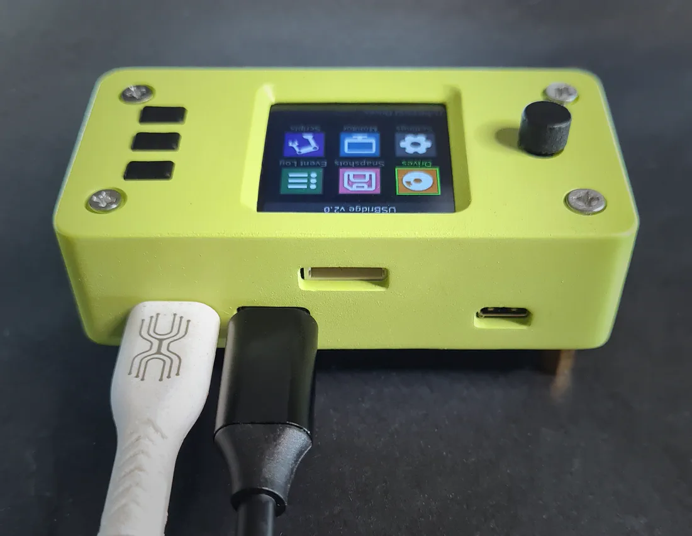
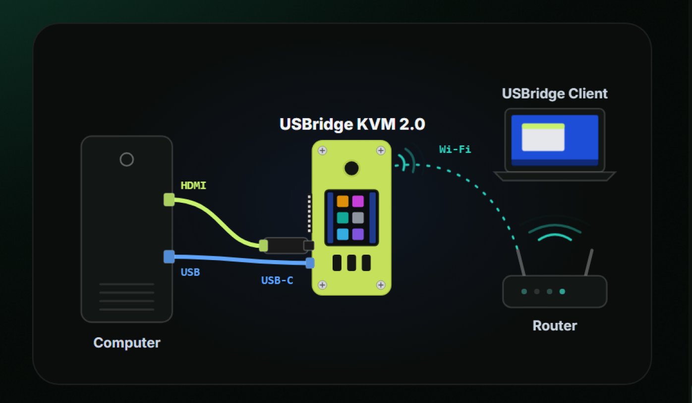
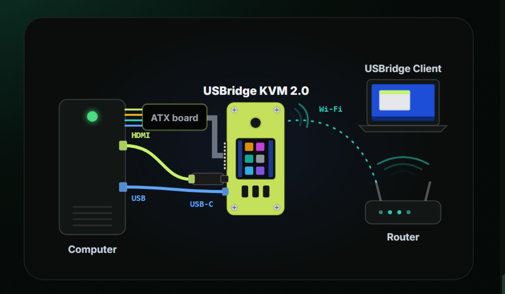
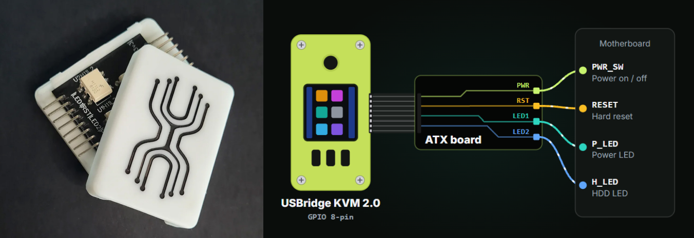

# Quick Start: USBridge KVM 2.0 Standard & Full

This guide covers the hardware setup, onboard front-panel display navigation, and initial connection for the **USBridge KVM 2.0 Standard** and **USBridge KVM 2.0 Full** appliances.

---

## 1. What's in the Box

### USBridge KVM 2.0 Standard Kit
* **USBridge KVM 2.0 Standard Appliance**: Fully assembled desktop unit in a custom protective enclosure with an integrated 1.3" IPS color screen, 5-way joystick, and physical control buttons.
* **USB 3.0 HDMI Video Capture Dongle**: High-throughput 1080p @ 60 FPS UVC capture stick.
* **Pre-installed MicroSD card**: High-endurance card pre-flashed with USBridge OS.
* **Full lifetime USBridge OS license**: Included with the device (no subscriptions, recurring fees, or renewal charges).

### USBridge KVM 2.0 Full Kit (Flagship)
* **Everything in the Standard Kit**, plus:
* **ATX Power Control Board**: Dedicated adapter board providing 3.75 kV galvanic optocoupler isolation for remote power management.
* **8-Pin Ribbon Cable & DuPont Jumpers**: Jumper wires to bridge to motherboard Front Panel headers (`PWR_SW`, `RESET_SW`, `PWR_LED`, `HDD_LED`).
* **USB-C Data & Power Cables**: High-speed USB-C cables and USB-C to USB-A adapter.

---

## 2. Physical Ports & Connectors

* **USB-C 3.0 (Host Capture Port)**: Connects to the included USB 3.0 HDMI capture dongle to stream video from the target server.
* **USB-C 2.0 (OTG / Host HID & Power)**: Connects to an available USB port on the target server. Delivers power and provides hardware-level keyboard, mouse, and virtual ISO media emulation.
* **8-Pin Expansion Header**: Connects the included ATX ribbon cable (on Full edition, or upgraded Standard units) for remote hardware power and reset control.
* **Micro HDMI**: Mirror video output for connecting a local physical monitor directly at the server or rack.
* **MicroSD Slot**: Hosts the operating system and immutable Btrfs storage volume.
* **1.3" IPS Color Display & Controls**: 240×240 color screen with 5-way joystick and 3 front-panel physical buttons for on-device network setup, system diagnostics, and Live Monitor Mode.

---

## 3. Hardware Setup

### Standard Edition: 3-Step Setup

1. **HDMI Cable**: Connect an HDMI cable from the target computer's GPU / motherboard video output into the included USB 3.0 capture dongle plugged into the KVM Host port.
2. **USB-C OTG Cable**: Connect a USB-C cable from Port 1 (OTG) to a USB port on the target computer. This single cable delivers power, keyboard/mouse emulation, and virtual storage mounting.
3. **Network Connection**: Connect to Wi-Fi 6 directly using the on-screen menu or attach an external USB-to-Ethernet adapter.

---

### Full Edition: 4-Step Setup & ATX Wiring

1. **HDMI Cable**: Connect an HDMI cable from the computer's GPU / motherboard video output to the USB 3.0 capture dongle.
2. **USB-C OTG Cable**: Connect from Port 1 to the host computer for power, input emulation, and virtual storage mounting.
3. **ATX Power Control Board**: Plug the 8-pin ribbon cable into the KVM's expansion port, then attach the DuPont jumpers to the motherboard Front Panel headers (`PWR_SW`, `RESET_SW`, `PWR_LED`, `HDD_LED`).
4. **Network Connection**: Connect to Wi-Fi 6 or plug in a USB Ethernet adapter.

#### ATX Front Panel Wiring Scheme

The included ATX board provides complete galvanic isolation up to 3.75 kV between the KVM and the target motherboard:

| Signal | Description | Behavior |
| :--- | :--- | :--- |
| **`PWR_SW`** | Power Switch | Momentary pulse to power on / graceful ACPI shutdown; hold for 5s for hard cutoff |
| **`RESET_SW`** | Reset Switch | Instant hardware reboot for unrecoverable crashes or kernel panics |
| **`PWR_LED`** | Power Indicator | Real-time telemetry in client UI showing whether the host motherboard is powered |
| **`HDD_LED`** | Disk Activity | Real-time storage read/write activity indicator |

---

### Capture Dongle Cable Orientation (`[5G]` vs `[480M]`)

The USB 3.0 HDMI capture dongle negotiates in either of two hardware modes depending on the physical orientation of the USB-C plug:

* **`[5G]` Mode (SuperSpeed USB 3.0 — Target Mode)**: Full 5 Gbps bus bandwidth, uncompressed YUY2/NV12 video, zero JPEG compression artifacts, and minimal input latency (~45 ms).
* **`[480M]` Mode (High-Speed USB 2.0 — Fallback Mode)**: Compatibility fallback running at 480 Mbps. The stream falls back to lossy MJPEG compression with visible artifacts, color banding, and increased latency.

> [!IMPORTANT]
> **How to ensure `[5G]` Mode:**  
> Check the connection badge in the USBridge client interface or on-device screen:
> * If you see **`[480M]`**, simply **unplug the USB-C cable from the KVM Host port, rotate the plug 180°, and plug it back in**.
> * The dongle will immediately renegotiate into high-speed **`[5G]`** mode.

---

## 4. Connect & Initial Setup

Because **Standard** and **Full** editions come fully assembled with the pre-flashed MicroSD card and an interactive 1.3" IPS color screen, initial network setup and pairing can be executed directly on the device. For comprehensive pairing details, master key mechanics, and client walkthroughs, refer to the **[Initial Client Setup Guide](./initial-setup.md)**.

### Method A: Front-Panel Screen & Wi-Fi Setup

1. **Power on the unit**: Plug the USB-C OTG cable into the target host or external 5V power supply.
2. **Configure Wi-Fi**:
   * Navigate to **`Settings` ➔ `Internet` ➔ `Wi-Fi`**.
   * Select **`Enable Wi-Fi`**, then choose **`Available Networks`** to scan for your network.
   * Type your Wi-Fi password using the 3 front-panel physical buttons:
     * **Button 1**: Digits (`0–9`)
     * **Button 2**: Uppercase letters (`A–Z`)
     * **Button 3**: Lowercase letters (`a–z`)
   * **Press and hold Button 3** to confirm and connect.
3. **Pair Client**:
   * Navigate to **`Settings` ➔ `Authentication` ➔ `Show Master Key`**.
   * A pairing QR code appears on the 1.3" color display.
   * **Mobile App**: Scan the QR code with the USBridge mobile app to pair instantly.
   * **Desktop App**: Open the [Desktop Client App](../7-software-access/desktop-app.md), click **`+` ➔ Manual**, and enter the device IP and master key.
   * **Web Client**: Connect in any browser via **[web.usbridge.io](https://web.usbridge.io)**.

### Method B: Default IP Address (`10.55.0.1` over USB)

Plug the KVM's USB-C OTG cable directly into your workstation or laptop: your computer immediately gets a virtual USB network adapter, and the KVM is reachable at **`10.55.0.1`**.

Open **`http://10.55.0.1`** in any web browser to view the setup dashboard, configure Wi-Fi, or retrieve your Master Key.

### Live Monitor Mode

You can preview the target host's video feed directly on the unit's onboard 1.3" display without opening a browser or client app:
* From the main screen, highlight **`Monitor`** using the 5-way joystick and press center to enter.
* The 1.3" screen immediately mirrors the live HDMI capture feed in real time.
* Press any button to exit back to the main navigation menu.

> [!TIP]
> For the complete walkthrough on pairing, browser configuration, and Moonlight setup, see the **[Initial Setup & Client Pairing Guide](./initial-setup.md)**.

---

* 👉 For full technical specifications, Btrfs storage details, and 3D-printable enclosure CAD files, see the **[USBridge KVM 2.0 Standard Hardware Reference](../../../Hardware/Kits/USBridge-KVM-2.0-Standard/)** and the **[USBridge KVM 2.0 Full Hardware Reference](../../../Hardware/Kits/USBridge-KVM-2.0-Full/)**.
